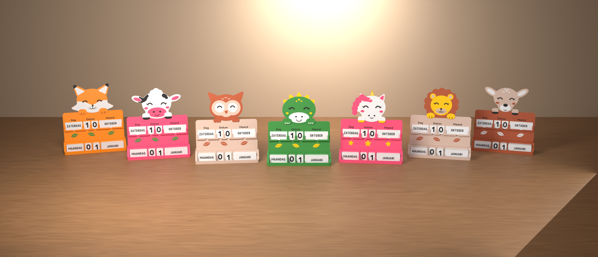
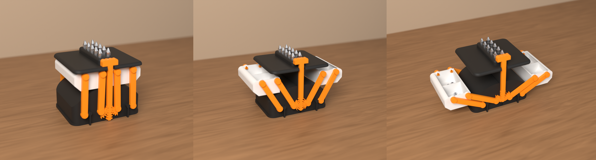
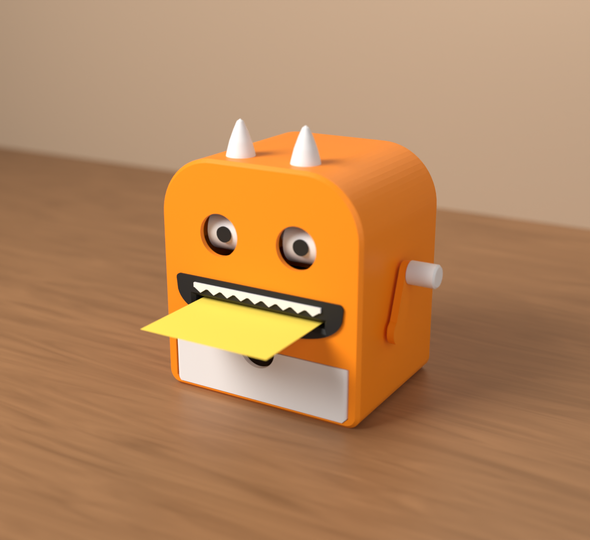
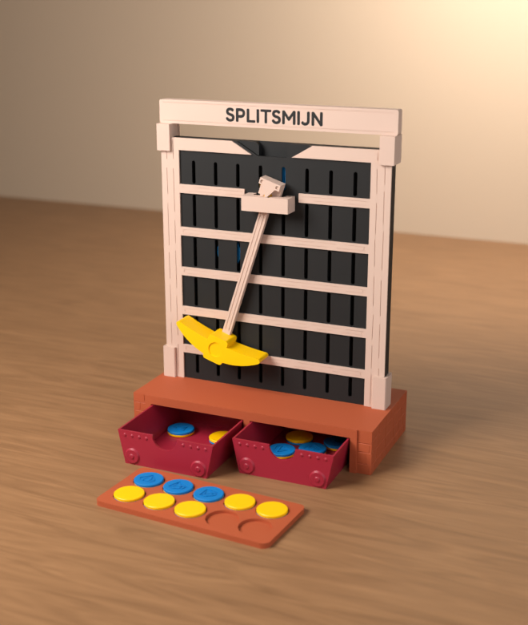
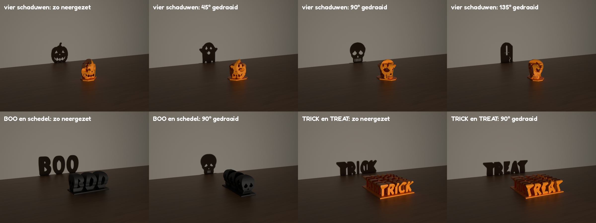
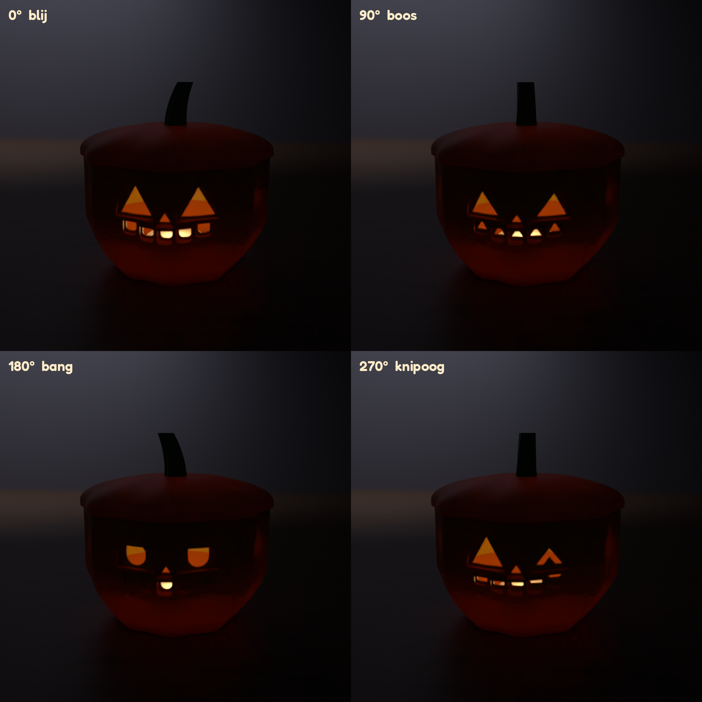
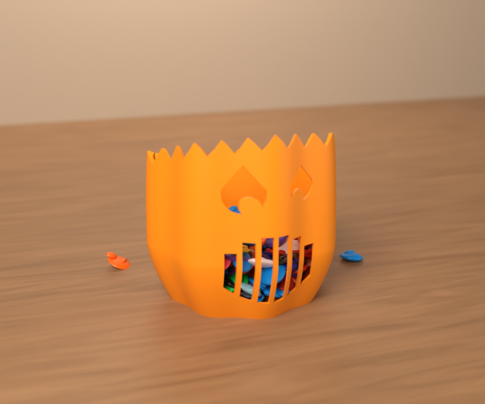

# 3D-printmodellen · 3D print models

Eigen ontwerpen voor de Bambu Lab A1 met AMS Lite, gemaakt als code (parametrisch) en klaar voor MakerWorld.
*Original designs for the Bambu Lab A1 with AMS Lite, built as code (parametric) and ready for MakerWorld.*

| Model | Varianten · variants | Talen · languages |
|---|---|---|
| [C-01 Dierenkalender · animal calendar](modellen/C-01-dierenkalender/) | vos, koe, uil, draak, eenhoorn, leeuw, hert · fox, cow, owl, dragon, unicorn, lion, deer | NL, EN |
| [B-34B Repair Pod](modellen/B-34B-repair-pod/) | werkplek die openklapt met twee horizontale schroevenbakjes · workspace that unfolds with two level screw trays | NL, EN |
| [B-34A Taakvreter · Task Eater](modellen/B-34A-taakvreter/) | bureaumonster dat je afgewerkte taakbriefjes opeet · desk monster that eats your finished task notes | NL, EN |
| [E-01 De Splitsmijn · The Split Mine](modellen/E-01-splitsmijn/) | valbord om te leren splitsen tot 10 (1ste leerjaar): de muntjes verdwijnen in twee mijnkarretjes, met pasproef · drop board for number bonds up to 10 (first grade): the coins disappear into two mine carts, with a test print | NL, EN |
| [H-01 Schaduwspook · Shadow Spook](modellen/H-01-schaduwspook/) | één beeldje, vier schaduwen: pompoen, spook, schedel, grafsteen (plus BOO en TRICK/TREAT) · one figure, four shadows: pumpkin, ghost, skull, tombstone (plus BOO and TRICK/TREAT) | NL, EN |
| [H-02 Moodkin](modellen/H-02-moodkin/) | pompoenlantaarn: draai het steeltje en het gezicht klikt naar blij, boos, bang of knipoog · pumpkin lantern: turn the stem and the face clicks to happy, angry, scared or wink | NL, EN |
| [H-03 Poepmonster · Poop Monster](modellen/H-03-poepmonster/) | pompoenmonster dat het purge-afval van de A1 opeet, laag of hoog · pumpkin monster that eats the A1's purge waste, low or high | NL, EN |





 



 

## Structuur · layout

```
gereedschap/                    gedeelde code · shared code: geometrie, tandwielen, Bambu-3MF, slicer, printcontrole, Blender
modellen/
  B-34A-taakvreter/             zelfde opbouw als B-34B · same layout as B-34B
  B-34B-repair-pod/
    README.md, README.en.md     uitleg · documentation
    print/                      Bambu Studio-project (.3mf) en STL's · project and STLs
    pasproef/                   eerst printen · print this first
    cad/, controle/, renders/   bron, controle, foto's · source, checks, renders
  C-01-dierenkalender/
    README.md, README.en.md     uitleg · documentation
    varianten/NN-dier/nl|en/    Bambu Studio-project (.3mf), front-STL's per kleur, productfoto
    gedeeld/                    herbruikbaar · reusable: voet/base, kaartjes/cards, pasproef/test fit
    fanart/                     bestaande personages, alleen voor eigen gebruik · existing characters, personal use only
    cad/                        de bron: Python-scripts die alles genereren · the source
    controle/                   montage- en printcontrole · assembly and print check
    renders/                    Blender-renders
  E-01-splitsmijn/              print/ (eindmodel) en pasproef/, met valsimulatie · print/ (final model) and pasproef/ (test print), with drop simulation
  H-01-schaduwspook/            zelfde opbouw als B-34B, zonder pasproef · same layout as B-34B, without a test print
  H-02-moodkin/
  H-03-poepmonster/
requirements.txt                Python-modules · Python packages (pip install -r requirements.txt)
```

Nieuwe modellen komen als eigen map onder `modellen/`. Een nieuw dier voor C-01 is één bestand in
`modellen/C-01-dierenkalender/cad/dieren/`, en daarna `python bouw.py` draaien.
*New models get their own folder under `modellen/`. A new C-01 animal is one file in `cad/dieren/` plus `python bouw.py`.*
