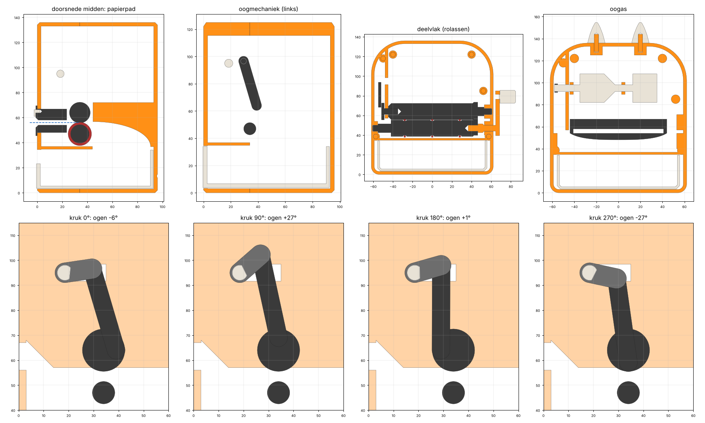
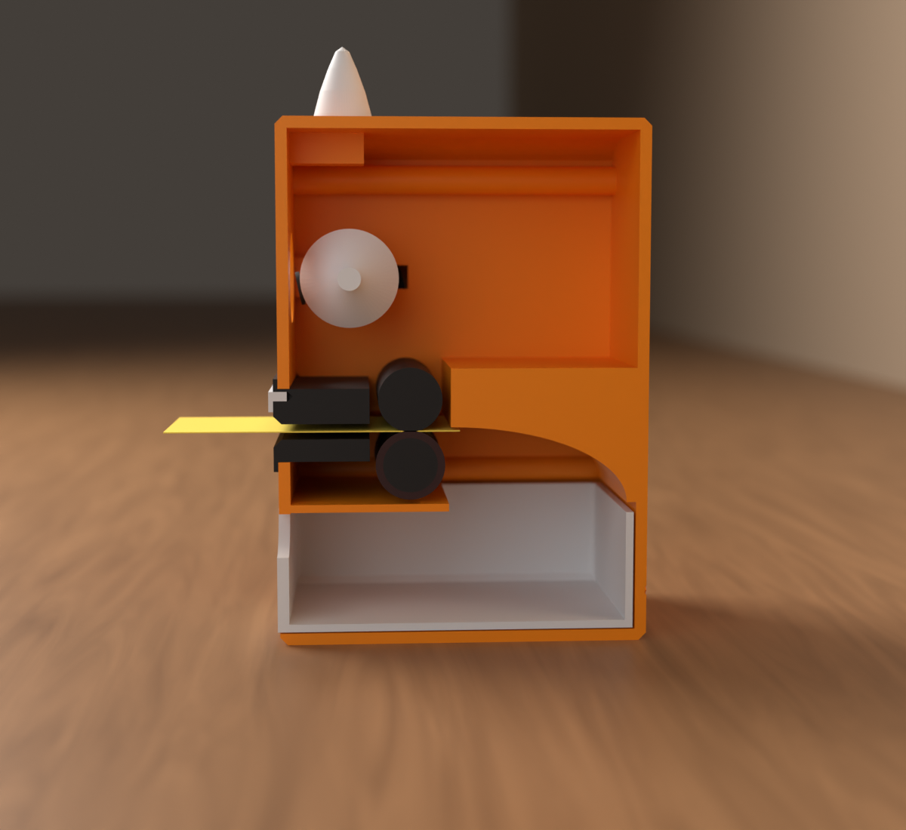
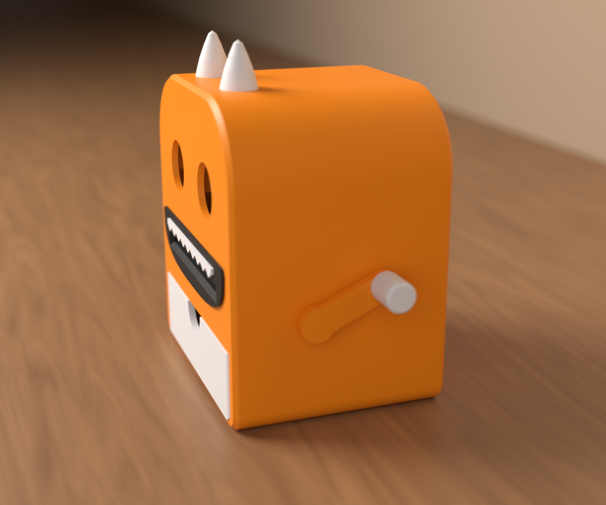
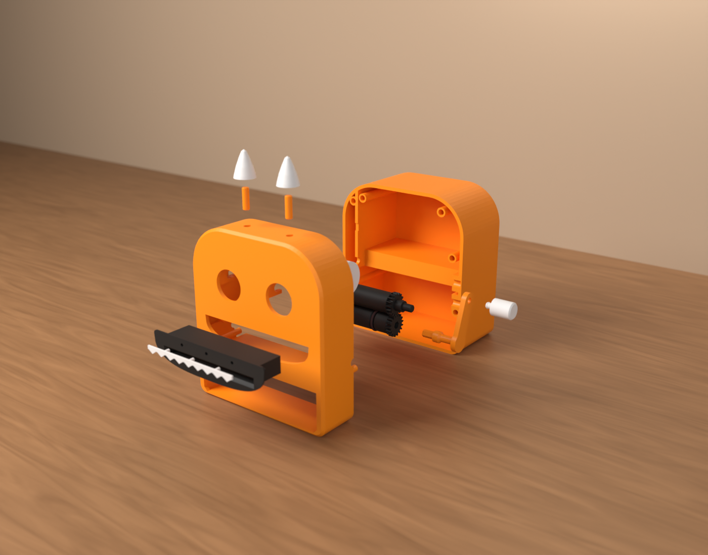

# B-34A Taakvreter (v0.1)

*English: [README.en.md](README.en.md)*

Bureaumonster volgens regel **B-34A** van de MakerWorld-bouwselectie. Klaar met een taak? Steek het briefje
in de mond en draai aan de slinger: twee rollen nemen het blaadje heel mee naar binnen, en het valt in de lade
in de buik. Ondertussen rollen de ogen mee op en neer. Draai je terug, dan komt het blaadje weer naar buiten.


> **Status:** CAD, STL's, het Bambu Studio-project en de montage- en printcontrole zijn klaar. Er is **nog
> niets echt geprint**. Druk eerst de pasproef af (`pasproef/pasproef.3mf`), zie hieronder.
>
> De 3MF-projecten zijn gecontroleerd tegen de regels van het Bambu-formaat
> (`gereedschap/bambu/valideer.py` in de root van de repo). Ze zijn hier niet in Bambu Studio zelf
> geopend: dat programma draait niet in deze omgeving.

| | |
|---|---|
| Romp (b × d × h) | 124 × 96 × 136 mm; met slinger 147 breed, met hoorntjes 156 hoog |
| Briefjes | memoblaadjes van 76 × 76 mm (zoals Post-it), via een invoer van 82 × 4 mm |
| Lade | binnenmaat 107 × 88 × 29 mm |
| Nodig | **3 O-ringen 14 × 2 mm (NBR)**, of een elastiekje dat je een paar keer in elke groef wikkelt |

Kleuren (Bambu PLA, uit de kleurplanning):

- **Pumpkin Orange 10301**: de romp, de slinger en de paspennen.
- **Ivory White 11100**: de lade, de ogen, de tanden, de knop en de hoorntjes.
- **Charcoal 11101**: de rollen, het oogmechaniek, het mondstuk en de pupillen.

## Hoe het werkt



- **Slinger en rollen**: de slinger zit rechts en draait de onderste rol rechtstreeks, met een zeskant.
  - De slinger en zijn as zijn één onderdeel.
  - Tandwielen aan de rechterkant laten de bovenste rol 1:1 meedraaien.
  - Op de onderste rol liggen drie O-ringen. Die drukken 0,65 mm in tegen de bovenste rol: zo hebben de
    rollen grip op het papier. Ook als de lagers hun speling (samen tot 0,4 mm) opnemen, blijft er minstens
    0,25 mm over.
- **Rolbekleding en assen**: als bekleding dienen O-ringen 14 × 2 mm (NBR). De assen zijn geprint: aan
  elke rol zit een asstomp, en de slinger heeft zijn eigen as. Metalen assen heb je niet nodig.
- **Papierpad**:
  - Het briefje gaat door een invoer van 4 mm hoog in het mondstuk. Tot 4,7° scheef past het nog.
  - De rollen zijn breder dan de invoer, dus het papier kan niet bij de tandwielen komen.
  - Achter de rollen buigt een glijgoot het blaadje omlaag, door een opening van 49 mm de lade in.
- **Ogen**: op het linkereind van de bovenste rol zit een krukje van 5 mm. Via een drijfstang en een
  tuimelaar draait het de oogas heen en weer.
  - De oogtrommels draaien 54° en de pupillen gaan zo'n 6 mm op en neer, één keer per slag.
  - Het mechanisme draait rond zonder te klemmen: de overbrengingshoek is overal minstens 58°.
- **Veilig voor vingers**:
  - In de invoer van 4 mm past geen vinger, ook niet van een kind. Het knijppunt zit 35 mm diep.
  - Een schap onder de rollen schermt ze van onderen af.
  - **Draai alleen met de lade erin.** Zonder lade kan een vinger van onderen bij de achterkant van de
    rollen. Daar lopen ze wel uit elkaar, dus ze trekken niets naar binnen.



## Onderdelen

| Onderdeel | Aantal | Kleur | Maat (mm) | Bestand |
|---|---|---|---|---|
| romp voorhelft (gezicht, oogaslagers, schap, beugel) | 1 | Pumpkin Orange | 124 × 136 × 44 | `print/romp_voor.stl` |
| romp achterhelft (glijgoot, beugel) | 1 | Pumpkin Orange | 124 × 136 × 62 | `print/romp_achter.stl` |
| slinger met as | 1 | Pumpkin Orange | 46 × 15 × 32 | `print/kruk.stl` |
| paspen Ø 5 × 16 | 8 + 2 reserve | Pumpkin Orange | | `print/paspen.stl` |
| lade | 1 | Ivory White | 111 × 93 × 31 | `print/lade.stl` |
| ogen (oogas met twee trommels) | 1 | Ivory White | Ø 26 × 93 | `print/ogen.stl` |
| tanden | 1 | Ivory White | 80 × 5 | `print/tanden.stl` |
| knop | 1 | Ivory White | Ø 13 × 22 | `print/knop.stl` |
| hoorntje | 2 | Ivory White | Ø 16 × 20 | `print/hoorn.stl` |
| onderste rol (met tandwiel en O-ringgroeven) | 1 | Charcoal | Ø 19 × 107 | `print/rol_onder.stl` |
| bovenste rol (met tandwiel) | 1 | Charcoal | Ø 19 × 105 | `print/rol_boven.stl` |
| nokas (krukschijf voor de ogen) | 1 | Charcoal | Ø 17 × 17 | `print/nokas.stl` |
| drijfstang | 1 | Charcoal | 41 × 7 | `print/drijfstang.stl` |
| tuimelaar | 1 | Charcoal | 19 × 11 | `print/tuimelaar.stl` |
| mondstuk (lip, mond, invoertunnel) | 1 | Charcoal | 105 × 24 × 25 | `print/mondstuk.stl` |
| pupil | 2 | Charcoal | Ø 9 | `print/pupil.stl` |

Dat zijn zestien verschillende onderdelen: 25 geprinte stuks in de montage, plus 3 O-ringen.

## Printen met het Bambu Studio-project

Open `print/taakvreter.3mf` in Bambu Studio. Het project heeft vier platen, elk in één kleur:

| Plaat | Wat | Kleur | Filament* | Tijd* |
|---|---|---|---|---|
| 1 | voorhelft, slinger, 10 paspennen | Pumpkin Orange 10301 | 115 g | 3 u 12 |
| 2 | achterhelft | Pumpkin Orange 10301 | 199 g | 4 u 28 |
| 3 | lade, ogen, tanden, knop, hoorntjes | Ivory White 11100 | 72 g | 1 u 58 |
| 4 | rollen, nokas, drijfstang, tuimelaar, mondstuk, pupillen | Charcoal 11101 | 46 g | 1 u 33 |

Samen is dat ongeveer **430 g filament en 11 uur 11 printen**.

\* Gewicht en tijd komen uit PrusaSlicer met een profiel dat de A1 benadert, zie
[controle/RAPPORT.md](controle/RAPPORT.md). Het gewicht is betrouwbaar; de tijd rekent Bambu Studio zelf uit.

- **Instellingen**: *0.20mm Standard @BBL A1* op de *Textured PEI Plate*, 0,4 mm nozzle, **geen support**,
  gyroid-infill. Per object staat dit al in het project:
  - romp, lade, mondstuk, knop: 3 wanden;
  - rollen: 4 wanden en een brim van 5 mm, want ze staan rechtop en zijn 105 mm hoog;
  - ogen: 3 wanden en een brim;
  - slinger: 4 wanden, 40 % infill;
  - nokas, drijfstang, tuimelaar, paspennen: 4 wanden (helemaal massief), paspennen zonder brim.
- **Printligging**:
  - De voorhelft ligt met het gezicht op het bed, de achterhelft met de achterkant. Alles binnenin groeit
    vanaf die kant omhoog. De glijgoot is in de print een schuin plafond dat naar boven kijkt.
  - De rollen staan rechtop, dus ze worden precies rond: de onderste op zijn tandwiel, de bovenste op zijn
    linkereind. Onder elk tandwiel zit een 45°-kraag.
  - De ogen staan op de rechtertrommel; onder de linkertrommel zit een 45°-kegel.
  - Het mondstuk ligt met de lip op het bed. De tanden en de pupillen liggen met hun voorkant op het bed.
- Liggende gaatjes zijn druppelvormig en blinde gaatjes hebben een 45°-punt. De slicer bevestigt voor alle
  platen dat er geen support nodig is.

## Eerst de pasproef

Dit is de eerste test uit de bouwselectie: een afgeschermd proefstuk met de invoerrollen. Print
`pasproef/pasproef.3mf` in één kleur naar keuze. Het project heeft twee platen:

| Plaat | Wat | Filament* | Tijd* |
|---|---|---|---|
| 1 | proefframe: de romp rond de rollen (mond, beugel, ribben), met een dicht deksel en achteraan een uitvoersleuf | 87 g | 2 u 14 |
| 2 | beide rollen, slinger, knop, nokas, mondstuk, 6 paspennen, paspenstrip | 59 g | 2 u 12 |

Stap voor stap:

1. **Paspenstrip**: een paspen moet klemmen in een van de kleine gaten (4,85 tot 4,95 mm). In een van de
   grote gaten (5,00 tot 5,10 mm) moet hij met wat wrijving schuiven.
   - Zet de maten in `cad/params.py`: `GAT_PASPEN_VAST` en `GAT_PASPEN_LOS`.
2. **Monteer het proefframe** zoals hieronder bij *In elkaar zetten*, stap 3 tot 6 en stap 8. Ogen, lade,
   tanden en hoorntjes horen er niet bij.
   - De rollen moeten makkelijk draaien met de O-ringen erop.
   - Draait het te zwaar, zet dan `GROEF_DIEP` 0,1 mm dieper.
   - Glijdt het papier door, gebruik dan dikkere O-ringen of wikkel er een elastiekje bij.
3. **Test** met de slinger:
   - [ ] **Papiersoorten**: een memoblaadje, een strookje printpapier van 80 g, kassabonpapier en een kaartje
         van 160 g. Alles moet heel doorkomen en achteraan uit de sleuf komen.
   - [ ] **Scheef invoeren**: steek een blaadje schuin in de invoer. Het mag niet vastlopen en niet bij de
         tandwielen komen.
   - [ ] **Slip**: het blaadje volgt de slinger zonder te blijven hangen.
   - [ ] **Terugdraaien**: draai halverwege terug. Het blaadje komt er weer uit.
   - [ ] **Vingers**: met een vinger of potlood kom je nergens bij de rollen of tandwielen, ook niet via de
         sleuf.
   - [ ] **Lagers**: de asstompen en de slinger-as lopen soepel in de halve gaten. Zo niet, pas `GAT_DRAAI` aan.
   - [ ] **Zeskant**: de slinger en de nokas passen in de zeskantkokers van de rollen. Zo niet, pas
         `ZESKANT_GAT` aan.

Draai na elke aanpassing `python bouw.py` opnieuw.

## In elkaar zetten

1. **Mondstuk**: druk de tanden met hun drie pennetjes in de voorkant van het mondstuk. Druk het mondstuk
   dan van voren in de mond, tot de lip tegen het gezicht ligt.
2. **Ogen**:
   - Druk de pupillen met hun pennetje in de trommels.
   - Schuif de tuimelaar op het D-eind van de oogas, met zijn pen naar binnen.
3. **Voorhelft**: leg de voorhelft met het gezicht op tafel. Druk zes paspennen in de gaten in het deelvlak
   (ze klemmen).
4. **Oogas**: klik de oogas in de twee kliklagers: links naast de beugel en tussen de trommels. De tuimelaar
   zit dan in het linkervak, tegen de zijwand.
5. **Onderste rol**:
   - Leg de drie O-ringen in de groeven.
   - Steek de zeskant van de slinger in de rechterkant van de rol.
   - Leg rol en slinger samen in de halve gaten. De stomp gaat links in de wand, de as van de slinger rechts
     door de wand; de slingerarm zit buiten.
6. **Bovenste rol**:
   - Steek de nokas met zijn zeskant in het linkereind.
   - Leg de rol in de halve gaten: de stomp rechts in de wand, de nokas in de beugel. De krukschijf zit dan
     in het linkervak.
   - Laat de tandwielen in elkaar grijpen.
7. **Drijfstang**: steek zijn pen in het gaatje van de krukschijf. Het gat bovenaan gaat op de pen van de
   tuimelaar.
8. **Achterhelft**: zet de achterhelft op de paspennen en druk de twee helften tegen elkaar.
9. **Afmaken**:
   - Klik de knop in de slingerarm.
   - Steek in elk hoorntje een paspen en druk ze bovenop in de gaatjes.
   - Schuif de lade in de buik.

**Papierprop?** Trek de achterhelft eraf. De paspennen schuiven uit de achterhelft, en alles ligt open in de
voorhelft.

## Gebruiken

Schrijf je taak op een memoblaadje. Is hij klaar, steek het blaadje dan in de mond, met de plakrand
**achteraan**. Draai de slinger van je af: de bovenkant gaat naar achteren. Lade vol? Trek hem eruit en kijk
terug op wat je allemaal gedaan hebt.


## Mappen

```
print/        taakvreter.3mf (4 platen) en elk onderdeel als STL in printligging
pasproef/     pasproef.3mf (2 platen) en de STL's die niet in print/ staan
cad/          de bron: Python-scripts die alles hierboven maken
controle/     RAPPORT.md: botsingen, spelingen, tandwielen, oogmechaniek, papierpad, vingerproef, lade, printbaarheid, slicer
renders/      Blender-renders
onderdelen.json   volume en maat per STL
```

## Zelf bouwen

Vereist Python 3 met `manifold3d`, `shapely`, `trimesh`, `numpy`, `contourpy` en `matplotlib`. De
gedeelde code staat in [`gereedschap/`](../../gereedschap/) in de root van de repo.

```
cd cad
python bouw.py        # print/ en pasproef/: STL's en 3MF-projecten
python controle.py    # controle/RAPPORT.md (voor de slicertabel eerst python slice.py, vereist prusa-slicer)
python render.py alle # renders/ (vereist de pip-module bpy)
```

Alle maten staan in `cad/params.py`. Elke run rekent het mechanisme opnieuw door:

- botsingen over een hele slag van de slinger;
- spelingen en lagers;
- tandspeling;
- het oogmechaniek;
- het papierpad.

Pas je iets aan, kijk dan eerst in `controle/RAPPORT.md` of alles nog groen is.



