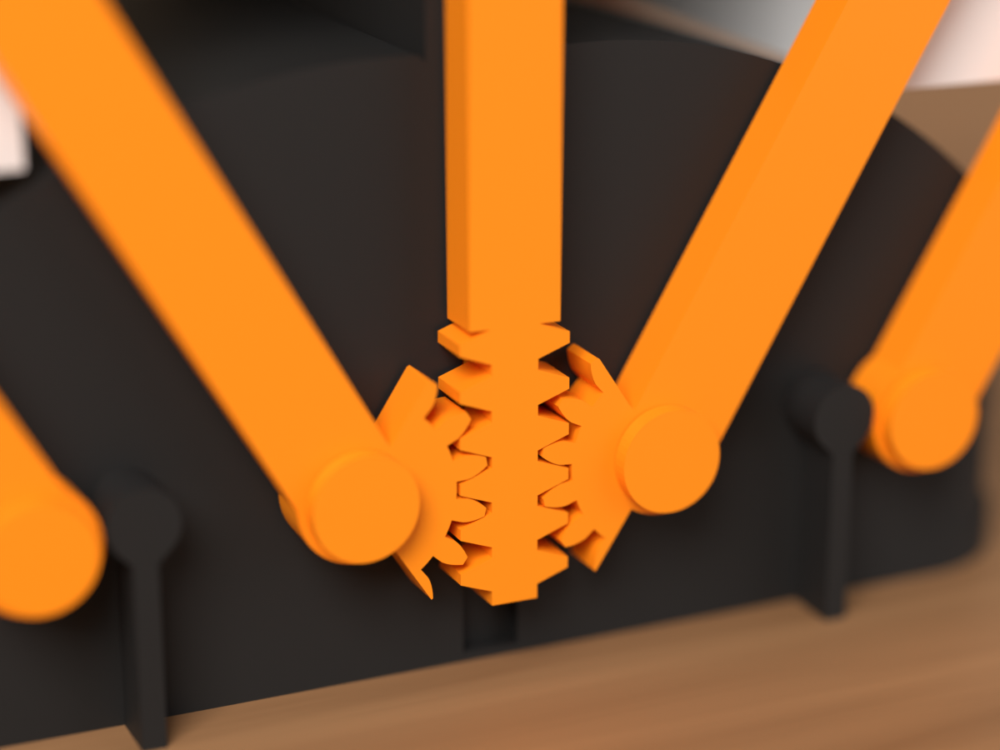
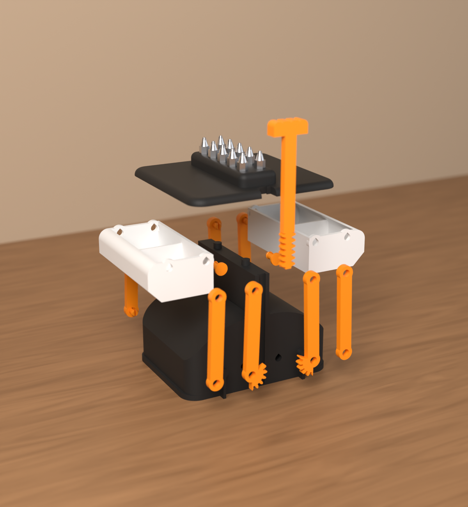

# B-34B Repair Pod (v0.1)

*Nederlands: [README.md](README.md)*

A compact capsule for the workbench, following line **B-34B** of the MakerWorld build selection. When you pull
the orange knob up, the pod unfolds into a small workspace. Two screw trays swing out to the left and right.
They stay level the whole way, because each tray hangs from a parallelogram of four arms. The roof holds ten
1/4" bits. No hardware is needed: everything clicks together with printed pins.


> **Status:** the CAD, STLs, Bambu Studio project and the assembly and print check are done. **Nothing has been
> printed yet.** Print the test fit first (`pasproef/pasproef.3mf`), see below.
>
> The 3MF projects are checked against the rules of the Bambu format (`gereedschap/bambu/valideer.py` at
> the root of the repo). They have not been opened in Bambu Studio itself: it does not run in this
> environment.

| | Closed | Open |
|---|---|---|
| Size (w × d × h) | 114 × 102 × 96 mm | 212 × 102 × 96 mm |
| Trays | 2 × 2 compartments, about 41 × 39 × 23 mm inside each | floor 23 mm above the table |
| Knob | 11 mm stroke | |

Colours (Bambu PLA, from the colour plan):

- **Charcoal 11101**: base and roof.
- **Pumpkin Orange 10301**: arms, slide and pins.
- **Ivory White 11100**: trays.

## How it works


- **Parallelogram arms**: each tray hangs from four 58 mm arms, two at the front and two at the back. Each
  pair forms a parallelogram, so the tray translates without rotating. It stays level from closed (92°) to
  open (28°).
- **One knob for both sides**: the two inner front arms carry a gear sector. Both sectors mesh with a rack
  that has teeth on both sides: the **slide**. The slide runs in a dovetail groove at the front of the
  centre spine and ends in the knob above the roof. That way one knob moves both sides at once, exactly
  together.
- **Open**: gravity pulls the trays outwards. In the open position the inner arm rests on a stop on the base.
- **Closed**: the knob rests on the roof and the pod stays closed by itself. Closing it with 150 g in each
  tray takes at most 18 N on the knob, about 1.8 kg.
- **Stability**: the base is 114 mm wide. With 150 g in one tray and the other empty, the centre of mass
  stays at least 31 mm inside the edge of the base.

## Parts

| Part | Qty | Colour | Size (mm) | File |
|---|---|---|---|---|
| base (plate, centre spine, flanks, pivots, stops) | 1 | Charcoal | 114 × 97 × 86 | `print/voet.stl` |
| roof with bit rack (10 × 1/4") | 1 | Charcoal | 108 × 102 × 14 | `print/dak.stl` |
| tray (2 compartments) | 2 | Ivory White | 46 × 86 × 28 | `print/bak.stl` |
| gear arm (inner front arm with gear sector) | 2 | Pumpkin Orange | 16 × 74 × 4.5 | `print/tandarm.stl` |
| arm | 6 | Pumpkin Orange | 12 × 68 × 4.5 | `print/arm.stl` |
| slide (rack and knob) | 1 | Pumpkin Orange | 24 × 95 × 8 | `print/schuif.stl` |
| clip pin | 16 + 2 spare | Pumpkin Orange | Ø 9 × 12 | `print/pen.stl` |

That makes seven different parts. Some of them are used on both sides: on the left you mount them turned
over.

- Both trays are identical.
- Both gear arms are identical.
- All six plain arms are identical.

## Printing with the Bambu Studio project

Open `print/repair-pod.3mf` in Bambu Studio. The project has three plates, one colour each:

| Plate | What | Colour | Filament* | Time* |
|---|---|---|---|---|
| 1 | base and roof | Charcoal 11101 | 180 g | 3 h 43 |
| 2 | two trays | Ivory White 11100 | 59 g | 1 h 12 |
| 3 | 2 gear arms, 6 arms, slide, 18 pins | Pumpkin Orange 10301 | 29 g | 1 h 15 |

In total about **270 g of filament and 6 h 10 of printing**.

\* Weight and time come from PrusaSlicer with a profile that approximates the A1, see
[controle/RAPPORT.md](controle/RAPPORT.md). The weight is reliable. Bambu Studio works out the time itself.

- **Settings**: *0.20mm Standard @BBL A1* on the *Textured PEI Plate*, 0.4 mm nozzle, **no supports**. The
  project already stores these per object:
  - base, roof, trays: 3 walls;
  - arms and slide: 3 walls, 40 % infill;
  - pins: 4 walls (that makes them fully solid), no brim.
- **Print orientation**:
  - Base, roof and trays print upright.
  - Arms and slide lie flat, so the teeth and eyes come out best.
  - Pins stand on their heads, so the shank is perfectly round.
- **No supports**: horizontal holes are teardrop-shaped (point up), and rounded rims have a 45° chamfer
  underneath. The slicer confirms this for every plate.

## Test fit first

Print `pasproef/pasproef.3mf` in one colour of your choice. The project has two plates.

**Plate 1: hinge strips, bit block and 4 pins** (16 g, 40 min).

- **Wall strip**: three horizontal holes of 4.95, 5.05 and 5.15 mm, like those in the base and trays. A pin
  should click in clearly and not fall out on its own.
- **Arm strip**: three vertical holes of 5.15, 5.25 and 5.35 mm, like those in the arms. The arm should turn
  freely on the pin without rattling.
- **Bit block**: three hexagons of 6.4, 6.6 and 6.8 mm. A bit should stay in when you turn the block upside
  down and still come out easily.

Set the best sizes in `cad/params.py` (`GAT_WAND`, `GAT_ARM`, `BIT_SW`) and run `python bouw.py` again.

**Plate 2: one side mechanism** (140 g, 3 h 05). It contains:

- the right half of the base with the full centre spine;
- one tray;
- one gear arm and three arms;
- ten pins;
- the slide.

Assemble it as described below. Then put 150 g in the tray and check:

- [ ] The tray stays level over the whole stroke (at most ~1.3° of tilt from the hinge play).
- [ ] The hinges move smoothly, without binding or rattling.
- [ ] Open: the inner arm rests on its stop.
- [ ] Closed: without a roof the tray rests against the spine. In the full pod the knob on the roof stops it
      0.6 mm earlier.
- [ ] Nothing rubs: arm along the base, tray along the flank, slide in the groove.
- [ ] The knob has an 11 mm stroke.
- [ ] The teeth don't skip when you push the knob down with a full tray. Insert the slide as in step 3 below.

## Assembly

1. **Arms and trays**: each pin goes through the eye of an arm into a hole in the base or a tray, and clicks
   in behind it.
   - At the front, on each side:
     - the gear arm on the inner pivot, with its gear sector towards the middle;
     - a plain arm on the outer pivot.
   - At the back: two plain arms, the same way.
   - On the left, mount the same parts turned over.
   - The upper eyes go on the pins in the tray. The chamfered lower edge of the tray faces outwards.

   Without the slide the trays fall open by themselves until the inner arms rest on their stops. Leave them
   like that.
2. **Roof**: put the roof on the spine, with its two pegs in the holes and the notch at the front. The roof
   is not fixed: its weight and the pegs keep it in place. If you want to lift the pod by its roof, glue it
   with a drop of glue on the pegs.
3. **Slide**: with the pod open, push the slide down from above through the notch in the roof. The rack
   goes in front of the spine and the dovetail into the groove. Lower it until the rack engages between the
   two gear sectors, then push the knob down: both trays close together.
4. **Check**: when closed, the knob should rest exactly on the roof.
   - If the knob stays a few mm above the roof, the rack is one tooth too high.
   - If the pod does not close all the way, the rack is one tooth too low.

   To fix either one, open the pod, pull the slide out and let it engage one tooth lower (knob too high) or
   higher (pod won't close).

**Removing pins**:

- A pin in a tray can come out again: squeeze its two springs together inside the tray with pliers and push
  the pin back.
- The pins in the base click into a closed cavity and stay put, so do the test fit first.

## Folders

```
print/        repair-pod.3mf (3 plates) and every part as an STL in print orientation
pasproef/     pasproef.3mf (2 plates, test fit) and the STLs not already in print/
cad/          the source: Python scripts that generate everything above
controle/     RAPPORT.md: collisions, clearances, gears, end stops, force, tipping, printability, slicer
renders/      Blender renders
onderdelen.json   volume and size per STL
```

## Building it yourself

You need Python 3 with `manifold3d`, `shapely`, `trimesh`, `numpy`, `contourpy` and `matplotlib`. The shared
code lives in [`gereedschap/`](../../gereedschap/) at the root of the repo.

```
cd cad
python bouw.py        # print/ and pasproef/: STLs and 3MF projects
python controle.py    # controle/RAPPORT.md (for the slicer table run python slice.py first, needs prusa-slicer)
python render.py alle # renders/ (needs the pip module bpy)
```

All dimensions are in `cad/params.py`. Every run recomputes the mechanism:

- collisions over 33 positions;
- clearances;
- gear backlash;
- end stops.

If you change something, check `controle/RAPPORT.md` first to see that everything is still green.



