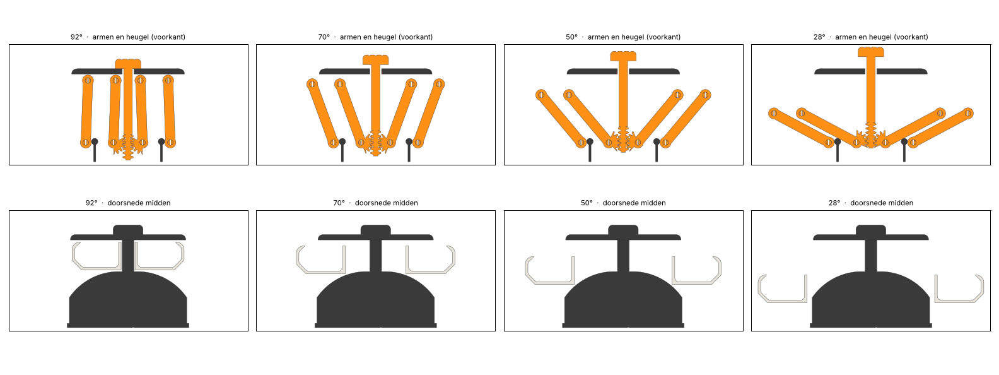

# Controle B-34B Repair Pod

Automatisch gegenereerd door `cad/controle.py` (v0.1). Maten in mm. ✅ = in orde, ⚠️ = bekijken.

## 1. Botsingen over de hele slag

✅ 33 standen van 92° (dicht) tot 28° (open), 38 onderdelen inclusief pennen, elk paar: nergens overlap.

## 2. Spelingen over de hele slag

| Paar | Kleinste speling | Bij hoek |
|---|---|---|
| bak - dak | ✅ 0.56 | 90.0° |
| bak - voet (rug en flank) | ✅ 0.58 | 92.0° |
| bak - bak | ✅ 10.00 | 28.0° |
| binnenarm - voet | ✅ 0.50 | 30.0° |
| buitenarm - bak | ✅ 0.50 | 28.0° |
| binnenarm - buitenarm | ✅ 2.51 | 28.0° |
| schuif - voet (zwaluwstaart) | ✅ 0.30 | 28.0° |

## 3. Tandsector en heugel

Slag van de knop: 11.17 mm. Speling tussen de tanden over de hele slag (0 = overlap, groot = los):

| Kant | Kleinste | Grootste |
|---|---|---|
| rechts | ✅ 0.093 | 0.094 |
| links | ✅ 0.093 | 0.094 |

## 4. Eindstops

| Stand | Afstand | Zo hoort het |
|---|---|---|
| open: binnenarm tegen de nok | ✅ 0.001 | 0 (raakt) |
| 2° voor open | ✅ 0.500 | vrij |
| dicht: knop op het dak | ✅ 0.000 | 0 (raakt) |
| 2° voor dicht | ✅ 0.349 | vrij |

## 5. Horizontaal

- Parallellogram: de bak verschuift alleen en draait niet, in elke stand.
- Speling per scharnier 0.15 mm (gat in arm en wand min de pen): de bak kan daardoor hooguit 1.32° scheef hangen. Pas `GAT_ARM` aan na de pasproef.

## 6. Kracht op de knop en kantelen

Kracht om de pod in een stand te houden (zwaartekracht trekt hem open; dicht houdt hij zichzelf):

| Lading per bak | 92° | 80° | 60° | 45° | 28° |
|---|---|---|---|---|---|
| 0 g | -0.1 N | 0.6 N | 1.6 N | 2.3 N | 2.9 N |
| 150 g | -0.7 N | 3.5 N | 10.2 N | 14.4 N | 18.0 N |

Kantelen met 150 g in één bakje en het andere leeg (zwaartepunt t.o.v. de voetrand op 57 mm):

| Hoek | Zwaartepunt x | Marge tot de rand | Totaal |
|---|---|---|---|
| 92° | 9.1 | ✅ 47.9 | 488 g |
| 75° | 14.3 | ✅ 42.7 | 488 g |
| 60° | 18.6 | ✅ 38.4 | 488 g |
| 45° | 22.3 | ✅ 34.7 | 488 g |
| 28° | 25.4 | ✅ 31.6 | 488 g |

## 7. Printbaarheid (Bambu Lab A1, 0,4 mm nozzle, 0,2 mm laag)

| Plaat | Kleur | Maat | Past | Overhang > 48° (mm²) | Te smal (< 0,4 mm) |
|---|---|---|---|---|---|
| 1 voet en dak | Charcoal | 235 × 102 × 86 | ✅ | ✅ 0 | ✅ geen |
| 2 bakjes | Ivory White | 106 × 86 × 28 | ✅ | ✅ 0 | ✅ geen |
| 3 armen, schuif en pennen | Pumpkin Orange | 219 × 181 × 12 | ✅ | ✅ 0 | ✅ geen |

### Slicer (PrusaSlicer, A1-achtig profiel)

| Plaat | Filament | Tijd (indicatie) | Support nodig |
|---|---|---|---|
| 1 voet en dak | 180.3 g | 3h 43m 20s | ✅ nee |
| 2 bakjes | 59.2 g | 1h 12m 3s | ✅ nee |
| 3 armen, schuif en pennen | 28.9 g | 1h 15m 6s | ✅ nee |
| pasproef 1 scharnierstrip, bitblok en pennen | 15.9 g | 40m 2s | ✅ nee |
| pasproef 2 zijmechanisme | 139.9 g | 3h 4m 33s | ✅ nee |
