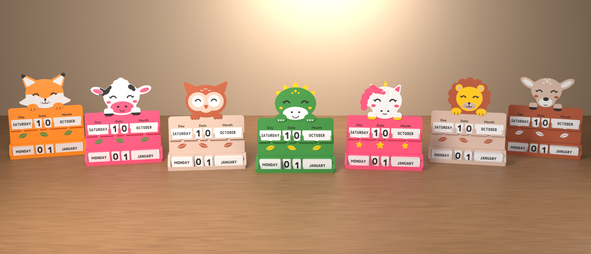
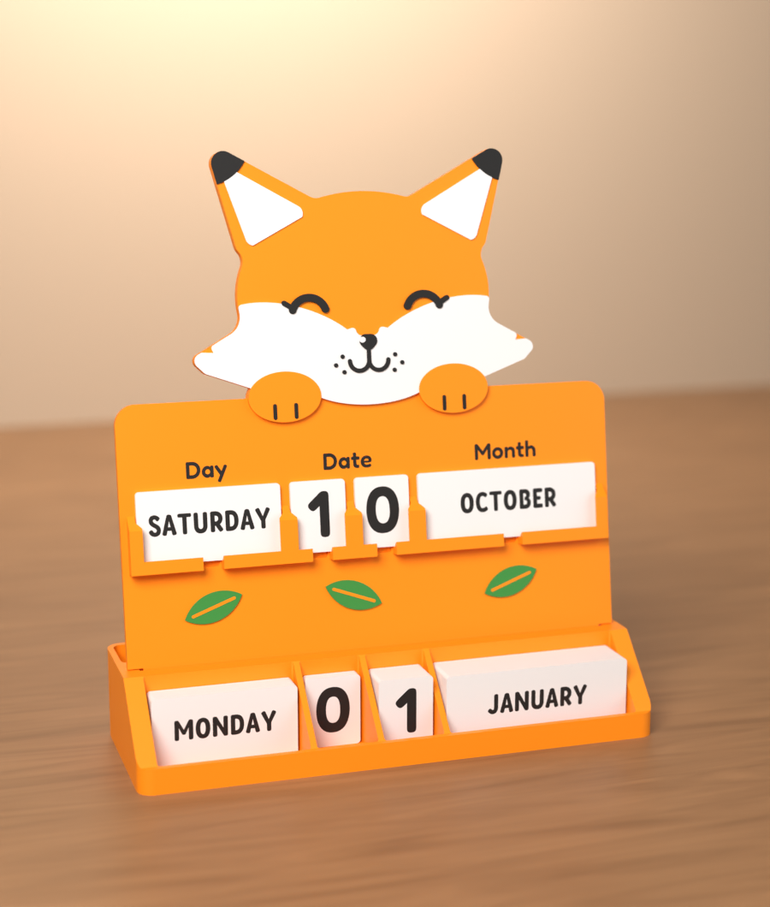
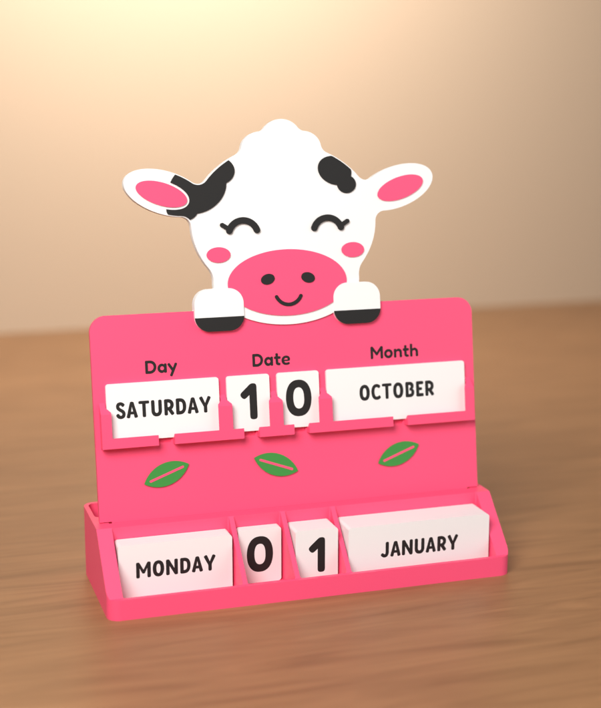
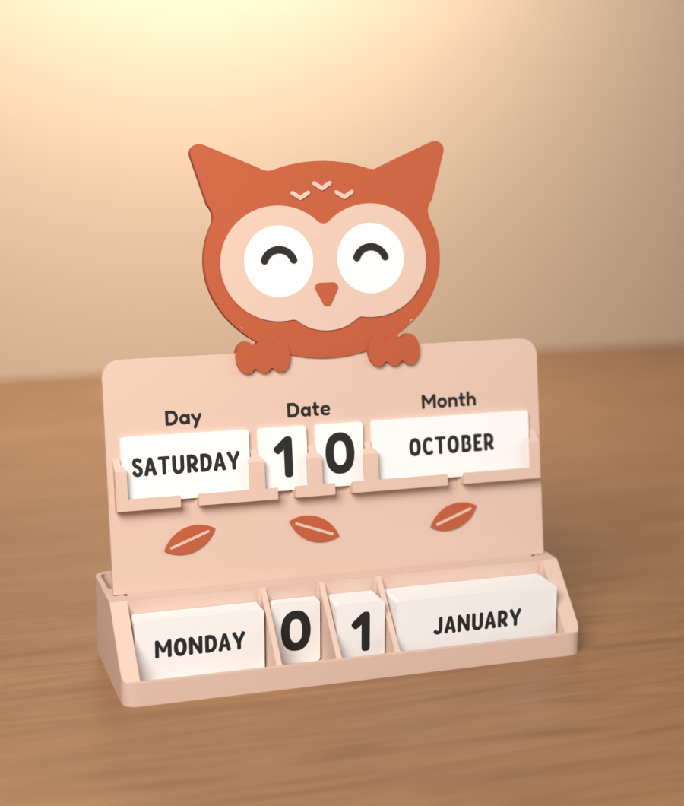
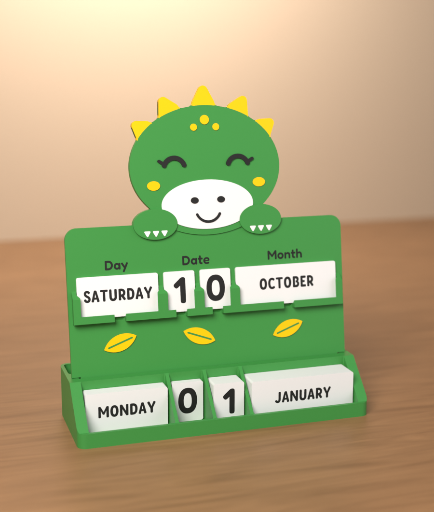
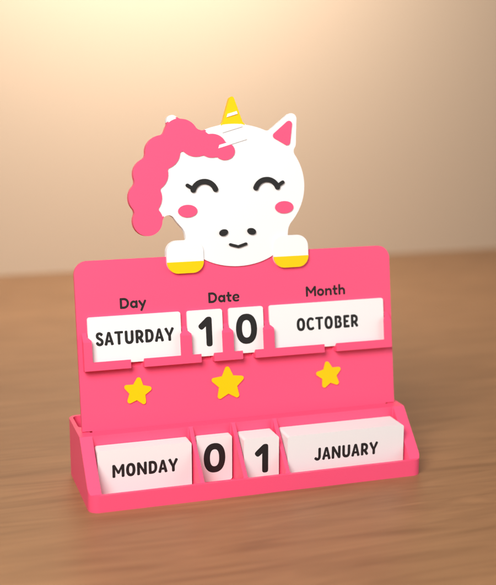
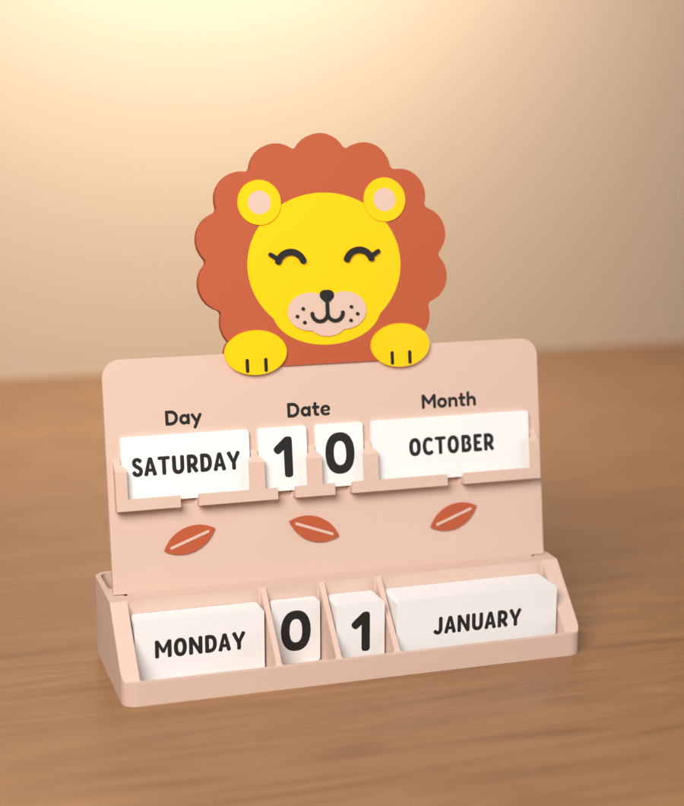
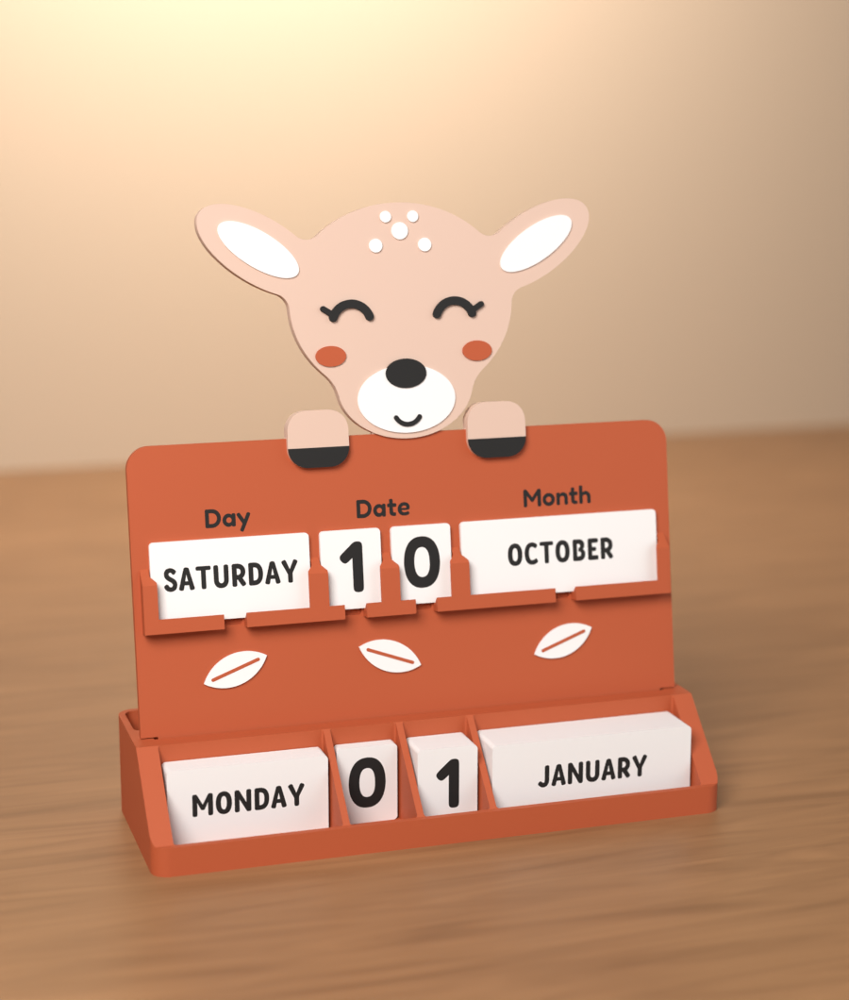
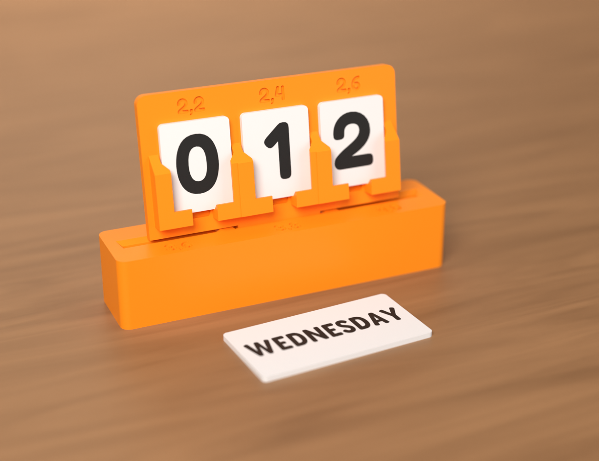

# C-01 Perpetual animal calendar (v0.3)

*Nederlands: [README.md](README.md)*

Perpetual desk calendar following the **Dierenkalender** tab of the MakerWorld production list. Printer: Bambu
Lab A1 with AMS Lite, at most four colours per plate. There are seven animals, each in Dutch and in English. The
base and the cards are shared by all of them.



Four positions: **DAY | tens | units | MONTH**, with four storage bins below for the 33 cards. The front drops
into the slot in the base with a tongue and leans back 8°.

> **Status:** CAD, STLs, Bambu Studio projects and the assembly and print check are done. **Nothing has been
> printed yet.** Print the test fit first (`gedeeld/pasproef`).
>
> The 3MF projects are checked against the rules of Bambu's format, using the Bambu Studio source and a real A1
> project as reference (`gereedschap/bambu/valideer.py` at the repo root). They have not been opened in Bambu Studio itself, because it
> does not run in this environment.

## Variants

| No | Animal | Front colours (Bambu PLA) | Front* | Photo |
|---|---|---|---|---|
| 01 | [vos · fox](varianten/01-vos/) | Pumpkin Orange 10301 (board and head), Ivory White 11100, Charcoal 11101, Mistletoe Green 10502 | 90.5 g · 2 h 22 |  |
| 02 | [koe · cow](varianten/02-koe/) | Hot Pink 10204 (board), Ivory White 11100 (head), Charcoal 11101, Mistletoe Green 10502 | 92.1 g · 2 h 34 |  |
| 03 | [uil · owl](varianten/03-uil/) | Latte Brown 11800 (board), Terracotta 11203 (head), Ivory White 11100, Charcoal 11101 | 91.7 g · 2 h 32 |  |
| 04 | [draak · dragon](varianten/04-draak/) | Mistletoe Green 10502 (board and head), Ivory White 11100, Charcoal 11101, Sunflower Yellow 10402 | 91.3 g · 2 h 34 |  |
| 05 | [eenhoorn · unicorn](varianten/05-eenhoorn/) | Hot Pink 10204 (board), Ivory White 11100 (head), Charcoal 11101, Sunflower Yellow 10402 | 94.3 g · 2 h 46 |  |
| 06 | [leeuw · lion](varianten/06-leeuw/) | Latte Brown 11800 (board), Terracotta 11203 (head), Charcoal 11101, Sunflower Yellow 10402 | 92.6 g · 2 h 34 |  |
| 07 | [hert · deer](varianten/07-hert/) | Terracotta 11203 (board), Latte Brown 11800 (head), Ivory White 11100, Charcoal 11101 | 89.2 g · 2 h 31 |  |

\* Front weight and time come from PrusaSlicer with a profile that approximates the A1, see
[controle/RAPPORT.md](controle/RAPPORT.md). The weight is reliable. Bambu Studio calculates time and purging
itself.

Fan art lives separately in [`fanart/`](fanart/): Mario, Sonic, Spider-Man, Steve and the Creeper. It is **for
personal use only**: do not publish it and do not sell it.

## Folders

```
varianten/NN-animal/nl|en/  dierenkalender_<dier>_nl.3mf / animal-calendar_<animal>_en.3mf  (everything for one calendar)
                            front_<animal>__<colour>.stl                                     (the front, one file per colour)
                            <animal>_en.png                                                   (product photo)
gedeeld/voet/               voet.stl and voet.3mf: the same base for every animal, pick your colour
gedeeld/kaartjes/           digits (all languages), nl/ and en/ for days, months and the 3MF (kaartjes_nl / cards_en)
gedeeld/pasproef/           channels, slots, and nl/ and en/ for test cards and the 3MF (pasproef_nl / test-fit_en)
fanart/                     the same for the fan-art variants (personal use only)
cad/                        the source: Python scripts that generate everything above
controle/                   RAPPORT.md: assembly, card removal, printability, stability, slicer, 3MF check
renders/                    Blender renders
```

(`gedeeld` = shared, `voet` = base, `kaartjes` = cards, `pasproef` = test fit, `varianten` = variants.)

## Printing with the Bambu Studio project

Open `varianten/NN-animal/en/animal-calendar_<animal>_en.3mf` in Bambu Studio. You get five plates:

| Plate | What | Colours | Filament | Time* |
|---|---|---|---|---|
| 1 | Front: board, animal, card guides, labels, decoration | 4 (see the table above) | 89-95 g | 2 h 20 to 2 h 50 |
| 2 | Base: four bins, tilted slot, open rear compartment | board colour | 107.8 g | 2 h 18 | |
| 3 | Month cards (12) | white + Charcoal | 52.1 g | 1 h 25 | |
| 4 | Day cards (7) | white + Charcoal | 23.0 g | 42 min | |
| 5 | Digit cards (4 tens + 10 units) | white + Charcoal | 18.4 g | 37 min | |

A complete calendar takes about 290 g of filament and 7.5 hours of printing.

- **Settings** start from *0.20mm Standard @BBL A1* on the *Textured PEI Plate*: 0.4 mm nozzle, no supports, no
  brim. The project already carries these per-part settings:
  - front: 3 walls, 20 % infill, flush into infill;
  - base: 3 walls;
  - cards: fully solid, 1.6 mm.

  Because they are stored per object, Bambu Studio does not reset them to the system profile on opening.
- **Colours**: the filaments are Bambu PLA Basic and PLA Matte with their real colour codes, ordered in the
  project as follows: board colour first, then the other front colours, then white and Charcoal for the cards.
  Map them to your AMS slots when printing. A plate never uses more than four. The lion and Steve use five
  filaments in total (the four of the front plus white or Charcoal for the cards), so swap one spool between the
  front and the cards.
- The front and the cards print **flat**, back side down. The colours are only in the top millimetres.
- **Reuse**: the base and the cards are the same for every animal. Already have them? Then print only plate 1 of
  a new animal. A separate base in another colour: `gedeeld/voet/voet.3mf`, pick the filament there. All cards of
  one language: `gedeeld/kaartjes/en/cards_en.3mf`.


### Without the project (STLs only)

Drag all `front_<animal>__*.stl` files of one folder into your slicer at once and answer *"Yes, as a single object
with multiple parts"*. The parts are already in place. Then assign a filament to each part.

## Photos

| | |
|---|---|
|  |  |
| Fox front | Exploded view: front, cards, base |
|  |  |
| Card guides: 45° run-out at the top, opening with a nail notch in the support rail | Side view: the front leans back 8° |
|  |  |
| Back: flat, open rear compartment, recessed version label | Test fit: channel strip in the slot block |


All renders are made in Blender (Cycles) from the real print files, in the Bambu colours. They are not photos of
a print.

## Test fit: what to check

Print `gedeeld/pasproef/en/test-fit_en.3mf`. Put the channel strip with its tongue into each slot of the slot block,
then slide the digit cards into each channel.

- [ ] **Channel** (2.2 / 2.4 / 2.6 mm): the card slides in and out easily, but does not fall out when you tilt
      the strip forward.
- [ ] **Removal**: the card sticks out 9 mm above the guides, so you can grip it by the sides. Through the
      opening in the support rail (with nail notch) you push it up from below.
- [ ] **Slot** (3.6 / 3.8 / 4.0 mm): the tongue drops in without binding and the strip does not wobble.
- [ ] **Tilt**: the strip leans back about 8° and stays put while you change a card.
- [ ] **Lips**: the 45° lips print cleanly and have not sagged.
- [ ] **Cards**: WEDNESDAY and the digits are clearly legible and the letters are intact.

Then set the winning sizes in `cad/params.py` (`CHANNEL`, `SLOT_W`) and regenerate everything.

## Assembly and print check

`cad/controle.py` checks the real geometry and writes [`controle/RAPPORT.md`](controle/RAPPORT.md) (in Dutch):

- **Collisions:** 69 combinations checked in the assembled state, including all 33 cards in the bins at once:
  no overlap.
- **Card in channel:** 0.5 mm side clearance and 1.3 mm free space to the front. The lip overlaps the card edge by
  at least 1.0 mm, even when the card is pushed fully to one side.
- **Tongue in slot:** 0.4 mm all round and 1.0 mm below the tongue. The board's shoulders rest on the base.
- **Bins:** 1.0 mm to the sides; 6 to 19 mm left in front of a full stack.
- **Card removal:** in all twelve variants every card slides up freely past the guides. At the top it stays at
  least 3.0 mm below the paws, hooves or chin.
- **Printability:**
  - everything fits on the A1;
  - no overhang steeper than 45°;
  - no details narrower than 0.4 mm;
  - no supports needed anywhere.
- **3MF:** all 29 projects pass the rules of the Bambu Studio reader.
- **Stability:** a complete calendar weighs 281 to 292 g, with its centre of gravity 44 to 49 mm high. It only
  tips over at a tilt of 36° or more.


## Regenerating

```bash
cd cad
pip install -r requirements.txt
python bouw.py              # all STLs and 3MF projects (or: python bouw.py vos koe)
python slice.py             # weight/time/supports via PrusaSlicer (optional; needs prusa-slicer)
python controle.py          # assembly and print check -> controle/RAPPORT.md
python render.py --alle     # renders of the fox; --varianten for one product photo per variant
python schets.py koe uil    # quick 2D sketch of fronts, to refine drawings
```

| File | What |
|---|---|
| `cad/params.py` | all dimensions and the filaments (Bambu code, name, colour) |
| `cad/talen.py` | all texts per language: labels, days, months, file names |
| `cad/dieren/` | one file per animal; `kit.py` holds the shared shapes (paws, hooves, leaves) |
| `cad/kalender.py` | guides, front, base, cards, test fit, assembly |
| `cad/bouw.py`, `cad/projecten.py` | write the folders, STLs and 3MF projects |
| [`gereedschap/`](../../gereedschap/) | shared by all models: geometry, Bambu 3MF (writing and checking), A1 profiles, slicer, print check, fonts |
| `cad/controle.py`, `cad/slice.py`, `cad/render.py` | checks, slicer, Blender |

### A new animal

1. Copy for example `cad/dieren/hert.py` to `cad/dieren/<animal>.py`. Give it a number, the NL and EN names,
   and the board and head colours.
2. Add it to `VOLGORDE` in `cad/dieren/__init__.py`.
3. Refine the drawing with `python schets.py <animal>`.
4. Run `python bouw.py <animal>`, `python controle.py` and `python render.py --varianten <animal>`.

The base, cards and project settings come along automatically. Add new filaments to `FILAMENTEN` in `params.py`.

## Changes

| Version | What |
|---|---|
| v0.3 | Seven animals (fox, cow, owl, dragon, unicorn, lion, deer), NL and EN; Bambu Studio projects with five plates per variant; shared base and cards; new folder layout; fan art kept separate (traced from reference images) |
| v0.2 | More clearance and lead-ins (channel 2.4 mm, slot 189.6 mm, chamfered tongue, funnel, 45° run-out of the guides), recessed labels, windows at 36 mm (the check found collisions when removing cards), more detail on the fox, version label on the back |
| v0.1 | First prototype with the fox |

## Licences

- **Fredoka** is licensed under the SIL Open Font License (`gereedschap/fonts/OFL.txt`). The condensed variant is a static
  instance (wdth 75, wght 600) of the variable Fredoka from Google Fonts.
- **The Bambu profiles and the flush calculation** in `gereedschap/bambu/` are derived from Bambu Studio (AGPL-3.0), see
  `gereedschap/bambu/LEESMIJ.md`.
