# C-01 Eeuwigdurende dierenkalender (v0.3)

*English: [README.en.md](README.en.md)*

Eeuwigdurende kalender volgens het tabblad **Dierenkalender** van de MakerWorld-productielijst. Printer:
Bambu Lab A1 met AMS Lite, maximaal vier kleuren per plaat. Er zijn zeven dieren, elk in het Nederlands en
in het Engels. Voet en kaartjes zijn voor alle dieren hetzelfde.


Vier posities: **DAG | tiental | eenheid | MAAND**, met daaronder vier opbergbakken voor de 33 kaartjes. Het
front zakt met een tong 8° achterover in de sleuf van de voet.

> **Status:** CAD, STL's, Bambu Studio-projecten en de montage- en printcontrole zijn klaar. Er is **nog niets
> echt geprint**. Druk eerst de pasproef af (`gedeeld/pasproef`).
>
> De 3MF-projecten zijn gecontroleerd tegen de regels van het Bambu-formaat, met de bron van Bambu Studio en
> een echt A1-project als referentie (`gereedschap/bambu/valideer.py` in de root van de repo). Ze zijn hier niet in Bambu Studio zelf
> geopend: dat programma draait niet in deze omgeving.

## Varianten

| Nr | Dier | Frontkleuren (Bambu PLA) | Front* | Foto |
|---|---|---|---|---|
| 01 | [vos · fox](varianten/01-vos/) | Pumpkin Orange 10301 (bord en kop), Ivory White 11100, Charcoal 11101, Mistletoe Green 10502 | 90,5 g · 2 u 22 | 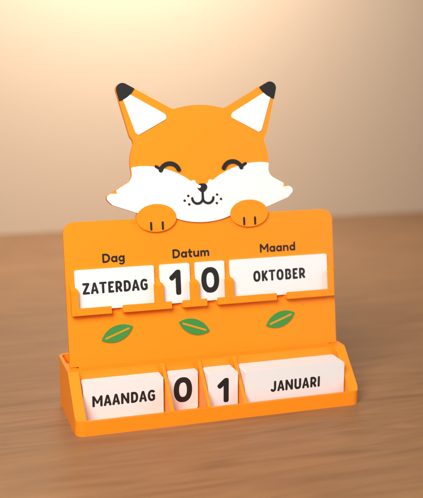 |
| 02 | [koe · cow](varianten/02-koe/) | Hot Pink 10204 (bord), Ivory White 11100 (kop), Charcoal 11101, Mistletoe Green 10502 | 92,1 g · 2 u 34 | 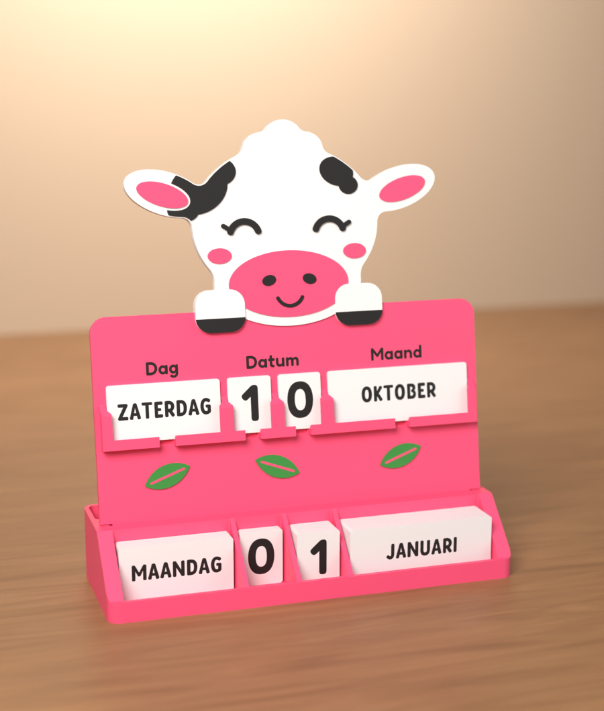 |
| 03 | [uil · owl](varianten/03-uil/) | Latte Brown 11800 (bord), Terracotta 11203 (kop), Ivory White 11100, Charcoal 11101 | 91,7 g · 2 u 32 | 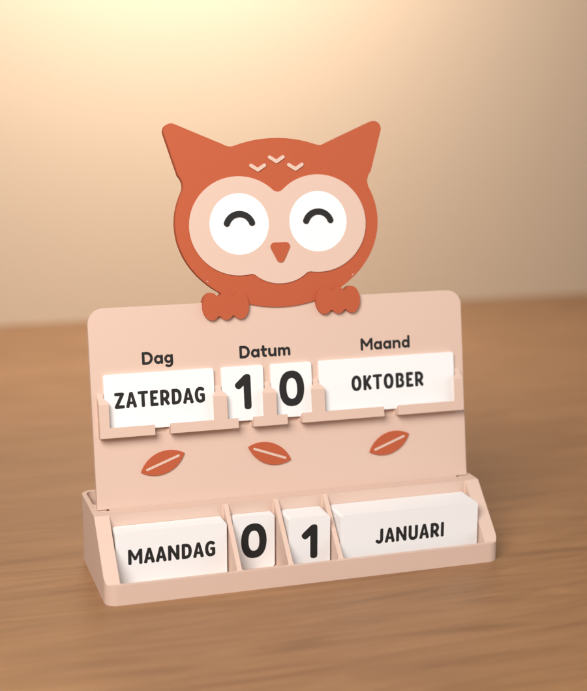 |
| 04 | [draak · dragon](varianten/04-draak/) | Mistletoe Green 10502 (bord en kop), Ivory White 11100, Charcoal 11101, Sunflower Yellow 10402 | 91,3 g · 2 u 34 | 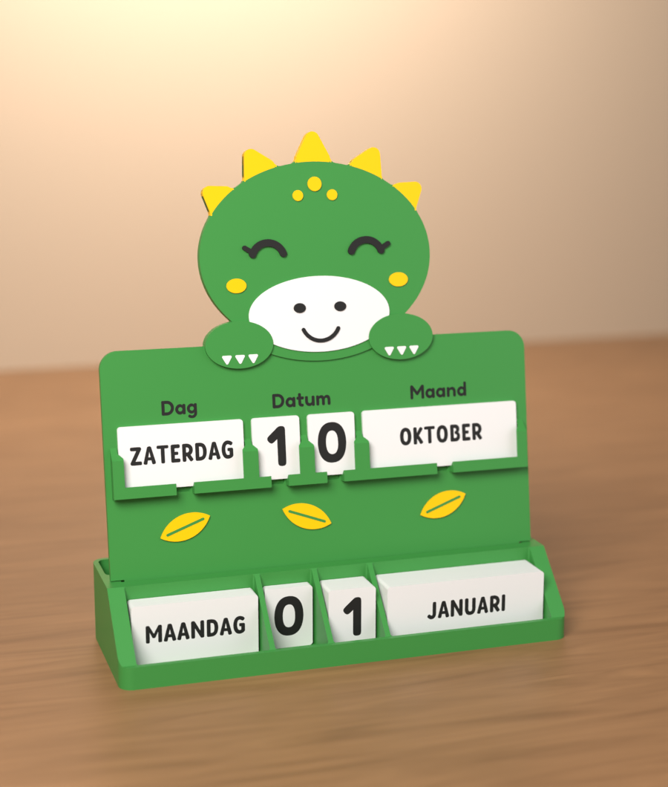 |
| 05 | [eenhoorn · unicorn](varianten/05-eenhoorn/) | Hot Pink 10204 (bord), Ivory White 11100 (kop), Charcoal 11101, Sunflower Yellow 10402 | 94,3 g · 2 u 46 | 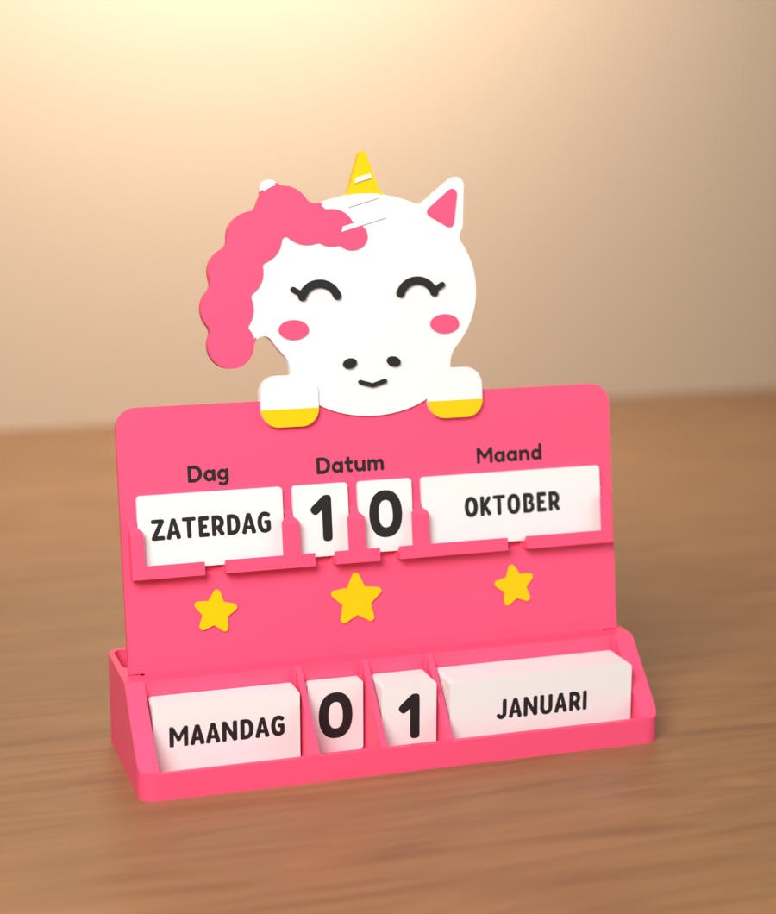 |
| 06 | [leeuw · lion](varianten/06-leeuw/) | Latte Brown 11800 (bord), Terracotta 11203 (kop), Charcoal 11101, Sunflower Yellow 10402 | 92,6 g · 2 u 34 | 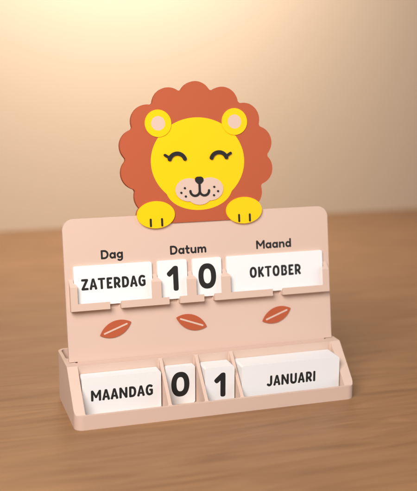 |
| 07 | [hert · deer](varianten/07-hert/) | Terracotta 11203 (bord), Latte Brown 11800 (kop), Ivory White 11100, Charcoal 11101 | 89,2 g · 2 u 31 | 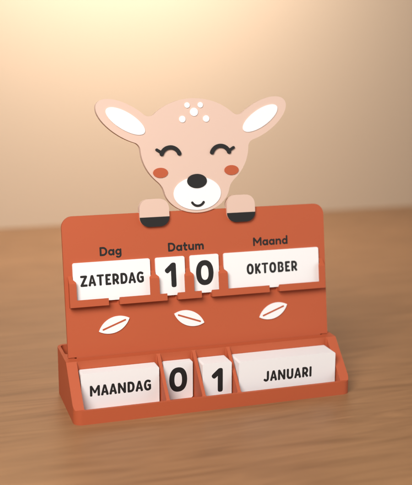 |

\* Gewicht en tijd van het front komen uit PrusaSlicer met een profiel dat de A1 benadert, zie
[controle/RAPPORT.md](controle/RAPPORT.md). Het gewicht is betrouwbaar. Bambu Studio rekent de tijd en het
spoelen zelf uit.

Fan-art staat apart in [`fanart/`](fanart/): Mario, Sonic, Spider-Man, Steve en de Creeper. Dat is **alleen
voor eigen gebruik**: niet publiceren en niet verkopen.

## Mappen

```
varianten/NN-dier/nl|en/   dierenkalender_<dier>_nl.3mf / animal-calendar_<animal>_en.3mf  (alles voor één kalender)
                           front_<dier>__<kleur>.stl                                       (het front per kleur)
                           <dier>_nl.png                                                    (productfoto)
gedeeld/voet/              voet.stl en voet.3mf: dezelfde voet voor elk dier, kies de kleur zelf
gedeeld/kaartjes/          cijfers (voor alle talen), nl/ en en/ voor dagen, maanden en het 3MF (kaartjes_nl / cards_en)
gedeeld/pasproef/          kanalen, sleuven, en nl/ en en/ voor proefkaartjes en het 3MF (pasproef_nl / test-fit_en)
fanart/                    idem voor de fan-art-varianten (alleen voor eigen gebruik)
cad/                       de bron: Python-scripts die alles hierboven maken
controle/                  RAPPORT.md: montage, uitnemen, printbaarheid, stabiliteit, slicer, 3MF-controle
renders/                   Blender-renders
```

## Printen met het Bambu Studio-project

Open `varianten/NN-dier/nl/dierenkalender_<dier>_nl.3mf` in Bambu Studio. Je krijgt vijf printplaten:

| Plaat | Wat | Kleuren | Filament | Tijd* |
|---|---|---|---|---|
| 1 | Front: bord, dier, geleiders, labels, decoratie | 4 (zie de tabel hierboven) | 89-95 g | 2 u 20 tot 2 u 50 |
| 2 | Voet: vier bakken, schuine sleuf, open achtervak | bordkleur | 107,8 g | 2 u 18 | |
| 3 | Kaartjes maanden (12) | wit + Charcoal | 52,1 g | 1 u 25 | |
| 4 | Kaartjes dagen (7) | wit + Charcoal | 23,0 g | 42 min | |
| 5 | Kaartjes cijfers (4 tientallen + 10 eenheden) | wit + Charcoal | 18,4 g | 37 min | |

Een complete kalender is ongeveer 290 g filament en 7,5 uur printen.

- **Instellingen** gaan uit van *0.20mm Standard @BBL A1* op de *Textured PEI Plate*: 0,4 mm nozzle, geen support,
  geen brim. Per onderdeel zit er al het volgende in het project:
  - front: 3 wanden, 20 % infill, spoelen in de infill;
  - voet: 3 wanden;
  - kaartjes: volledig massief, 1,6 mm.

  Omdat deze instellingen per object zijn opgeslagen, zet Bambu Studio ze bij het openen niet terug naar het
  systeemprofiel.
- **Kleuren**: de filamenten zijn Bambu PLA Basic en PLA Matte, met hun echte kleurcodes, en staan op volgorde
  in het project: eerst de bordkleur, dan de andere frontkleuren, dan wit en Charcoal voor de kaartjes. Bij het
  printen koppel je ze aan de AMS-sleuven. Een plaat gebruikt er nooit meer dan vier. Leeuw en Steve hebben in
  totaal vijf filamenten (de vier van het front plus wit of Charcoal voor de kaartjes): wissel dan één spoel
  tussen het front en de kaartjes.
- Front en kaartjes liggen **plat**, met de achterkant op de plaat. De kleuren zitten alleen in de bovenste
  millimeters.
- **Herbruiken**: voet en kaartjes zijn voor elk dier gelijk. Heb je ze al, dan print je van een nieuw dier alleen
  plaat 1. Een losse voet in een andere kleur: `gedeeld/voet/voet.3mf`, en daar het filament kiezen. Alle
  kaartjes van één taal: `gedeeld/kaartjes/nl/kaartjes_nl.3mf`.

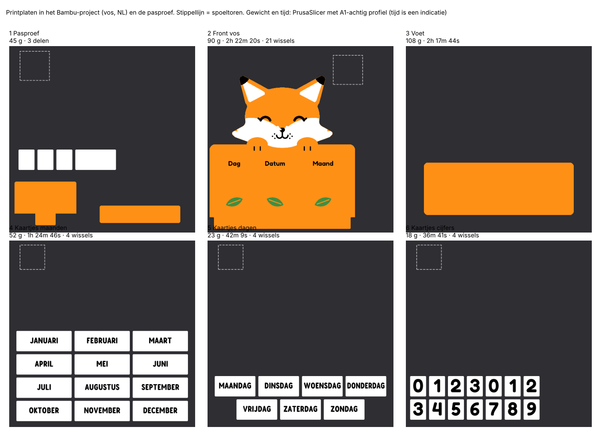

### Zonder het project (alleen STL's)

Sleep alle `front_<dier>__*.stl` van één map tegelijk in je slicer en kies *"Ja, als één object met meerdere
delen"*. De delen staan al op de juiste plek. Wijs daarna per deel het filament toe.

## Foto's

| | |
|---|---|
| 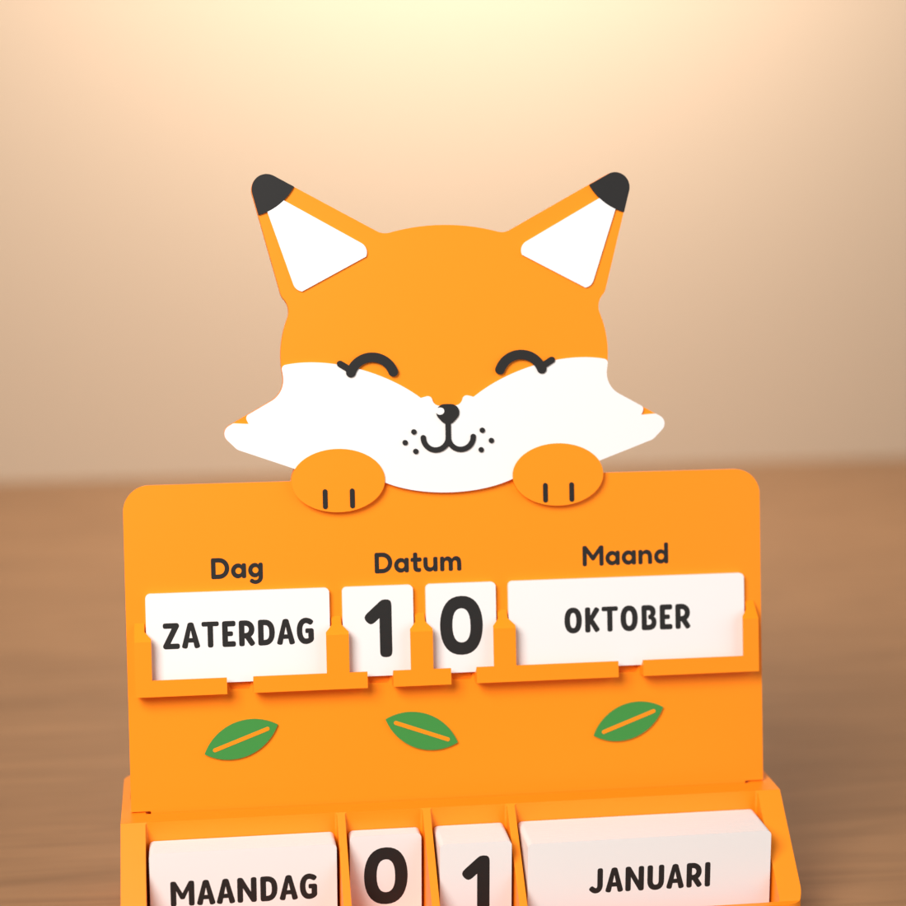 | 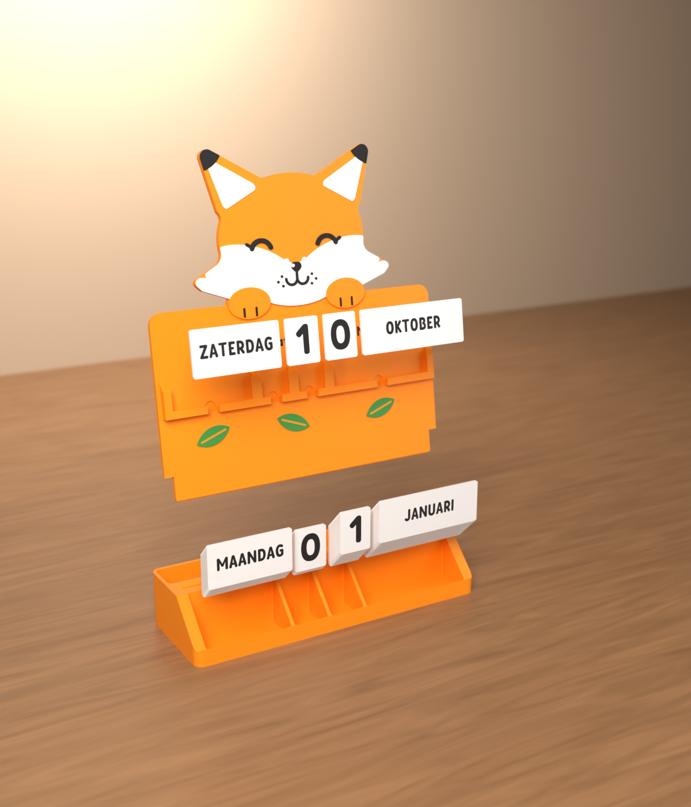 |
| Vossenfront | Explosietekening: front, kaartjes, voet |
| 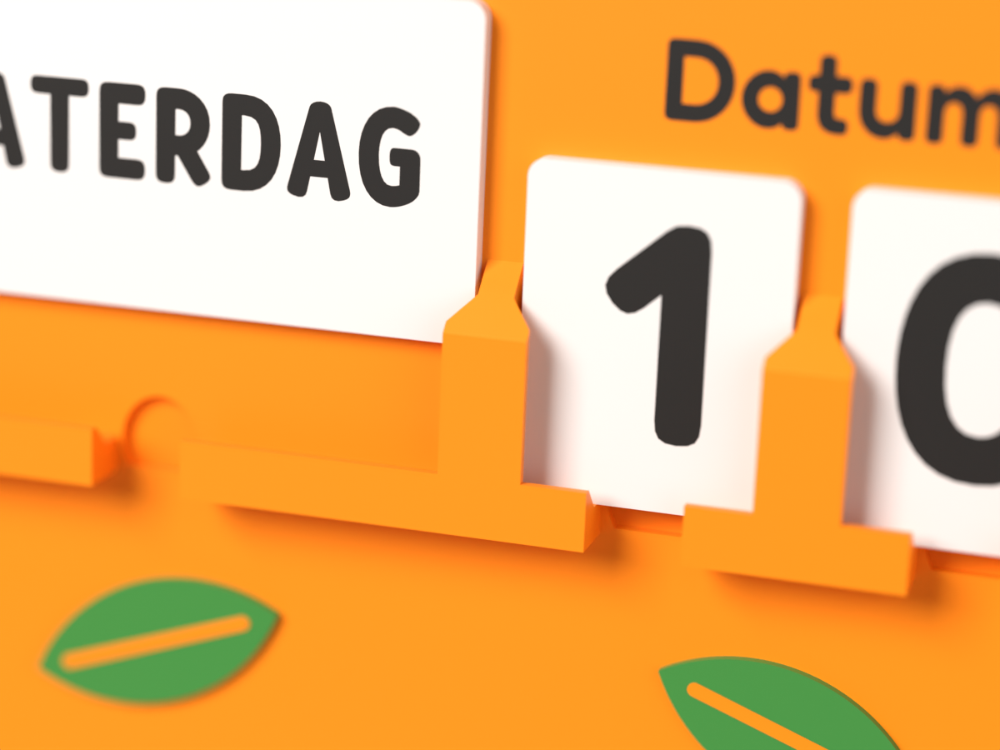 | 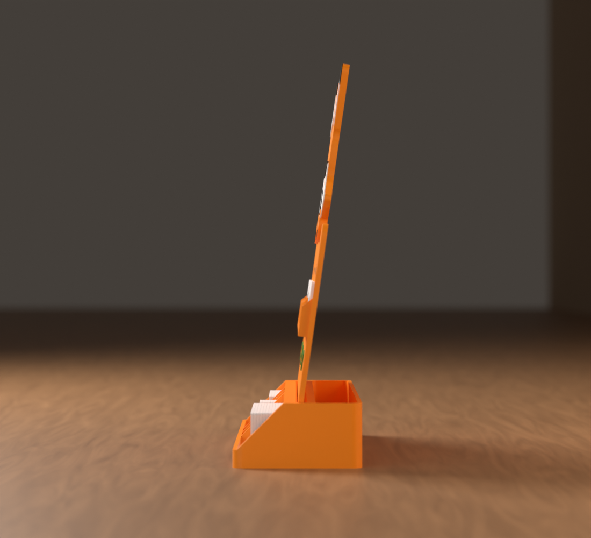 |
| Geleiders: 45°-afloop bovenaan, opening met nagelkuiltje in de draagrand | Zijkant: het front leunt 8° achterover |
| 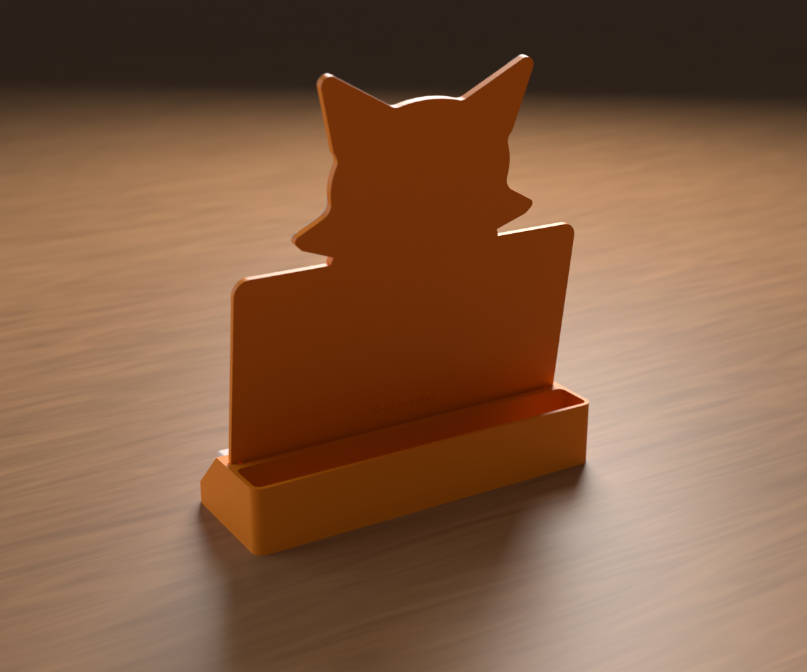 | 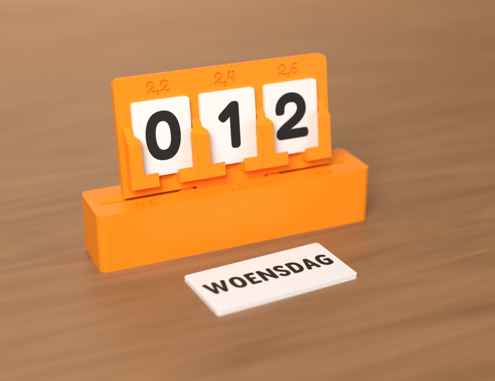 |
| Achterkant: vlak, open achtervak, verzonken versielabel | Pasproef: kanaalstrook in het sleuvenblok |

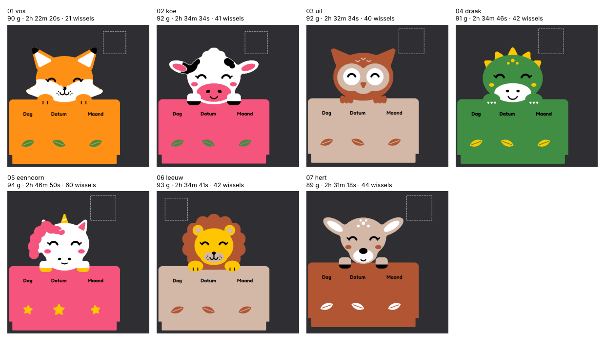

Alle renders komen uit Blender (Cycles) op de echte printbestanden, met de Bambu-kleuren. Het zijn geen foto's
van een print.

## Pasproef: wat je test

Print `gedeeld/pasproef/nl/pasproef_nl.3mf`. Steek de kanaalstrook met zijn tong in elke sleuf van het sleuvenblok,
en schuif de cijferkaartjes in elk kanaal.

- [ ] **Kanaal** (2,2 / 2,4 / 2,6 mm): het kaartje glijdt er makkelijk in en uit, maar valt er niet uit als je de
      strook voorover kantelt.
- [ ] **Uitnemen**: het kaartje steekt 9 mm boven de geleiders uit, zodat je het aan de zijkanten kunt vastpakken.
      Via de opening in de draagrand (met nagelkuiltje) duw je het van onderen omhoog.
- [ ] **Sleuf** (3,6 / 3,8 / 4,0 mm): de tong zakt erin zonder te klemmen en de strook staat niet te wiebelen.
- [ ] **Kanteling**: de strook leunt ongeveer 8° achterover en blijft staan als je een kaartje wisselt.
- [ ] **Lippen**: de 45°-lippen zijn netjes geprint en niet doorgezakt.
- [ ] **Kaartjes**: WOENSDAG en de cijfers zijn goed leesbaar en de letters zijn heel.

Pas daarna de winnende maten aan in `cad/params.py` (`CHANNEL`, `SLOT_W`) en genereer alles opnieuw.

## Montage- en printcontrole

`cad/controle.py` controleert de echte geometrie en schrijft [`controle/RAPPORT.md`](controle/RAPPORT.md):

- **Botsingen:** 69 combinaties in gemonteerde stand, ook met alle 33 kaartjes tegelijk in de bakken: geen overlap.
- **Kaartje in kanaal:** 0,5 mm zijspeling en 1,3 mm vrije ruimte naar voren. De lip ligt minstens 1,0 mm over de
  kaartrand, ook als het kaartje helemaal opzij schuift.
- **Tong in sleuf:** 0,4 mm rondom en 1,0 mm onder de tong. De schouders van het bord rusten op de voet.
- **Bakken:** 1,0 mm opzij; vóór de volle stapel blijft 6 tot 19 mm over.
- **Uitnemen:** bij alle twaalf varianten schuift elk kaartje vrij omhoog tot boven de geleiders. Bovenaan blijft
  het minstens 3,0 mm onder de pootjes, hoefjes of kin.
- **Printbaarheid:**
  - alles past op de A1;
  - geen overhang steiler dan 45°;
  - geen details smaller dan 0,4 mm;
  - nergens support nodig.
- **3MF:** alle 29 projecten voldoen aan de regels van de Bambu Studio-lezer.
- **Stabiliteit:** een complete kalender weegt 281 tot 292 g, met het zwaartepunt op 44 tot 49 mm hoogte. Hij
  kantelt pas bij 36° of meer scheefstand.

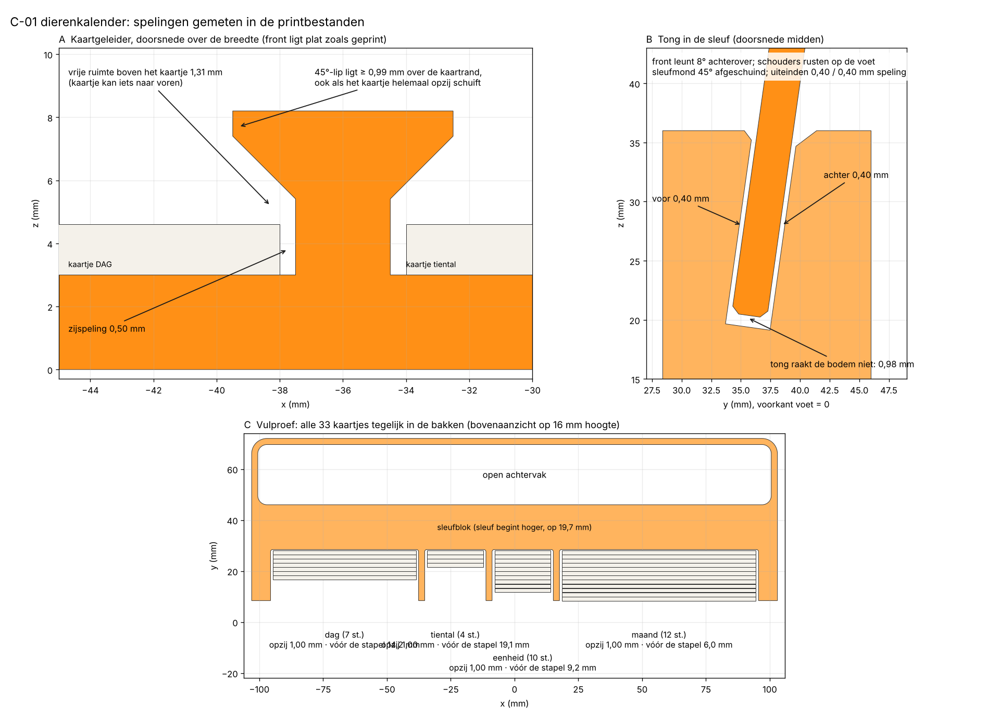

## Opnieuw genereren

```bash
cd cad
pip install -r requirements.txt
python bouw.py              # alle STL's en 3MF-projecten (of: python bouw.py vos koe)
python slice.py             # gewicht/tijd/support via PrusaSlicer (optioneel; vereist prusa-slicer)
python controle.py          # montage- en printcontrole -> controle/RAPPORT.md
python render.py --alle     # renders van de vos; --varianten voor een productfoto per variant
python schets.py koe uil    # snelle 2D-schets van fronten, om tekeningen bij te schaven
```

| Bestand | Wat |
|---|---|
| `cad/params.py` | alle maten en de filamenten (Bambu-code, naam, kleur) |
| `cad/talen.py` | alle teksten per taal: labels, dagen, maanden, bestandsnamen |
| `cad/dieren/` | één bestand per dier; `kit.py` heeft de gedeelde vormen (pootjes, hoefjes, blaadjes) |
| `cad/kalender.py` | geleiders, front, voet, kaartjes, pasproef, montage |
| `cad/bouw.py`, `cad/projecten.py` | schrijven de mappen, STL's en 3MF-projecten |
| [`gereedschap/`](../../gereedschap/) | gedeeld door alle modellen: geometrie, Bambu-3MF (schrijven en controleren), A1-profielen, slicer, printcontrole, lettertypen |
| `cad/controle.py`, `cad/slice.py`, `cad/render.py` | controles, slicer, Blender |

### Een nieuw dier

1. Kopieer bijvoorbeeld `cad/dieren/hert.py` naar `cad/dieren/<dier>.py`. Geef het een nummer, de NL- en
   EN-naam, en de kleuren van bord en kop.
2. Zet het in `VOLGORDE` in `cad/dieren/__init__.py`.
3. Schaaf de tekening bij met `python schets.py <dier>`.
4. Draai `python bouw.py <dier>`, `python controle.py` en `python render.py --varianten <dier>`.

Voet, kaartjes en projectinstellingen komen er vanzelf bij. Nieuwe filamenten voeg je toe in `FILAMENTEN` in
`params.py`.

## Wijzigingen

| Versie | Wat |
|---|---|
| v0.3 | Zeven dieren (vos, koe, uil, draak, eenhoorn, leeuw, hert), NL en EN; Bambu Studio-projecten met vijf platen per variant; gedeelde voet en kaartjes; nieuwe mappenstructuur; fan-art apart (overgetrokken van referentieafbeeldingen) |
| v0.2 | Meer speling en invoerschuintes (kanaal 2,4 mm, sleuf 189,6 mm, tong met afschuining, trechter, 45°-afloop van de geleiders), verzonken labels, vensters op 36 mm (de controle vond botsingen bij het uitnemen), vos met meer details, versielabel op de achterkant |
| v0.1 | Eerste prototype met de vos |

## Ontwerpkeuzes

| Onderwerp | Keuze | Reden |
|---|---|---|
| Kaarttekst | 0,4 mm Charcoal **verzonken** in de bovenkant, kaartje overal 1,6 mm | Een vlak kaartje schuift beter onder de lippen en stapelt recht; losse letters kunnen niet afbreken |
| Lettertype | Fredoka SemiBold (cijfers, labels), Fredoka SemiBold smal (dagen, maanden), 8 mm hoog | DONDERDAG en WEDNESDAY passen in 56 mm, met hooguit 8 % extra versmalling |
| Zijlippen | Lip van 2 mm met een onderkant onder 45° | Printbaar zonder support terwijl het front plat ligt |
| Kaartje uitnemen | Geleiders 19 mm hoog, kaartje steekt 9 mm boven uit; opening van 8 mm in de draagrand | Vastpakken aan de zijkanten, of van onderen omhoog duwen |
| Dierenkop | Kop in eigen kleur door de volle plaatdikte | Ook de zijkant van de kop heeft de goede kleur |
| Sleufdiepte | 16,5 mm | De tong raakt de bodem niet; de schouders van het bord rusten op de voet |
| Voorkant bakken | 10 mm hoog, zijwanden lopen schuin op naar 36 mm | De tekst van het voorste kaartje blijft zichtbaar en je vingers kunnen erbij |
| Buitenwanden voet | 7,4 mm | Vier bakken van 58/24/24/78 mm passen precies in 206 mm, met ruimte voor de R6-hoeken |
| Achtervak | Open vak achter de sleuf | Minder filament dan een massieve voet, en extra opbergruimte |

## Licenties

- **Fredoka** valt onder de SIL Open Font License (`gereedschap/fonts/OFL.txt`). De smalle variant is een statische
  instantie (wdth 75, wght 600) van de variabele Fredoka uit Google Fonts.
- **Bambu-profielen en het spoeldeel** in `gereedschap/bambu/` zijn afgeleid van Bambu Studio (AGPL-3.0), zie
  `gereedschap/bambu/LEESMIJ.md`.
