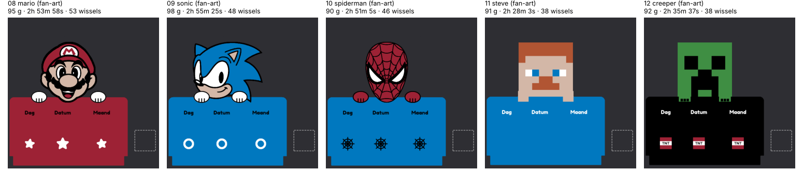

# Fan-art · alleen voor eigen gebruik / personal use only

> **NL:** Mario (Nintendo), Sonic (SEGA), Spider-Man (Marvel), Steve en de Creeper (Minecraft, Mojang/Microsoft)
> zijn beschermde personages. Deze varianten zijn alleen bedoeld om zelf te printen. **Niet publiceren op
> MakerWorld of elders, en niet verkopen.** Mario, Sonic en Spider-Man zijn rechtstreeks overgetrokken van
> bestaande afbeeldingen, en dat maakt het des te strikter.
>
> **EN:** These characters are protected IP. These variants are for printing yourself only. **Do not publish
> them on MakerWorld or anywhere else, and do not sell them.** Mario, Sonic and Spider-Man are traced directly
> from existing artwork, which makes this even stricter.

| Nr | Variant | Kleuren · colours (Bambu PLA) | Hoe · how |
|---|---|---|---|
| 08 | Mario | Maroon Red 10205 (bord), Latte Brown 11800, Ivory White 11100, Charcoal 11101 | overgetrokken · traced |
| 09 | Sonic | Marine Blue 11600 (bord), Latte Brown 11800, Ivory White 11100, Charcoal 11101 | overgetrokken · traced |
| 10 | Spider-Man | Marine Blue 11600 (bord), Maroon Red 10205, Ivory White 11100, Charcoal 11101 | overgetrokken · traced |
| 11 | Steve | Marine Blue 11600 (bord), Latte Brown 11800, Terracotta 11203, Ivory White 11100 (+ Charcoal voor de kaartjes) | pixelraster · pixel grid |
| 12 | Creeper | Charcoal 11101 (bord), Mistletoe Green 10502, Maroon Red 10205 (TNT), Ivory White 11100 | pixelraster · pixel grid |

Elke map `NN-naam/nl|en/` bevat hetzelfde als een gewone variant: het Bambu Studio-project
(`dierenkalender_<naam>_nl.3mf` / `animal-calendar_<name>_en.3mf`, vijf platen), de front-STL's per kleur en een
productfoto. Voet en kaartjes zijn de gedeelde onderdelen uit `../gedeeld/`.
*Each folder holds the same as a regular variant: the Bambu Studio project (five plates), the front STLs per colour
and a product photo. Base and cards are the shared parts from `../gedeeld/`.*

## Overtrekken · tracing (`cad/dieren/trace.py`)

1. Ruis eruit, en elke pixel krijgt de dichtstbijzijnde paletkleur (in Lab). Het palet staat per personage in de
   module, b.v. `cad/dieren/mario.py`.
2. De achtergrond is alles wat je vanaf de beeldrand bereikt zonder een zwarte lijn te kruisen. Wat overblijft
   is het silhouet.
3. Opschonen voor de printer:
   - anti-aliasranden weg;
   - zwarte lijnen verdikt tot ze printbaar zijn (Spider-Man: +0,22 mm per kant, ongeveer 1 mm);
   - stroken smaller dan 0,5 mm en eilandjes kleiner dan 0,6 mm² gaan naar de kleur ernaast.
4. Per kleur de randen volgen en naar mm schalen: 103 mm hoog, met de onderkant op de bordrand.
5. Hoogtes: kleurvlakken tot 4,4 mm, zwarte lijnen tot 5,0 mm. De lijnen liggen dus 0,6 mm hoger, als een
   cartoonrand. Mario's neus gaat tot 5,4 mm, de witte lenzen van Spider-Man liggen verzonken (4,2 mm).

*Noise removed, pixels mapped to the nearest palette colour, background flood-filled from the border up to the black
outline. Lines thickened to a printable width, slivers and specks merged into their neighbour, contours vectorised
and scaled to 103 mm. Colour fields up to 4.4 mm, black lines raised to 5.0 mm.*

De bronafbeeldingen staan **niet** in deze repo, vanwege het auteursrecht van anderen. Wil je Mario, Sonic of
Spider-Man opnieuw bouwen, zet ze dan in `bronnen/` (zie de [LEESMIJ](bronnen/LEESMIJ.md) daar). Zonder die
afbeeldingen slaat `bouw.py` ze over en blijven de bestaande bestanden staan. Mario's lichtblauwe iris kan geen
vijfde kleur worden en is zwart geworden.
*The source images are not in this repo (third-party copyright). Put them in `bronnen/` to rebuild; without them
`bouw.py` skips these characters and keeps the existing files.*

### Nieuw personage · new character

1. Zet een afbeelding in `bronnen/`. Het beste werkt platte cartoonkunst met zwarte omlijning en weinig kleuren,
   op een witte of effen achtergrond.
2. Kopieer `cad/dieren/sonic.py`. Pas daarin aan:
   - het palet: RGB-waarden uit de afbeelding, met per kleur het filament of `ACHTER`;
   - de hoogte en de handjes.
3. Zet de naam in `cad/dieren/__init__.py` en draai `python bouw.py <naam>`.
