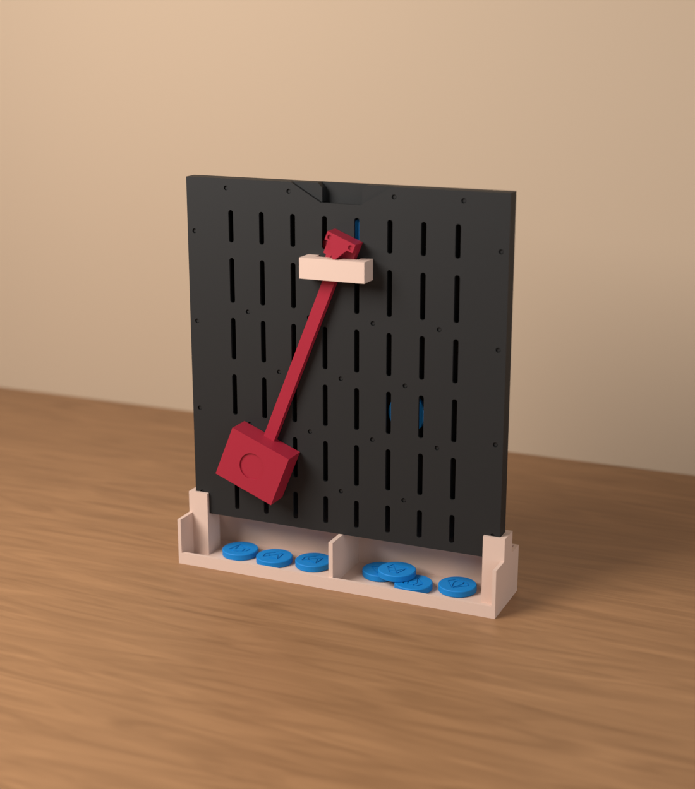
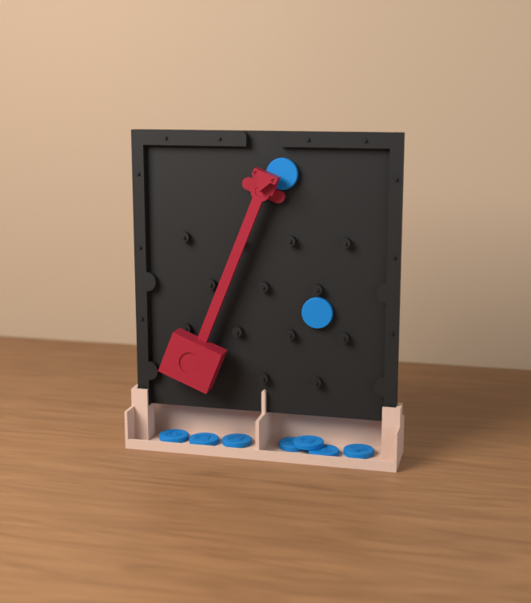
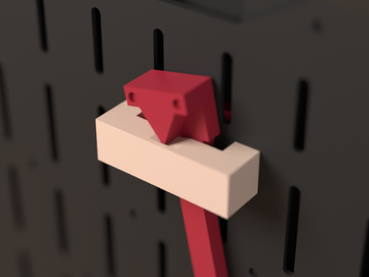
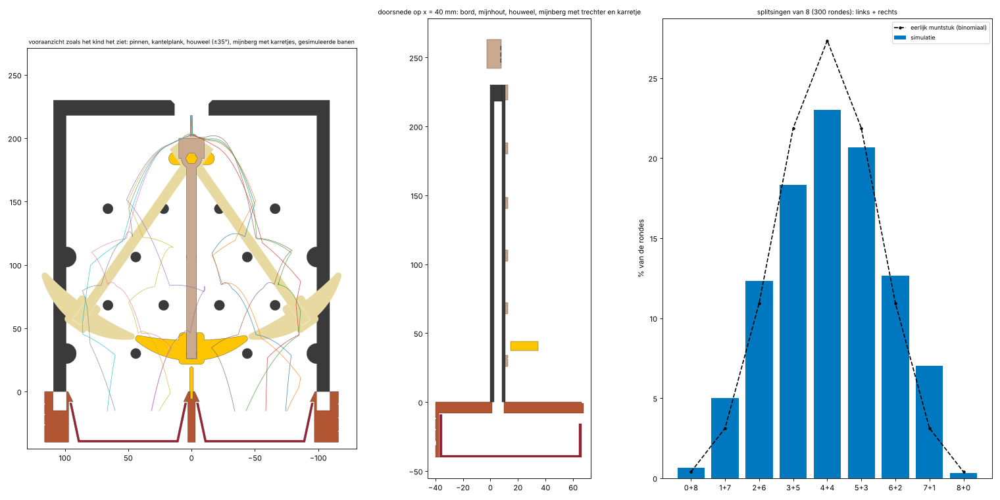
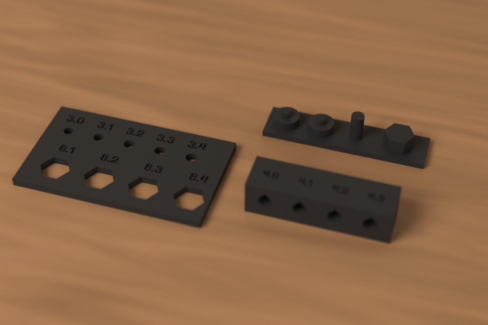
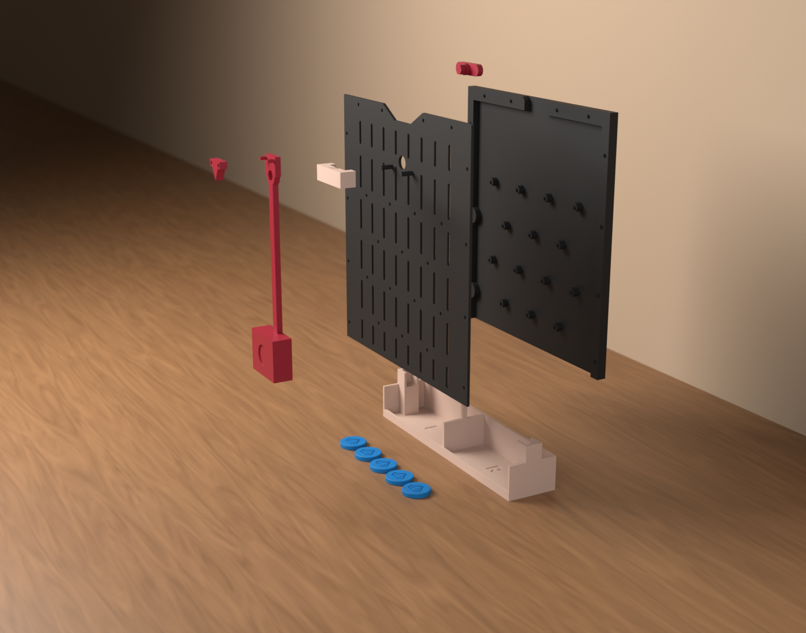

# E-01 Splitsmijn (Split Mine): test print of the drop board (v0.1)

*Nederlands: [README.md](README.md)*

A math toy for learning **number bonds up to 10**, for first grade (ages 5 to 6). The child throws a handful
of diamond coins into the mine. They tick down past the pins and fall into a tray on the left or the right.
Then the child says the bond: *8 is 3 and 5*. In the final model one tray is a closed chest: *8 = 3 + ?*.
Guess first, then open the chest and count.

This is the **test print**: the drop board at full size, with the pendulum, a simple base with two open trays,
and 10 coins. It tests the two things that could break the concept:

1. **Does a coin ever get stuck?**
2. **Are the splits really random?** Otherwise the child soon knows where the coins will go.



> **Status:** the CAD, the STLs, the Bambu Studio project and the checks are done. **Nothing has been
> printed yet.** Start with the fit strip (plate 1), then the rest, and follow *Testing* below.
>
> The 3MF project has been checked against the rules of the Bambu format (`gereedschap/bambu/valideer.py` in
> the root of the repo). It has not been opened in Bambu Studio itself: that program does not run in this
> environment.

| | |
|---|---|
| Size (w × d × h) | 226 × 48 × 262 mm, including the base |
| Coins | 10 coins Ø 25 × 4.5 mm (the size of a 2-euro coin), with an engraved diamond |
| Hardware | none: no screws, glue or metal parts |

Colours (Bambu PLA, from the colour plan):

- **Charcoal 11101**: back and front plate. The coins stand out against the dark board.
- **Latte Brown 11800**: the base and the bracket.
- **Maroon Red 10205**: the pendulum, the knife block and the tilting plank: everything that moves.
- **Marine Blue 11600**: the coins.

## How it works



- **Drop board**: the coins fall upright in a 6 mm gap between the back plate and the front plate.
  - There are four rows of 3 or 4 pins in a triangular grid, 44 mm apart. Between two pins, or between a pin
    and the wall, there is at least 29 mm everywhere, for a 25 mm coin.
  - Next to the rows with a centre pin there is a half pin in the wall, so no coin slides straight down along
    the wall.
  - At the bottom, the divider stands right under the centre pin. Whatever falls to its left lands in the left
    tray.
- **Why a pendulum**: a 25 mm coin is big next to pins 44 mm apart. It does not bounce randomly but rolls
  over the pins along a fixed path. In the simulation a plain drop board sent the coin to the side the child
  aimed at 65 to 95 % of the time. Then a child learns to aim, not to split.
  - So every coin first lands on a **tilting plank** under the slot. The plank is fixed to a heavy
    **pendulum** in front of the board.
  - The child gives the pendulum one push. What decides is which end of the plank is lower at that moment.
    A coin is far too light to disturb the pendulum.
  - The slot is only 2 mm wider than a coin: the less room there is to aim, the less the aim counts.
- **A knife instead of an axle**: a printed 4 mm axle brakes the pendulum so hard that it stops after 10 to
  20 seconds.
  - So the pendulum hangs on a **knife edge** in a V-groove, like an old balance scale. Half a minute after a
    35° push it still swings 27 to 31°.
  - The groove is obtuse (150°): the knife can tilt 45° before its flanks touch the groove, and the pendulum
    swings at most 35°.
  - The groove does not run through to the front. That little rim holds the knife back, so the pendulum
    cannot slide off its hexagon.



### What the checks say

The check rebuilds the drop board in a 2D physics model. A round goes as in class: one push, then 8 coins
with 0.8 to 2 seconds in between. This was run for 12 combinations of bounce, friction and damping, because
PLA on PLA is not known exactly. Everything is in [controle/RAPPORT.md](controle/RAPPORT.md) (in Dutch).

- **Jams**: 0 of 4608 coins got stuck. There is also no spot anywhere where a coin can come to rest on two
  supports.
- **Aiming**: aiming left gives at most 4 percentage points more "left" than aiming right. Without the
  pendulum that is 30 to 90 percentage points.
- **Splits** of 8: they follow the odds of a fair coin toss. 4 + 4 comes up most often, 0 + 8 almost never.
- **Pendulum**: after the last coin of a round it still swings about 29°. One push is enough for a whole
  round.



## Parts and printing

Open `pasproef/pasproef.3mf` in Bambu Studio. The project has six plates, one colour each:

| Plate | What | Colour | Filament* | Time* |
|---|---|---|---|---|
| 1 | **fit strip: print this first**, see below | Charcoal 11101 | 12 g | 0 h 32 |
| 2 | back plate with the pins | Charcoal 11101 | 138 g | 3 h 16 |
| 3 | front plate with viewing slots | Charcoal 11101 | 109 g | 3 h 02 |
| 4 | base with the trays, bracket | Latte Brown 11800 | 74 g | 1 h 36 |
| 5 | pendulum, knife block, tilting plank | Maroon Red 10205 | 46 g | 0 h 54 |
| 6 | 10 coins | Marine Blue 11600 | 17 g | 0 h 32 |

That comes to about **395 g of filament and almost 10 hours of printing**. It is not a one-evening test piece,
but the drop board can only be tested at full size: the coins, the pins and the pendulum have to be real.

\* Weight and time come from PrusaSlicer with a profile that approximates the A1, see
[controle/RAPPORT.md](controle/RAPPORT.md). The weight is reliable; Bambu Studio calculates its own time.

- **Settings**: *0.20mm Standard @BBL A1* on the *Textured PEI Plate*, 0.4 mm nozzle, **no supports**,
  gyroid infill. The project already sets this per object:
  - back plate and base: 3 walls; front plate: 2 walls;
  - pendulum: 3 walls and **100 % infill**, rectilinear (gyroid can't do 100 %): a heavy weight swings longer;
  - tilting plank: 4 walls; coins: 3 walls, no brim.
- **Print orientation**:
  - The back and front plates lie flat. The back plate lies on its back with the pins up. The front plate
    lies with its inner face on the bed.
  - The pendulum lies with the back of the arm on the bed: the pegs and the weight point up.
  - The knife block lies on its back (the knife stands upright). The bracket stands on its legs. The plank
    lies with the hub up.
- `pasproef/voorplaat_glad.stl` is the same front plate without viewing slots. It is meant for clear filament
  (PETG or transparent PLA), if you want to see the coins fall all the way.

| Part | Qty | Size (mm) | File |
|---|---|---|---|
| back plate with pins and side rims | 1 | 218 × 230 × 10 | `pasproef/achterplaat.stl` |
| front plate | 1 | 218 × 230 × 2.5 (13.5 with pegs) | `pasproef/voorplaat.stl` |
| base with two trays and divider | 1 | 226 × 48 × 52 | `pasproef/voet.stl` |
| bracket with V-groove | 1 | 44 × 14 × 13 | `pasproef/beugel.stl` |
| pendulum (arm and weight) | 1 | 44 × 184 × 17 | `pasproef/slinger.stl` |
| knife block | 1 | 20 × 16 × 6.5 | `pasproef/mesblok.stl` |
| tilting plank with hub and hexagon | 1 | 36 × 10 × 13 | `pasproef/plank.stl` |
| diamond coin | 10 | Ø 25 × 4.5 | `pasproef/munt.stl` |
| fit strip: hole strip, peg block, bracket sample | 3 | 58 × 34 × 2.5; 50 × 12 × 10.5; 42 × 12 × 11 | `pasproef/gatenstrip.stl` etc. |

## First the fit strip



There are no snap hooks: everything **clamps** or **slides** together. How tight that turns out depends on your
printer. A hole usually comes out 0.1 to 0.2 mm smaller than in the CAD, and with the 26 studs of the front
plate that matters a lot: too tight, and you cannot get the front plate on (or off again).

So print plate 1 first (half an hour) and try the pieces together:

| Try | In | Pick the hole where it | Set in `cad/params.py` | Now |
|---|---|---|---|---|
| stud of the peg block | round holes 3.0 to 3.4 | goes in with light thumb pressure and stays, without forcing | `NOK_GAT` | 3.2 |
| the same stud | round holes 3.0 to 3.4 | clamps firmly (one size tighter is fine) | `MES_GAT` | 3.1 |
| hexagon of the peg block | hex holes 8.1 to 8.4 | slides easily without wobbling | `ZESKANT_SPEL` = size − 8 | 0.2 |
| Ø 4 peg of the peg block | holes 4.0 to 4.3 of the bracket sample | clamps firmly | `BEUGEL_GAT` | 4.1 |

If everything matches the current values, there is nothing to do. Otherwise change the values and run
`python bouw.py` in `cad/` again. Only then print plates 2 to 6.

What clamps where, and how much play each joint has in the CAD, is in
[controle/RAPPORT.md](controle/RAPPORT.md), under *Verbindingen*.

## Assembly



1. **Back plate**: lay it flat on the table, pins up.
2. **Tilting plank**: lay the plank in the middle under the slot, hub up. It sits between the top pins and
   the ceiling.
3. **Front plate**: lay it on top, viewing slots facing you. Put the hub through the round hole.
   - Press the front plate down all around: the 26 studs on the pins and rims clamp lightly into the holes.
   - The plank must now tilt freely; the hub does not touch the hole anywhere.
4. **Pendulum**: press the knife block onto the two pegs at the top of the arm (it clamps), knife pointing
   down. Then slide the arm with its hexagonal hole onto the hexagon of the plank.
5. **Bracket**: slide the bracket with its two holes onto the pegs under the hub (it clamps), legs towards
   the front plate.
   - Lift the weight a tiny bit while you slide. The hub has 1 mm of play in its hole, and this way the knife
     slides into the groove from behind.
   - The rim at the front of the groove now holds the knife back.
6. **Base**: stand the board upright in the base. The side rims drop into the sleeves, and the fin of the
   divider reaches into the gap at the bottom.

## Testing

Always give the pendulum a push first. If it stands still, the plank is level and the aim decides again.

- [ ] **Swinging**: push the pendulum to about 30° and time how long it moves. After 30 seconds it should
      still swing clearly.
  - If it stops quickly, check that the knife sits neatly in the groove and that the hub and the plank do not
    rub anywhere.
- [ ] **Jams**: throw 10 rounds of 10 coins. Not a single one may get stuck.
  - If one does, note where. If the coin clamps between the plates, make `SPLEET` in `cad/params.py` 0.5 mm
    larger.
- [ ] **Slot**: does every coin drop smoothly through the slot? If not, make `INWORP_HALF` 0.5 mm larger.
- [ ] **Fairness**: throw 40 coins, all aimed as far left in the funnel as possible. Then do the same on the
      right.
  - Count how many come out on the left each time. On a fair board both counts are between 14 and 26.
  - If aiming left gives "left" much more often, the aim still counts.
- [ ] **With a child**: let a preschooler or a first-grader play.
  - Do they get the push and the slot without explanation?
  - Can they get the coins out of the trays?
  - How long do they keep playing?

Run `python bouw.py` again after every change. If the test print works, the final model comes next: a mine
shaft with a closed chest for the second tray and a ten-frame to lay out the split.

## In class (the iceberg model)

The drop board is the concrete level of the iceberg: the child sees and feels the coins split.

1. **Concrete**: throw, say, 8 coins and count them in each tray. *8 is 3 and 5.*
2. **Model**: lay the coins on a ten-frame, or fill in a number bond diagram.
3. **Abstract**: write *8 = 3 + 5*. So what is *5 + 3*?
4. **Closed chest**: cover one tray with a cup or your hand. How many are on the left? Then *8 = 3 + ?*.
   Guess first, then look.

Because the split is different every time, the child eventually practises all the bonds of the same number.

## Folders

```
pasproef/     pasproef.3mf (6 plates, plate 1 is the fit strip) and every part as an STL in print orientation
cad/          the source: Python scripts that make everything above (params.py has all dimensions)
controle/     RAPPORT.md: coin passage, drop simulation, pendulum, clearances, joints, printability, slicer
renders/      Blender renders
onderdelen.json   volume and size per STL
```

```
cd cad
python bouw.py            # pasproef/
python slice.py           # controle/slicer.json (needs PrusaSlicer)
python controle.py        # controle/ (--snel for a shorter simulation)
python simulatie.py       # just the drop simulation
python render.py alle     # renders/ (needs the pip module bpy)
```

## MakerWorld

The concept borrows from a well-known block game and from the drop board of a TV game show. Do not use those
names in the title, the tags or the description. The model is called **De Splitsmijn** (The Split Mine), and
the diamonds are an original drawing.
