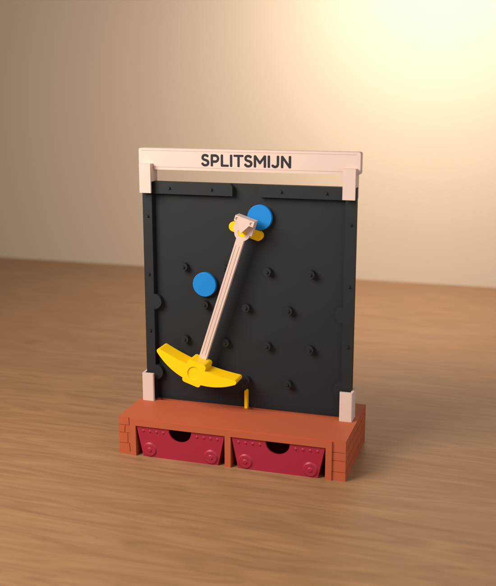
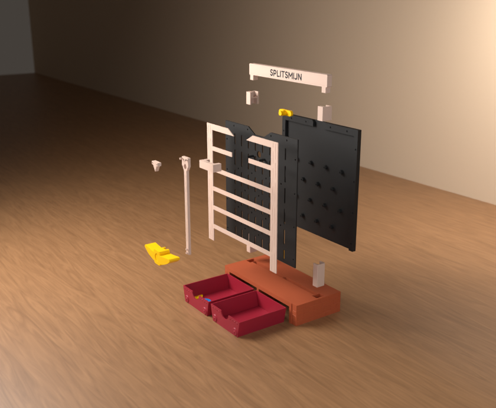
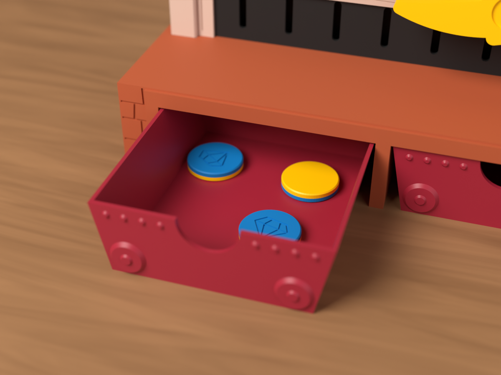

# E-01 De Splitsmijn (eindmodel v1.0, pasproef v0.1)

*English: [README.en.md](README.en.md)*

Rekenmachine om te leren **splitsen tot 10**, voor het 1ste leerjaar (5 tot 6 jaar). Het kind telt een handvol
diamantmuntjes af, gooit ze één voor één in de mijn en geeft de houweel een duw. De muntjes tikken langs de
pinnen naar beneden en verdwijnen in twee **mijnkarretjes**, diep in de berg. Niemand ziet waar ze heen gingen.

Trek één karretje uit: 3 muntjes. Hoeveel zitten er in het andere? *8 = 3 + ?* Eerst raden, dan het tweede
karretje open. Leg ze op het tienveld: die van het eerste karretje met de blauwe kant boven, die van het tweede
met de gele kant.


> **Status:** CAD, STL's, het Bambu Studio-project en de controle zijn klaar, voor het eindmodel en voor de
> pasproef. Er is **nog niets echt geprint**.
>
> De 3MF-projecten zijn gecontroleerd tegen de regels van het Bambu-formaat (`gereedschap/bambu/valideer.py` in
> de root van de repo). Ze zijn hier niet in Bambu Studio zelf geopend: dat programma draait niet in deze
> omgeving.

| | |
|---|---|
| Maat (b × d × h) | 232 × 108 × 303 mm |
| Muntjes | 10 stuks Ø 25 × 4,5 mm (zo groot als 2 euro), half blauw met een diamant, half geel |
| Filament | ongeveer 670 g in 6 kleuren (slicer), zo'n 19 uur printen over 9 platen |
| Nodig | niets: geen schroeven, lijm of metalen onderdelen. Een AMS is alleen nodig voor de naam en de munten |

Kleuren (Bambu PLA):

- **Charcoal 11101**: de achter- en voorplaat (op donker zie je de muntjes goed) en de letters van de naam.
- **Latte Brown 11800**: het mijnhout, het portaal, de steel van de houweel, de beugel.
- **Terracotta 11203**: de mijnberg en het tienveld.
- **Sunflower Yellow 10402**: de houweelkop, de kantelplank, de verdelervin, de gele kant van de munten.
- **Maroon Red 10205**: de twee mijnkarretjes.
- **Marine Blue 11600**: de blauwe kant van de munten.

## Hoe het werkt



- **Valbord**: de muntjes vallen rechtop in een spleet van 6 mm tussen de achter- en voorplaat.
  - Er staan vier rijen van 3 of 4 pinnen in een driehoeksraster, 44 mm uit elkaar. Tussen twee pinnen, of
    tussen een pin en de wand, is het overal minstens 29 mm, voor een muntje van 25 mm.
  - Naast de rijen met een middenpin zit een halve pin in de wand, zodat geen muntje langs de wand naar
    beneden glijdt.
  - Onderaan staat de **verdelervin** recht onder de middelste pin. Wat links ervan valt, komt in het linker
    karretje.
- **Waarom een houweel**: een muntje van 25 mm is groot naast pinnen van 44 mm. Het botst niet willekeurig,
  maar rolt in een vaste baan over de pinnen. Op een gewoon valbord gaat het 65 tot 95 % van de keren naar de
  kant waar het kind mikt. Dan leert een kind mikken, geen splitsen.
  - Daarom valt elk muntje eerst op een **kantelplank** onder de inworp. Die plank zit vast aan de houweel, een
    zware slinger vóór het bord.
  - Het kind geeft de houweel één duw. Wat er dan beslist, is welke kant van de plank op dat moment lager ligt.
    Het muntje is veel te licht om de slinger te storen.
- **Mes in plaats van as**: een geprinte as remt een slinger zo hard af dat hij na 10 tot 20 seconden stilhangt.
  - Daarom hangt de houweel op een **mes** in een V-groef, zoals een ouderwetse balans. Een halve minuut na een
    duw slingert hij nog met 26 tot 31°: één duw is genoeg voor een hele ronde.
- **Mijnberg**: onder het bord zitten twee trechters in het dek. Ze leiden elk muntje naar een **karretje** in
  een tunnel.
  - Tussen de bovenrand van een karretje en het dek is 1 mm: daar past geen muntje tussen.
  - De karretjes schuiven vooraan uit de berg, als een laatje.
- **Mijnhout en portaal**: het houten raamwerk en de mijningang met de naam klemmen zonder lijm.
  - Links en rechts klemt een **kokervoet** met zijn prop in het dek. In die U-koker van 30 mm hoog staan de
    zijranden van het bord en de staanders van het raamwerk samen.
  - Bovenaan zit op elke hoek een **kokerkap**. Onderin klemt hij over het bord en het raamwerk, bovenin staat
    een tong van het portaal.
  - Nokjes achterop houden het raamwerk op zijn plaats.



### Wat de controle zegt

De controle bouwt het valbord na in een 2D-fysicamodel, van de inworp tot in de karretjes.

- Een ronde gaat zoals in de klas: één duw, dan 8 muntjes met 0,8 tot 2 seconden ertussen.
- Dat is doorgerekend voor 12 combinaties van stuit, wrijving en demping, want PLA op PLA is niet precies
  bekend.
- De houweel zit erin met zijn echte massa, uitgerekend uit de geometrie: 44 g, slingertijd 0,77 s.

Alles staat in [controle/RAPPORT.md](controle/RAPPORT.md). Kort:

- **Vastlopen**: 0 van 4608 muntjes bleven hangen. Op het bord is er nergens een plek waar een muntje op twee
  steunpunten kan blijven liggen. De trechters staan 56° en 65° steil: daar glijdt een muntje altijd verder.
- **Mikken**: links mikken geeft hooguit 7 procentpunten meer links dan rechts mikken. Zonder houweel is dat
  30 tot 90 procentpunten.
- **Splitsingen** van 8 volgen een eerlijk muntstuk: 4 + 4 komt het vaakst voor, 0 + 8 haast nooit.
- **Passen**: in de hele uitslag van de houweel raakt niets, en overal is minstens 0,5 mm speling.
- **Stabiliteit**: duw je de houweel naar achteren, dan moet je 3,8 N (zo'n 390 g) duwen voor het bord kantelt.


## In de klas (ijsbergmodel)

De Splitsmijn is het concrete niveau van de ijsberg: het kind ziet en voelt de muntjes zich splitsen.

1. **Concreet**: tel 8 muntjes af en gooi ze in de mijn. Trek beide karretjes uit en tel. *8 is 3 en 5.*
2. **Kist dicht**: trek maar één karretje uit. Er zitten er 3 in. Hoeveel zitten er in het andere? *8 = 3 + ?*
   Eerst raden, dan kijken.
3. **Schematisch**: leg de muntjes op het tienveld, eerst die van het ene karretje met de blauwe kant boven,
   dan die van het andere met de gele kant boven. Of vul een splitsbeen in.
4. **Abstract**: schrijf *8 = 3 + 5*. Wat is dan *5 + 3*?

Omdat de splitsing elke keer anders is, oefent het kind op den duur alle splitsingen van hetzelfde getal.

## Printen

Open `print/splitsmijn.3mf` in Bambu Studio. Het project heeft negen platen:

| Plaat | Wat | Kleur | Filament* | Tijd* |
|---|---|---|---|---|
| 1 | **passtrip: eerst printen**, zie hieronder | Charcoal | 11 g | 0 u 31 |
| 2 | achterplaat met de pinnen (dezelfde als bij de pasproef) | Charcoal | 138 g | 3 u 37 |
| 3 | voorplaat met kijkspleten | Charcoal | 107 g | 3 u 10 |
| 4 | mijnhout | Latte Brown | 33 g | 1 u 06 |
| 5 | mijnberg, tienveld | Terracotta | 195 g | 5 u 41 |
| 6 | portaal met de naam, steel, beugel, mesblok, twee kokervoeten, twee kokerkappen | Latte Brown + Charcoal (letters) | 60 g | 1 u 52 |
| 7 | houweelkop, kantelplank, verdelervin | Sunflower Yellow | 33 g | 0 u 48 |
| 8 | twee karretjes | Maroon Red | 78 g | 1 u 25 |
| 9 | 10 munten | Sunflower Yellow + Marine Blue | 17 g | 0 u 36 |

Samen is dat ongeveer **670 g filament** en 19 uur printen.

\* Uit PrusaSlicer met een profiel dat de A1 benadert, elk object met de wanden en de infill uit het project
(`cad/slice.py`). Het gewicht is betrouwbaar; de tijd rekent Bambu Studio zelf uit. De spoeling bij de
kleurwissels op plaat 6 en 9 komt er nog bij.

- **Instellingen**: *0.20mm Standard @BBL A1* op de *Textured PEI Plate*, 0,4 mm nozzle, **geen support**,
  gyroid-infill. Per object staat dit al in het project:
  - de steel, de houweelkop en het mesblok: **100 % infill** (rechtlijnig). Een zware slinger slingert langer.
  - de rest: 2 tot 4 wanden.
- **Twee kleuren op één plaat**, alleen op plaat 6 en 9.
  - Op plaat 6 liggen de letters 0,6 mm diep in de dwarsbalk van het portaal: een paar wissels.
  - Op plaat 9 wisselt elk muntje één keer, halverwege: de onderste helft geel, de bovenste blauw.
  - Geen AMS? Print de letters dan in hetzelfde bruin, of wissel met de hand op de juiste hoogte.
- **Printligging** (staat al zo in het project):
  - Achter- en voorplaat liggen plat, het mijnhout met de voorkant op het bed.
  - De **mijnberg ligt ondersteboven**: dan zijn de tunnels open naar boven en hangt er niets in de lucht.
  - Steel, houweelkop en mesblok liggen op hun achterkant. Het portaal is een vlakke plaat en ligt op zijn
    achterkant: de letters zitten in de bovenste lagen.
  - De kokervoeten staan rechtop, met de prop op het bed. De kokerkappen liggen op hun buitenkant.
- Alles print zonder support. Ook PrusaSlicer met automatische support vindt niets, behalve een paar steuntjes
  (0,5 g) onder de brug in de gleuf van de houweelkop. Zonder support print het die als brug.
  - De karretjes staan rechtop, open boven.

| Onderdeel | Aantal | Maat (mm) | Bestand |
|---|---|---|---|
| achterplaat met pinnen en zijranden | 1 | 218 × 230 × 10 | `print/achterplaat.stl` |
| voorplaat | 1 | 218 × 230 × 2,5 (met pennen 16,5) | `print/voorplaat.stl` |
| mijnhout (raamwerk van balken) | 1 | 218 × 230 × 2,4 | `print/mijnhout.stl` |
| mijnberg | 1 | 232 × 108 × 40 | `print/mijnberg.stl` |
| tienveld | 1 | 157 × 70 × 4,5 | `print/tienveld.stl` |
| portaal met de naam | 1 | 224 × 31 × 10,6 | `print/portaal.stl` |
| steel van de houweel | 1 | 20 × 174 × 10,5 | `print/steel.stl` |
| houweelkop | 1 | 89 × 25 × 20 | `print/kop.stl` |
| kokervoet | 2 | 13 × 18 × 44,5 | `print/kokervoet_L.stl`, `print/kokervoet_R.stl` |
| kokerkap | 2 | 24 × 20,5 × 13 | `print/kokerkap_L.stl`, `print/kokerkap_R.stl` |
| beugel met V-groef, mesblok | 1 + 1 | 44 × 17 × 13; 20 × 16 × 6,5 | `print/beugel.stl`, `print/mesblok.stl` |
| kantelplank, verdelervin | 1 + 1 | 36 × 10 × 16; 3 × 25 × 5 | `print/plank.stl`, `print/verdelervin.stl` |
| mijnkarretje | 2 | 92 × 105 × 31 | `print/karretje_L.stl`, `print/karretje_R.stl` |
| muntje | 10 | Ø 25 × 4,5 | `print/munt.stl` |

De STL's zijn elk in één stuk (ook het portaal en de munt), voor wie zonder AMS print.

## Eerst de passtrip


Er zitten geen klikhaakjes in: alles **klemt** of **schuift** in elkaar. Hoe strak dat wordt, hangt af van je
printer.

- Een gaatje komt meestal 0,1 tot 0,2 mm kleiner uit dan in het CAD.
- Bij de 26 nokjes van de voorplaat maakt dat veel uit: te strak, en je krijgt de voorplaat er niet op (of
  weer af).

Print daarom eerst plaat 1 (een halfuurtje) en probeer de stukjes in elkaar:

| Probeer | In | Kies het gat waar het | Zet in `cad/params.py` | Nu |
|---|---|---|---|---|
| nokje van het pennenblok | ronde gaten 3,0 tot 3,4 | met lichte duimdruk in gaat en blijft zitten, zonder forceren | `NOK_GAT` | 3,2 |
| hetzelfde nokje | ronde gaten 3,0 tot 3,4 | stevig klemt (een maat strakker mag) | `MES_GAT` | 3,1 |
| zeskant van het pennenblok | zeskantgaten 8,1 tot 8,4 | vlot schuift zonder te wiebelen | `ZESKANT_SPEL` = maat − 8 | 0,2 |
| pen Ø 4 van het pennenblok | gaten 4,0 tot 4,3 van de beugelproef | stevig klemt | `BEUGEL_GAT` | 4,1 |

`MES_GAT` geldt ook voor de pennetjes van de steel in de houweelkop.

- Klopt alles met wat er nu staat? Dan hoef je niets te doen.
- Anders: pas de waarden aan en draai `python bouw.py` in `cad/` opnieuw. Print daarna de andere platen.

Wat waar klemt en hoeveel speling elke verbinding heeft, staat in
[controle/RAPPORT.md](controle/RAPPORT.md), onder *Verbindingen*.

## In elkaar zetten

1. **Achterplaat**: leg ze plat op tafel, met de pinnen omhoog.
2. **Kantelplank**: leg de plank in het midden onder de inworp, met de naaf omhoog.
3. **Voorplaat**: leg ze erop, met de kijkspleten naar je toe. Steek de naaf door het ronde gat. Druk de
   voorplaat rondom aan: de 26 nokjes klemmen licht in de gaatjes. De plank moet vrij kunnen kantelen.
4. **Mijnhout**: leg het raamwerk op de voorplaat. De nokjes achterop vallen in de gaatjes van de voorplaat.
5. **Houweel**:
   - druk het mesblok op de twee pennetjes bovenaan de steel, met het mes naar beneden;
   - druk de houweelkop op de twee pennetjes onderaan;
   - schuif dan de steel met zijn zeskantgat op de zeskant van de plank.
6. **Beugel**: schuif de beugel met zijn twee gaten op de pennen onder de naaf, met de poten naar de voorplaat.
   Til de houweel een beetje op terwijl je schuift: zo glijdt het mes van achteren in de groef.
7. **Mijnberg**:
   - druk de verdelervin met haar tong in de sleuf midden in het dek;
   - druk de twee kokervoeten met hun prop in de uitsparingen links en rechts in het dek, de open kant naar het
     midden. Ze klemmen licht;
   - schuif de twee karretjes in de tunnels.
8. **Bord in de mijnberg**: zet het bord rechtop tussen de kokervoeten. De zijranden en de staanders van het
   mijnhout zakken samen in de kokers, de verdelervin glijdt onderaan in de spleet.
9. **Portaal**: schuif de twee kokerkappen over de bovenhoeken van het bord, met de open kant naar het midden.
   Ze gaan over het bord en het mijnhout samen. Steek dan de twee tongen van het portaal in de kappen.

Het tienveld ligt los op tafel, vóór de mijn: op het dek is er geen plaats voor, en daar zwaait de houweel.

Verplaatsen? Til de Splitsmijn op aan de mijnberg, niet aan het portaal: het bord staat los in de kokervoeten.

## Testen

Geef de houweel altijd eerst een duw. Staat hij stil, dan ligt de plank vlak en beslist het mikpunt weer.

- [ ] **Slingeren**: duw de houweel tot zo'n 30° en tel hoe lang hij beweegt. Na 30 seconden moet hij nog
      duidelijk slingeren.
  - Valt hij snel stil? Kijk dan of het mes mooi in de groef zit en of de naaf of de plank nergens schuurt.
- [ ] **Vastlopen**: gooi 10 rondes van 10 muntjes. Er mag er geen enkel blijven hangen, ook niet in de
      trechters of tussen een karretje en het dek.
  - Hangt er toch een? Klemt het muntje tussen de platen, maak dan `SPLEET` in `cad/params.py` 0,5 mm groter.
- [ ] **Inworp**: past elk muntje vlot door de inworp? Zo niet, zet `INWORP_HALF` 0,5 mm groter.
- [ ] **Karretjes**: schuiven ze vlot uit en in, ook vol? Zo niet, zet `KAR_SPEL` groter.
- [ ] **Kokervoeten**: klemmen ze in het dek, zonder hamer? Te strak: zet `KOKER_SPEL` 0,1 groter. Te los: een
      maat kleiner, of een strookje plakband rond de prop.
- [ ] **Eerlijk**: gooi 40 muntjes en mik ze allemaal zo ver mogelijk links in de trechter. Doe daarna
      hetzelfde rechts.
  - Tel telkens hoeveel er links uitkomen. Bij een eerlijk bord ligt dat beide keren tussen 14 en 26.
  - Komt het bij links mikken veel vaker links uit? Dan telt het mikpunt nog mee.
- [ ] **Met een kind**: laat een kleuter of een kind uit het 1ste leerjaar spelen.
  - Snapt het de duw, de inworp en de karretjes zonder uitleg?
  - Hoe lang blijft het spelen?



## Pasproef (v0.1)

De pasproef is hetzelfde valbord met een eenvoudige voet, twee open bakjes en een rode slinger. Ze test de twee
dingen die het concept kunnen breken:

1. Blijft er ooit een muntje hangen?
2. Zijn de splitsingen echt willekeurig?

Wil je eerst alleen die twee dingen testen, print dan `pasproef/pasproef.3mf` (6 platen, ongeveer 395 g en
bijna 10 uur). De **achterplaat is dezelfde** als die van het eindmodel. De slinger en de beugel hangen 3 mm
dichter bij de voorplaat, want er zit geen mijnhout tussen.


| Plaat | Wat | Kleur | Filament* | Tijd* |
|---|---|---|---|---|
| 1 | passtrip | Charcoal 11101 | 12 g | 0 u 32 |
| 2 | achterplaat met de pinnen | Charcoal 11101 | 138 g | 3 u 16 |
| 3 | voorplaat met kijkspleten | Charcoal 11101 | 109 g | 3 u 02 |
| 4 | voet met de bakjes, beugel | Latte Brown 11800 | 74 g | 1 u 36 |
| 5 | slinger, mesblok, kantelplank | Maroon Red 10205 | 46 g | 0 u 54 |
| 6 | 10 muntjes | Marine Blue 11600 | 17 g | 0 u 32 |

\* Uit PrusaSlicer met een profiel dat de A1 benadert. Het gewicht is betrouwbaar; de tijd rekent Bambu Studio
zelf uit.

- `pasproef/voorplaat_glad.stl` is dezelfde voorplaat zonder kijkspleten. Die is voor doorzichtig filament
  (PETG of transparante PLA), als je de muntjes helemaal wilt zien vallen.
- In elkaar zetten gaat zoals hierboven, zonder mijnhout, portaal en karretjes. Het bord zakt met zijn zijranden
  in de kokers van de voet.


## Mappen

```
print/        het eindmodel: splitsmijn.3mf (9 platen, plaat 1 is de passtrip) en elk onderdeel als STL in printligging
pasproef/     de pasproef: pasproef.3mf (6 platen) en elk onderdeel als STL
cad/          de bron: Python-scripts die alles hierboven maken
              params.py (alle maten), valbord.py (het bord en de pasproef), mijn.py (het eindmodel),
              simulatie.py, platen.py, bouw.py, controle.py, render.py
controle/     RAPPORT.md: muntdoorgang, valsimulatie, slinger, spelingen, verbindingen, stabiliteit, printbaarheid;
              slicer.json en slicer_eind.json (PrusaSlicer)
renders/      Blender-renders: splitsmijn*.png (eindmodel), voor, binnen, mes, explosie, passtrip (pasproef)
onderdelen.json   volume en maat per STL
```

```
cd cad
python bouw.py            # print/ en pasproef/
python slice.py           # controle/slicer*.json: gewicht, tijd en support per plaat (vereist prusa-slicer)
python controle.py        # controle/ (--snel voor een kortere simulatie)
python simulatie.py       # alleen de valsimulatie (pasproef)
python render.py eind     # renders/ van het eindmodel (proef: de pasproef; vereist de pip-module bpy)
```

## MakerWorld

Het concept leent bij een bekend blokjesspel en bij het valbord uit een tv-spelletje. Gebruik die namen niet in
de titel, de tags of de beschrijving. Het model heet **De Splitsmijn**, en de mijn, de houweel, de karretjes en de
diamantjes zijn eigen tekeningen.
