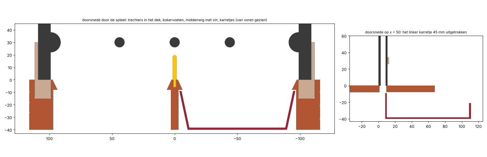

# Controle E-01 Splitsmijn

Automatisch gegenereerd door `cad/controle.py`: het eindmodel (v1.0) en de pasproef (v0.1). Maten in mm. ✅ = in orde, ⚠️ = bekijken.

## 1. Muntdoorgang

Het valbord (in beide modellen hetzelfde):

- ✅ Kleinste opening tussen twee pinnen of een pin en de wand: 29,0 mm, voor een muntje van 25 mm.
- ✅ Plekken waar een muntje op twee steunpunten kan blijven liggen (ook met wrijving 0,3 meegerekend): geen.
- ✅ Boven de vlakke kantelplank is er nog 4 mm tot het plafond: een muntje rolt er vrij over. De verdeler staat recht onder de middelste pin van de onderste rij (tussenruimte kleiner dan een muntje): een muntje valt er altijd naast.

Eindmodel, van de spleet tot in de karretjes:

- ✅ De sleuf in het dek (y 1,2 tot 9,6) is ruimer dan de spleet (2,4 tot 8,4).
- ✅ De trechters staan 64° (buitenkant) en 65° (middenwig) steil: een muntje glijdt eraf, ook bij wrijving 0,5 (dat is 27°).
- ✅ Onderaan lopen de trechters van x = 6,2 tot 93,6, binnen de bovenrand van een karretje (5,4 tot 94,6).
- ✅ Tussen de bovenrand van een karretje en het dek is 1,0 mm: daar past geen muntje (4,5 mm) tussen.
- ✅ Een karretje houdt 263 cm³; 10 muntjes zijn 22 cm³. Er liggen er 9 plat naast elkaar op de bodem.

## 2. Valsimulatie

Het valbord nagebouwd in een 2D-fysicamodel (pymunk, zie `cad/simulatie.py`). Een ronde zoals in de klas: één duw tegen de slinger, dan 8 muntjes met 0,8 tot 2 seconden ertussen, steeds gemikt op dezelfde plek. Doorgerekend voor 12 combinaties van stuit, wrijving en demping, en twee waarden voor de wrijving van het mes. Het eindmodel met de houweel (massa uit de geometrie) en de trechters van de mijnberg, tot het muntje onder de bovenrand van een karretje is.

| | Eindmodel | Pasproef |
|---|---|---|
| Kans op links, elke combinatie en elk mikpunt | ✅ 0,36 tot 0,64 | ✅ 0,33 tot 0,64 |
| Gemiddeld, mikken links / midden / rechts | ✅ 0,49 / 0,48 / 0,48 | ✅ 0,51 / 0,47 / 0,48 |
| Mikeffect (links min rechts mikken) per stuit | ✅ 0,3: +0,06, 0,5: +0,02, 0,7: -0,04 | ✅ 0,3: +0,04, 0,5: +0,02, 0,7: +0,03 |
| Muntjes die bleven hangen | ✅ 0 van 4608 | ✅ 0 van 4608 |
| Uitslag van de slinger bij het laatste muntje (mediaan) | 29° (minstens 17°) | 29° (minstens 16°) |

Met 64 muntjes per vakje is ±0,15 op de kans gewoon toeval. Zonder slinger is het mikeffect 0,3 tot 0,9: het muntje rolt groot naast de pinnen in een vaste baan, en dan beslist het mikpunt. De kantelplank op de slinger maakt het eerlijk.

Hoe vaak elke splitsing van 8 voorkomt (links + rechts), naast een eerlijk muntstuk:

| Splitsing | 0+8 | 1+7 | 2+6 | 3+5 | 4+4 | 5+3 | 6+2 | 7+1 | 8+0 |
|---|---|---|---|---|---|---|---|---|---|
| Eindmodel | 1 % | 2 % | 13 % | 20 % | 25 % | 22 % | 12 % | 3 % | 1 % |
| Pasproef | 0 % | 3 % | 14 % | 24 % | 25 % | 19 % | 10 % | 4 % | 1 % |
| Binomiaal | 0 % | 3 % | 11 % | 22 % | 27 % | 22 % | 11 % | 3 % | 0 % |

- ✅ Eindmodel: gemiddeld 4,03 muntjes links, spreiding (variantie) 2,21; een eerlijk muntstuk geeft 4 en 2. Eén vakje wijkt bij 600 rondes gemakkelijk een paar procent af; de spreiding zegt of de splitsingen echt willekeurig zijn (te klein: de muntjes wisselen elkaar af, te groot: ze volgen elkaar).
- ✅ Pasproef: gemiddeld 3,97 muntjes links, spreiding (variantie) 2,20; een eerlijk muntstuk geeft 4 en 2. Eén vakje wijkt bij 600 rondes gemakkelijk een paar procent af; de spreiding zegt of de splitsingen echt willekeurig zijn (te klein: de muntjes wisselen elkaar af, te groot: ze volgen elkaar).

## 3. Slinger

| | Eindmodel (houweel) | Pasproef |
|---|---|---|
| Massa, zwaartepunt onder het mes | 44 g, 115 mm | 42 g, 128 mm |
| Slingertijd | 0,77 s | 0,77 s |
| Zwaartepunt van wat draait, boven het mes | ✅ y = 21,7 (mes 19,9 tot 25,9) | ✅ y = 17,9 (mes 16,9 tot 22,9) |
| Draaien voor de flanken van het mes de groef raken | ✅ 45° | ✅ 45° |
| Uitslag om de 5 s na een duw van 35°, mes als pen met wrijving 0,02 | 35°, 34°, 33°, 33°, 32°, 31° | 35°, 34°, 34°, 33°, 32°, 31° |
| Uitslag om de 5 s na een duw van 35°, mes als pen met wrijving 0,06 | 35°, 33°, 31°, 30°, 28°, 26° | 35°, 33°, 32°, 30°, 28°, 27° |

De slinger slaat hooguit 35° uit. Een gewone geprinte pen (wrijvingsgetal 0,2 tot 0,4) valt na 10 tot 20 seconden stil: daarom het mes.

## 4. Spelingen en botsingen over de hele uitslag (±35°)

**Eindmodel**: ✅ botsingen: geen; ✅ het mes rust op de bodem van de groef (0,00 mm).

| Bewegend - vast | Kleinste speling | Bij hoek |
|---|---|---|
| plank - voorplaat | ✅ 0,50 | -35° |
| plank - achterplaat | ✅ 0,50 | -35° |
| steel - beugel | ✅ 0,50 | -35° |
| plank - beugel | ✅ 0,80 | -35° |
| steel - mijnhout | ✅ 1,90 | -35° |
| kop - mijnhout | ✅ 1,90 | -35° |
| steel - voorplaat | ✅ 3,50 | -35° |
| kop - voorplaat | ✅ 3,50 | -35° |
| steel - achterplaat | ✅ 4,40 | -35° |
| kop - achterplaat | ✅ 4,40 | -35° |

**Pasproef**: ✅ botsingen: geen; ✅ het mes rust op de bodem van de groef (0,00 mm).

| Bewegend - vast | Kleinste speling | Bij hoek |
|---|---|---|
| plank - voorplaat | ✅ 0,50 | -35° |
| plank - achterplaat | ✅ 0,50 | -35° |
| slinger - voorplaat | ✅ 0,50 | -35° |
| slinger - beugel | ✅ 0,50 | -35° |
| plank - beugel | ✅ 0,80 | -35° |
| slinger - achterplaat | ✅ 1,40 | -35° |
| slinger - voet | ✅ 3,60 | -5° |
| mesblok - voorplaat | ✅ 5,50 | -35° |

## 5. Verbindingen

Er zijn geen klikhaakjes: alles klemt of schuift. Speling per kant in het CAD, gemeten tussen de onderdelen in de montagestand. Hoe strak het geprint wordt, hangt af van de printer: een staand gat komt meestal 0,1 tot 0,2 mm kleiner in diameter uit. Print daarom eerst plaat 1 (de passtrip) en zet de gekozen maten in `cad/params.py`.

**Eindmodel**

| Verbinding | Speling per kant | Bedoeld | Kies met |
|---|---|---|---|
| nokje Ø 3.0 in de voorplaat (26 stuks tegelijk) | 0,10 mm | licht klemmen | `NOK_GAT` |
| pennetjes Ø 3 van de steel in het mesblok | 0,05 mm | klemmen | `MES_GAT` |
| pennen Ø 4 van de voorplaat in de beugel (liggend druppelgat) | 0,05 mm | klemmen | `BEUGEL_GAT` |
| zeskant van de plank in de steel | 0,10 mm | schuiven zonder wiebelen | `ZESKANT_SPEL` |
| naaf van de plank in het gat van de voorplaat | 1,00 mm | vrij | `NAAF_R` |
| pennetjes Ø 3 van de steel in de houweelkop | 0,05 mm | klemmen | `MES_GAT` |
| steel in de gleuf van de houweelkop | 0,15 mm | schuiven |  |
| zijranden en mijnhout in de kokervoeten | 0,30 mm | schuiven | `SPEL` |
| prop van de kokervoet in het dek | 0,10 mm | licht klemmen | `KOKER_SPEL` |
| nokjes van het mijnhout in de voorplaat | 0,20 mm | vrij (houden het raamwerk op zijn plaats) |  |
| tong van de verdelervin in de wig | 0,10 mm | klemmen | `VIN_SLEUF` |
| verdelervin in de spleet | 0,60 mm | vrij |  |
| bovenrand van het bord en het mijnhout in de kokerkappen | 0,30 mm | schuiven | `SPEL` |
| tong van het portaal in de kokerkappen | 0,30 mm | schuiven | `SPEL` |
| karretjes in de tunnels | 0,80 mm | schuiven | `KAR_SPEL` |
| bovenrand van de karretjes onder het dek | 1,00 mm | vrij (kleiner dan een muntje) | `KAR_RAND_ONDER_DEK` |

**Pasproef**

| Verbinding | Speling per kant | Bedoeld | Kies met |
|---|---|---|---|
| nokje Ø 3.0 in de voorplaat (26 stuks tegelijk) | 0,10 mm | licht klemmen | `NOK_GAT` |
| pennetjes Ø 3 van de arm in het mesblok | 0,05 mm | klemmen | `MES_GAT` |
| pennen Ø 4 van de voorplaat in de beugel (liggend druppelgat) | 0,05 mm | klemmen | `BEUGEL_GAT` |
| zeskant van de plank in de arm | 0,10 mm | schuiven zonder wiebelen | `ZESKANT_SPEL` |
| naaf van de plank in het gat van de voorplaat | 1,00 mm | vrij | `NAAF_R` |
| zijranden in de kokers van de voet | 0,30 mm | schuiven | `SPEL` |
| vin van de verdeler in de spleet | 0,60 mm | vrij |  |

## 6. Stabiliteit (eindmodel)

- Alles samen ongeveer 670 g (geschat, met 10 muntjes). Het zwaartepunt ligt 112 mm boven de tafel, op y = 9,2; de voet loopt van y = -40 tot 66.
- ✅ Wie de houweelkop naar achteren duwt, moet 4,4 N (~449 g) duwen voor het bord kantelt; naar voren 5,0 N, opzij 10,3 N. Een duw om te slingeren gaat opzij, en de slinger zwaait dan weg.
- ✅ Het bord staat met 0,30 mm speling per kant 30 mm diep in de kokervoeten: het kan 1,1° naar voren of achteren wiebelen, bovenaan 5,9 mm. Recht laten staan hoeft niet: het valt vanzelf terug.

## 7. Printbaarheid (Bambu Lab A1, 0,4 mm nozzle, 0,2 mm laag)

**Eindmodel** (`print/splitsmijn.3mf`)

| Plaat | Kleuren | Maat | Past | Overhang > 48° | Platte plafonds (bruggen) | Te smal | Kleurwissels | Gewicht (schatting) | Slicer: gewicht | Slicer: tijd | Slicer: support |
|---|---|---|---|---|---|---|---|---|---|---|---|
| 1 passtrip | Charcoal | 119 × 40 × 11 | ✅ | ✅ 0 mm² | 0 mm² | ✅ geen | 0 | ~9 g | 11,2 g | 31m 20s | ✅ 0,0 g |
| 2 achterplaat | Charcoal | 218 × 230 × 10 | ✅ | ✅ 0 mm² | 0 mm² | ✅ geen | 0 | ~128 g | 138,4 g | 3h 37m | ✅ 0,0 g |
| 3 voorplaat | Charcoal | 218 × 230 × 16 | ✅ | ✅ 0 mm² | 0 mm² | ✅ geen | 0 | ~98 g | 106,9 g | 3h 10m | ✅ 0,0 g |
| 4 mijnhout | Latte Brown | 218 × 230 × 2 | ✅ | ✅ 0 mm² | 0 mm² | ✅ geen | 0 | ~32 g | 33,3 g | 1h 6m | ✅ 0,0 g |
| 5 mijnberg en tienveld | Terracotta | 232 × 209 × 40 | ✅ | ✅ 0 mm² | 474 mm² | ✅ geen | 0 | ~187 g | 195,4 g | 5h 41m | ✅ 0,0 g |
| 6 portaal, steel, beugel, mesblok, kokervoeten en -kappen | Latte Brown + Charcoal | 226 × 236 × 44 | ✅ | ✅ 0 mm² | 0 mm² | ✅ geen | 4 | ~67 g | 71,9 g | 2h 6m | ✅ 0,0 g |
| 7 houweelkop, plank, verdelervin | Sunflower Yellow | 90 × 80 × 20 | ✅ | ✅ 0 mm² | 74 mm² | ✅ geen | 0 | ~32 g | 33,1 g | 47m 31s | ✅ 0,4 g |
| 8 karretjes | Maroon Red | 198 × 105 × 31 | ✅ | ✅ 0 mm² | 0 mm² | ✅ geen | 0 | ~76 g | 77,8 g | 1h 25m | ✅ 0,0 g |
| 9 munten | Sunflower Yellow + Marine Blue | 145 × 55 × 4 | ✅ | ✅ 0 mm² | 0 mm² | ✅ geen | 1 | ~15 g | 16,5 g | 35m 41s | ✅ 0,0 g |

Samen ~644 g geschat uit de doorsneden (met de wanden en de infill uit het project). De slicer komt op 684 g en 19 u 03 printtijd.

- *Slicer*: PrusaSlicer met een profiel dat de A1 benadert (`cad/slice.py`), elk object met zijn eigen wanden en infill uit het project, in één kleur: de spoeling van de AMS bij een kleurwissel (plaat 6 en 9) komt erbij. Het gewicht is betrouwbaar, de tijd een indicatie. *Support* is wat PrusaSlicer met automatische support (drempel 30°) zou bijzetten; het project zelf print zonder support.
- Plaat 7: PrusaSlicer zet een paar steuntjes onder het plafond van de gleuf in de houweelkop, rond de twee gaatjes. Zonder support print het dat als brug (5,6 mm breed), en de gaatjes worden in twee stappen overbrugd: eerst een strook, dan een vierkant.
- *Platte plafonds*: de bodem van de uitsparingen voor de kokervoeten en de sleuf voor de vin in de mijnberg (die ondersteboven ligt), de gleuf voor de steel in de houweelkop. Ze zijn hoogstens 13 mm breed en aan twee kanten vast: de printer overbrugt ze. Korte bruggen (< 3 mm) tellen niet mee.
- *Te smal*: kleiner dan 1,5 mm² per laag telt niet (de onderste laag van een schuine rand); de slicer laat dat weg.
- *Kleurwissels*: geteld laag per laag. Op plaat 6 liggen de letters in de bovenste lagen van het portaal, en de andere delen op die plaat zijn hoger: een paar lagen met twee kleuren. De munten wisselen één keer, halverwege.

**Pasproef** (`pasproef/pasproef.3mf`)

| Plaat | Kleur | Maat | Past | Overhang > 48° (mm²) | Te smal (< 0,4 mm) |
|---|---|---|---|---|---|
| 1 passtrip | Charcoal | 119 × 40 × 11 | ✅ | ✅ 0 | ✅ geen |
| 2 achterplaat | Charcoal | 218 × 230 × 10 | ✅ | ✅ 0 | ✅ geen |
| 3 voorplaat | Charcoal | 218 × 230 × 14 | ✅ | ✅ 0 | ✅ geen |
| 4 voet en beugel | Latte Brown | 226 × 106 × 52 | ✅ | ✅ 0 | ✅ geen |
| 5 slinger, mesblok en plank | Maroon Red | 110 × 184 × 17 | ✅ | ✅ 0 | ✅ geen |
| 6 munten | Marine Blue | 145 × 55 × 4 | ✅ | ✅ 0 | ✅ geen |

Slicer van de pasproef (PrusaSlicer, A1-achtig profiel):

| Plaat | Filament | Tijd (indicatie) | Support nodig |
|---|---|---|---|
| 1 passtrip | 11.7 g | 31m 42s | ✅ nee |
| 2 achterplaat | 137.7 g | 3h 16m 2s | ✅ nee |
| 3 voorplaat | 108.5 g | 3h 1m 52s | ✅ nee |
| 4 voet en beugel | 74.2 g | 1h 36m 21s | ✅ nee |
| 5 slinger, mesblok en plank | 46.1 g | 54m 13s | ✅ nee |
| 6 munten | 16.5 g | 32m 29s | ✅ nee |

## 8. Montage (eindmodel)

Elk onderdeel schuift in de volgorde van de README van ver weg langs zijn richting tot op zijn plaats, in stapjes van 0,25 mm, en mag onderweg niets raken van wat er al staat (overlap > 0,01 mm³; klemmen en aanraken mag). Elk pad begint met het onderdeel helemaal los. Zie `cad/montage.py`.

| Stap | Wat | Richting | Afstand | Tegen | Pad |
|---|---|---|---|---|---|
| 2 | kantelplank op de achterplaat | −y (erop / naar achteren) | 15 mm | achterplaat | ✅ vrij |
| 3 | voorplaat erop: 26 nokjes in hun gaatjes, de naaf door het ronde gat | −y (erop / naar achteren) | 25 mm | achterplaat, plank | ✅ vrij |
| 4 | mijnhout op de voorplaat, nokjes in de gaatjes | −y (erop / naar achteren) | 25 mm | achterplaat, plank, voorplaat | ✅ vrij |
| 5a | mesblok op de pennetjes van de steel | −y (erop / naar achteren) | 15 mm | steel | ✅ vrij |
| 5b | houweelkop op de steel (de gleuf zit achteraan) | −y (erop / naar achteren) | 25 mm | steel, mesblok | ✅ vrij |
| 5c | houweel met het zeskantgat op de zeskant van de plank | −y (erop / naar achteren) | 25 mm | 4 onderdelen | ✅ vrij |
| 6 | beugel op de pennen onder de naaf, het mes glijdt in de groef | −y (erop / naar achteren) | 25 mm | 7 onderdelen | ✅ vrij |
| 7a | verdelervin met haar tong in de sleuf van het dek | −z (omlaag) | 15 mm | mijnberg | ✅ vrij |
| 7b | kokervoet L in zijn uitsparing | −z (omlaag) | 20 mm | mijnberg, verdelervin | ✅ vrij |
| 7c | kokervoet R in zijn uitsparing | −z (omlaag) | 20 mm | mijnberg, verdelervin, kokervoet L | ✅ vrij |
| 7d | karretje L van voren in zijn tunnel | −y (erop / naar achteren) | 120 mm | 4 onderdelen | ✅ vrij |
| 7e | karretje R van voren in zijn tunnel | −y (erop / naar achteren) | 120 mm | 5 onderdelen | ✅ vrij |
| 8 | bord rechtop in de mijnberg: zijranden en mijnhout in de kokervoeten, vin in de spleet | −z (omlaag) | 45 mm | 6 onderdelen | ✅ vrij |
| 9a | kokerkap L over de bovenhoek | −z (omlaag) | 25 mm | 14 onderdelen | ✅ vrij |
| 9b | kokerkap R over de bovenhoek | −z (omlaag) | 25 mm | 15 onderdelen | ✅ vrij |
| 9c | portaal met zijn tongen in de kokerkappen | −z (omlaag) | 50 mm | 16 onderdelen | ✅ vrij |

Stap 6 met de houweel hoger of lager dan zijn plaats op het mes (de naaf heeft 1 mm speling, dus zonder beugel hangt hij waar je hem houdt):

| Houweel | -0,50 mm | -0,25 mm | +0,00 mm | +0,25 mm | +0,50 mm | +1,00 mm |
|---|---|---|---|---|---|---|
| Beugel erop schuiven | ✋ raakt mesblok | ✋ raakt mesblok | ✅ vrij | ✅ vrij | ✅ vrij | ✅ vrij |

- ✅ Het mes glijdt in de groef als de houweel tussen 0,0 en 1,0 mm van zijn plaats hangt. Hangt hij lager, dan haakt het mes achter de groef: til de houweel dus een beetje op.

Uit elkaar (bij het spelen en opbergen), met al de rest op zijn plaats:

| Wat | Richting | Afstand | Pad |
|---|---|---|---|
| karretje L helemaal uittrekken | +y (naar voren) | 120 mm | ✅ vrij |
| karretje R helemaal uittrekken | +y (naar voren) | 120 mm | ✅ vrij |
| portaal eraf tillen | +z (omhoog) | 60 mm | ✅ vrij |
| bord uit de mijnberg tillen (portaal en kokerkappen eraf) | +z (omhoog) | 45 mm | ✅ vrij |

**Inworp**, met alles erop: een muntje rechtop, met de duim vooraan en de wijsvinger achteraan (16 mm breed, 12 mm dik, tot 15 mm boven het muntje). De hand komt van voren, met het muntje 1 mm boven het bord, onder het portaal door tot boven de spleet. Dan zakt ze tot het muntje 6 mm in de trechter zit, en laat los.

- ✅ Van voren onder het portaal door: ✅ vrij. Tussen de vingers en de dwarsbalk: 4,0 mm.
- ✅ Laten zakken in de trechter: ✅ vrij.
- ✅ Daarna valt het muntje alleen tot op de kantelplank: ✅ vrij.
