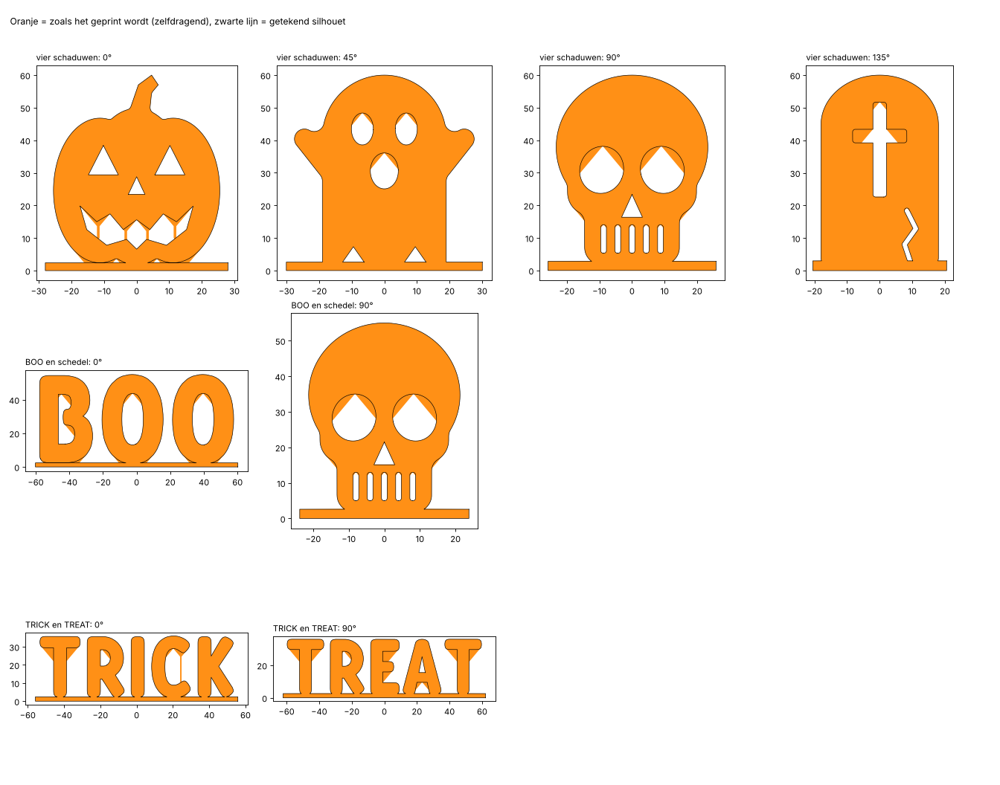

# H-01 Schaduwspook (v0.1)

*English: [README.en.md](README.en.md)*

Eén beeldje, vier schaduwen. Zet het op tafel, schijn er in het donker met de zaklamp van je gsm op, en op de
muur verschijnt een **pompoen**. Draai het een achtste slag: een **spookje**. Nog een achtste: een
**schedel**. Nog een: een **grafsteen**. Het beeldje zelf lijkt op geen van de vier.


> **Status:** CAD, STL's, het Bambu Studio-project en de controle zijn klaar. Er is **nog niets echt
> geprint**, en de schaduw is nog niet met een echte zaklamp getest. De beelden hierboven zijn renders met een
> gesimuleerde puntlamp.
>
> Het 3MF-project is gecontroleerd tegen de regels van het Bambu-formaat (`gereedschap/bambu/valideer.py` in
> de root van de repo). Het is hier niet in Bambu Studio zelf geopend: dat programma draait niet in deze
> omgeving.

| | |
|---|---|
| Varianten | **vier schaduwen**: pompoen, spook, schedel en grafsteen, om de 45° · **BOO en schedel** en **TRICK en TREAT**: twee schaduwen, om de 90° |
| Maat | vier schaduwen 56 × 52 × 60 mm · BOO 120 × 48 × 55 mm · TRICK 112 × 124 × 36 mm. Alles past op de A1 mini |
| Filament | ongeveer 24 g · 63 g · 102 g (geschat) |
| Nodig | een zaklamp (die van je gsm) en een lichte muur. Geen support, schroeven of lijm |

## Hoe het werkt

- Elke schaduw is een **silhouet**. Dat silhouet wordt uitgetrokken in de richting waarin het licht erop
  schijnt, als een koekjesvorm door een blok deeg. Het beeldje is het stuk dat in **alle** uitgetrokken
  silhouetten tegelijk zit.
- Schijnt het licht in de richting van één silhouet, dan zie je precies dat silhouet. Van elk stukje erin zit
  er wel ergens iets in de weg, en naast de rand is er nergens iets.
- **Twee schaduwen** onder 90° passen altijd precies op elkaar.
- **Vier schaduwen** onder 45° passen alleen als geen enkele vorm te breed is voor de schuine richtingen.
  - De pompoen is daarom 15 % smaller getekend.
  - Wat er toch wegvalt, is hooguit 2 %: een randje bovenaan het spook en de grafsteen.
  - Per schaduw staat het in [controle/RAPPORT.md](controle/RAPPORT.md).
- **Zonder support printen**: elk silhouet wordt eerst zelfdragend gemaakt (zie het rapport voor elke
  aanpassing). Dat zie je een beetje in de schaduw:
  - gaten (ogen, mond, tanden) krijgen een spitse bovenkant, zoals een gotische boog;
  - onder een overhang komt een wig van 40°;
  - wat boven een gat hangt, krijgt een dun pilaartje tot de bodem (de tanden van de schedel).
- Alle silhouetten staan op een **voetbalk**. Daardoor is het beeldje één stuk, en staat het stevig.



## De schaduw maken

1. Maak de kamer donker. De muur moet licht zijn.
2. Zet het beeldje **10 tot 30 cm voor de muur**.
3. Leg je gsm met de zaklamp aan **plat op tafel, 40 tot 60 cm voor het beeldje**. Richt het licht recht op
   het beeldje.
   - Hoe verder de lamp, hoe scherper de schaduw.
   - Een gewone lamp of een grote zaklamp geeft een vage schaduw: het licht moet uit één klein puntje komen.
4. Draai het beeldje **om de 45°** (vier schaduwen) of **om de 90°** (BOO, TRICK).
   - Zet je het een halve slag verder, dan komt dezelfde reeks terug, maar gespiegeld.
5. **Voor een video**: zet het beeldje op een draaiplateau of een draaiende taartplaat. Dan verandert de
   schaduw vanzelf van vorm.

## Printen

Open `print/schaduwspook.3mf` in Bambu Studio. Er is één plaat per variant:

| Plaat | Variant | Kleur in het project | Filament (geschat) |
|---|---|---|---|
| 1 | vier schaduwen | Pumpkin Orange 10301 | ~24 g |
| 2 | BOO en schedel | Charcoal 11101 | ~63 g |
| 3 | TRICK en TREAT | Pumpkin Orange 10301 | ~102 g |

- **Instellingen**: *0.20mm Standard @BBL A1* op de *Textured PEI Plate*, 0,4 mm nozzle. **Geen support,
  geen brim.** Het project zet per beeldje 3 wanden en gyroid-infill.
- Het beeldje **staat rechtop**, met de voetbalk op het bed.
- **Kleur maakt niet uit**: de schaduw is altijd zwart. Oranje of zwart staat overdag het best.

| Bestand | Maat (mm) |
|---|---|
| `print/schaduwspook_vier-schaduwen.stl` | 56 × 52 × 60 |
| `print/schaduwspook_boo-schedel.stl` | 120 × 48 × 55 |
| `print/schaduwspook_trick-treat.stl` | 112 × 124 × 36 |

## Zelf een beeldje maken

```
cd cad
python bouw.py eigen smal:EMMA schedel 40         # je naam van voren, een schedel opzij, 40 mm hoog
python bouw.py eigen kat spook pompoen*0.85 schedel 60
```

- Geef 2 tot 4 vormen. Ze komen gelijk verdeeld over een halve draai: 2 om de 90°, 3 om de 60°, 4 om de 45°.
- **Vormen**: `schedel`, `spook`, `pompoen`, `kat`, `grafsteen`, `tekst:WOORD`, of `smal:WOORD` (versmalde
  letters, voor langere woorden).
  - `*0.85` achter een vorm maakt hem smaller.
  - Een getal op het eind is de hoogte in mm (standaard 55). Een woord van 4 letters op 40 mm is al 130 mm
    breed.
- Het script zegt per schaduw hoeveel er wegvalt.
  - Woorden zijn breed: die werken het best met twee vormen.
  - Bij vier vormen moeten ze ongeveer even breed zijn.
- De STL komt in `print/eigen_<vormen>.stl`.

Een nieuwe vorm tekenen gaat in `cad/silhouetten.py`: een functie die een shapely-vorm teruggeeft (onderkant
op y = 0), en een regel in `VORMEN`.

## Controle

Zie [controle/RAPPORT.md](controle/RAPPORT.md). Kort:

- **Schaduw**: rij per rij (0,2 mm) nagemeten in elke kijkrichting. Bij twee schaduwen ontbreekt er niets. Bij
  vier schaduwen ontbreekt er hooguit 2 %.
- **Printbaarheid**: elk beeldje is één stuk en waterdicht, ook als STL. Er is geen overhang steiler dan 48° en
  geen detail smaller dan de nozzle.

## Mappen

```
print/        schaduwspook.3mf (3 platen) en een STL per variant
cad/          de bron: params.py (varianten en maten), silhouetten.py (de tekeningen), schaduw.py (de
              doorsnede en het zelfdragend maken), beeldje.py, bouw.py, controle.py, render.py
controle/     RAPPORT.md, controle.json, silhouetten.png
renders/      Blender-renders met een puntlamp en een muur
onderdelen.json   volume, maat en schaduwcontrole per STL
```

```
cd cad
python bouw.py            # print/
python controle.py        # controle/
python render.py alle     # renders/ (vereist de pip-module bpy)
```

## MakerWorld

- **Eigen ontwerp**: de vormen zijn eigen tekeningen, er zit geen personage van iemand anders in.
- Maak de hoofdfoto en de video met de **echte print en een echte schaduw**. MakerWorld laat geen
  AI-beelden toe als modelfoto, en een echte schaduw op de muur overtuigt meer dan een render.
