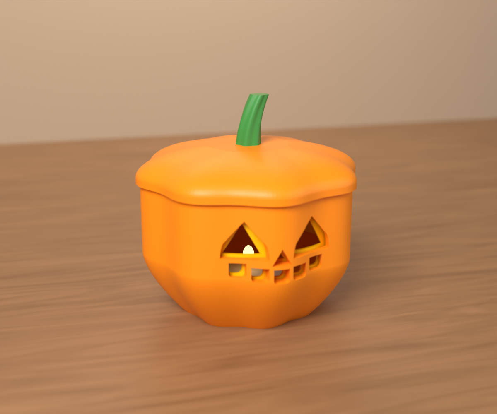
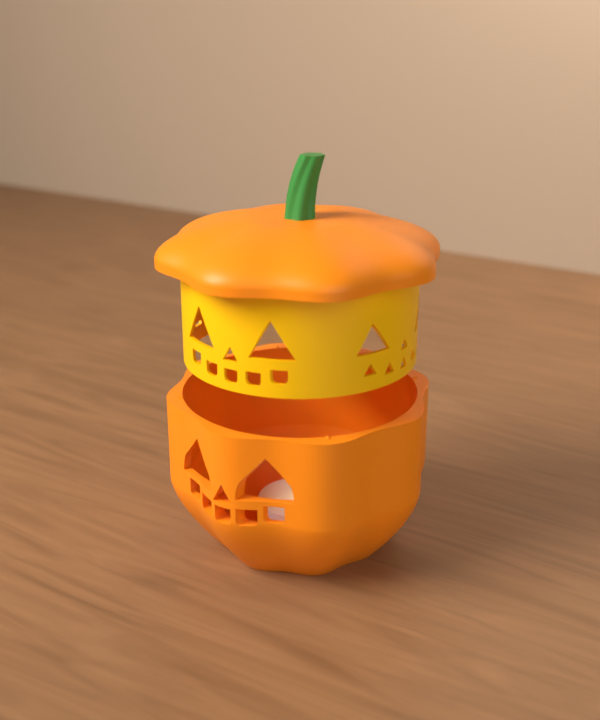
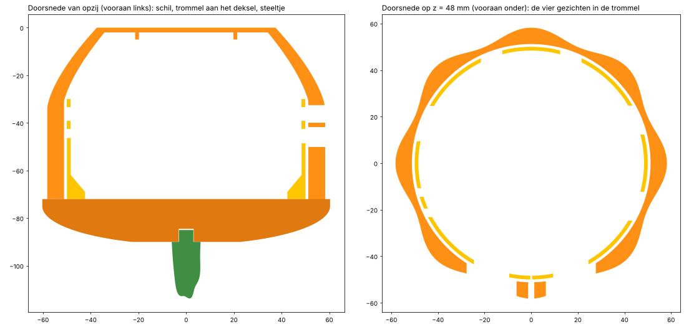

# H-02 Moodkin (v0.1)

*English: [README.en.md](README.en.md)*

Een pompoenlantaarn met vier humeuren. Draai aan het steeltje: *klik*, en de pompoen kijkt **blij**, **boos**,
**bang** of geeft je een **knipoog**. Zet er een LED-theelichtje in en alleen het gezicht dat vooraan staat, licht
op.


> **Status:** CAD, STL's, het Bambu Studio-project en de controle zijn klaar. Er is **nog niets echt
> geprint**: de klik, de pennetjes en hoe fel het licht door de gaten komt, zijn nog niet getest. De beelden
> zijn renders.
>
> Het 3MF-project is gecontroleerd tegen de regels van het Bambu-formaat (`gereedschap/bambu/valideer.py` in
> de root van de repo). Het is hier niet in Bambu Studio zelf geopend: dat programma draait niet in deze
> omgeving.

> ⚠️ **Alleen een LED-theelichtje (Ø 38 mm), nooit een echte kaars.** PLA wordt zacht vanaf ongeveer 55 °C:
> een kaars doet de pompoen smelten en kan brand veroorzaken.

| | |
|---|---|
| Gezichten | blij, boos, bang, knipoog: om de 90°, met een klik |
| Maat | Ø 121 mm (deksel), 116 mm hoog met het steeltje. Alles past op de A1 mini |
| Filament | ongeveer 166 g: schil 85 g en deksel 48 g oranje, trommel 31 g geel, steeltje 2 g groen (geschat) |
| Nodig | één LED-theelichtje (Ø 38 mm, tot 45 mm hoog). Geen support, schroeven, lijm of AMS |

## Hoe het werkt

- De **schil** heeft één vast gesneden gezicht: twee spitse oogkassen, een driehoekige neuskas en een grijns
  van vijf tandkolommen.
- Daarachter draait een gele **trommel** met vier gezichten, om de 90°. Door de kassen zie je het gele
  "vruchtvlees" met de gaten van één gezicht erin.
  - Overdag zie je het gezicht in het geel.
  - 's Nachts komt het licht alleen door de gaten van het gezicht vooraan. De andere drie zitten achter de
    dichte wand van de schil (de controle rekent na dat je ze ook schuin niet ziet).
- De trommel **hangt onder het deksel**: vier pennetjes klemmen in vier gaatjes.
- Het deksel ligt op de rand van de schil. Daar staan **vier nokjes**, en onder het deksel zitten vier gleufjes.
  - Draai je het deksel, dan tilt het op de nokjes 0,8 mm op.
  - Na een kwartslag valt het met een **klik** terug: het volgende gezicht staat vooraan.
- Het deksel heeft dezelfde ribben als de schil. Een klik is precies twee ribben, dus de ribben liggen in elke
  stand op elkaar.



## In elkaar zetten

1. Druk de **trommel** met zijn vier pennetjes in de gaatjes onder het **deksel**. Het kan op vier manieren,
   elke manier is goed.
2. Steek het **steeltje** met zijn vierkant pennetje in het deksel.
3. Zet het **LED-theelichtje** aan en leg het in het ringetje op de bodem van de schil.
4. Laat deksel en trommel in de schil zakken en draai tot het klikt.

Draai je met de klok mee (van bovenaf gezien), dan komen de gezichten in de volgorde blij, boos, bang,
knipoog.



## Printen

Open `print/moodkin.3mf` in Bambu Studio. Elk onderdeel heeft zijn eigen plaat, in één kleur:

| Plaat | Onderdeel | Kleur in het project | Filament (geschat) | Ligt op het bed |
|---|---|---|---|---|
| 1 | schil | Pumpkin Orange 10301 | ~85 g | rechtop |
| 2 | trommel met de vier gezichten | Sunflower Yellow 10402 | ~31 g | rechtop, pennetjes boven |
| 3 | deksel | Pumpkin Orange 10301 | ~48 g | met de vlakke onderkant op het bed |
| 4 | steeltje | Mistletoe Green 10502 | ~2 g | op zijn kop, met een brim |

- **Instellingen**: *0.20mm Standard @BBL A1* op de *Textured PEI Plate*, 0,4 mm nozzle. **Geen support.**
- Het project zet per onderdeel het aantal wanden:
  - de trommel 4, zodat zijn wand van 1,6 mm helemaal massief is (geen licht door de infill);
  - schil, deksel en steeltje 3.
- **Zonder support**: alle gaten zijn zo getekend dat ze rechtop printen.
  - Ogen en neus hebben een spitse bovenkant.
  - De tandkolommen en de ogen van "bang" hebben een plat plafond van hoogstens 12 mm. Dat overbrugt de
    printer.
- **Kleur**: de trommel mag een andere kleur hebben. Lichter (geel, wit) toont het gezicht overdag het best.
  Donkerder geeft 's nachts meer contrast.

| Bestand | Maat (mm) |
|---|---|
| `print/moodkin_schil.stl` | 116 × 116 × 73 |
| `print/moodkin_trommel.stl` | 100 × 100 × 46 |
| `print/moodkin_deksel.stl` | 121 × 121 × 18 |
| `print/moodkin_steel.stl` | 18 × 13 × 31 |

## Zelf aanpassen

- **Gezichten**: `cad/gezichten.py`. Een gezicht is een tekening in het vlak (u = breedte, v = hoogte), zoals je
  het van voren ziet. Het moet binnen de kassen van de schil blijven; de controle zegt of dat zo is.
- **Maten**: `cad/params.py` (schil, trommel, speling, klik, LED-ringetje).

```
cd cad
python bouw.py            # print/
python controle.py        # controle/
python render.py alle     # renders/ (vereist de pip-module bpy)
```

## Controle

Zie [controle/RAPPORT.md](controle/RAPPORT.md). Kort:

- **Gezichten**: elk gezicht valt helemaal binnen de kassen, met 0,6 mm marge. Het dunste stukje wand tussen
  twee gaten is 3,3 mm in de trommel en 1,5 mm in de schil.
- **Licht**: door de kassen zie je de trommel tot hoogstens 41° opzij. Het dichtste gat van een ander gezicht
  zit op 59°.
- **Passen**:
  - minstens 1 mm speling tussen trommel en schil;
  - geen enkele overlap in 3D, in elke stand en halverwege een klik;
  - 0,1 mm per kant voor de pennetjes en 0,15 mm voor het steeltje.
- **Printbaarheid**: elk onderdeel is één stuk en waterdicht. Er is geen overhang steiler dan 48° en geen
  detail smaller dan de nozzle.



## Mappen

```
print/        moodkin.3mf (4 platen) en een STL per onderdeel
cad/          de bron: params.py (maten), gezichten.py (kassen en gezichten), lantaarn.py (de onderdelen),
              bouw.py, controle.py, render.py
controle/     RAPPORT.md, controle.json, gezichten.png, doorsnede.png
renders/      Blender-renders: nacht_<gezicht>.png, gezichten.png, dag.png, open.png
onderdelen.json   volume en maat per STL
```

## MakerWorld

- **Eigen ontwerp**: de gezichten en het mechanisme zijn eigen tekeningen.
- Het sterkste beeld is een **video in het donker**: een hand draait aan het steeltje, *klik*, en het gezicht
  verandert. Film dat met de echte print; MakerWorld laat geen AI-beelden toe als modelfoto.
