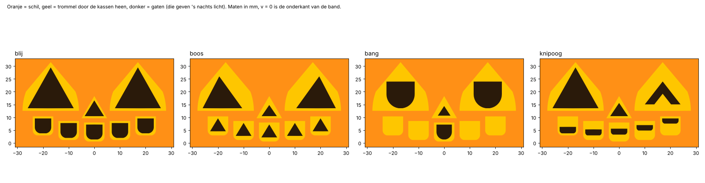

# Controle H-02 Moodkin

Automatisch gegenereerd door `cad/controle.py`. Maten in mm. ✅ = in orde, ⚠️ = bekijken.

## 1. Gezichten

De schil heeft vaste kassen (871 mm²); de gezichten zijn gaten in de trommel daarachter. Elk gat moet minstens 0,6 mm binnen de rand van de kassen blijven. *Dichtgemaakt* is wat het zelfdragend maken van de getekende gaten afhaalt (een randje van één rij hoog bovenaan en onderaan), *bijgemaakt* wat het toevoegt.

| Gezicht | Binnen de kassen | Dichtgemaakt | Bijgemaakt | Dunste stuk tussen twee gaten |
|---|---|---|---|---|
| blij | ✅ 0,00 mm² erbuiten | 3,7 mm² | 0,0 mm² | ✅ 3,26 |
| boos | ✅ 0,00 mm² erbuiten | 2,8 mm² | 0,0 mm² | ✅ 3,30 |
| bang | ✅ 0,00 mm² erbuiten | 1,7 mm² | 0,0 mm² | ✅ 3,50 |
| knipoog | ✅ 0,00 mm² erbuiten | 4,3 mm² | 0,0 mm² | ✅ 3,60 |

- Kassen in de schil: het zelfdragend maken verandert nog 0,55 mm² ✅ (randjes van één rij). Dunste tand tussen twee kassen: 1,51 mm ✅.

## 2. Licht

- Door de kassen zie je de trommel tot hoogstens 41,0° naast vooraan, ook als je er schuin (80°) door kijkt.
- Het dichtste gat van een ander gezicht zit op 58,7°. ✅ Marge 17,7°: je ziet altijd maar één gezicht.

## 3. Passen

- Speling trommel-schil: minstens 0,99 mm rondom over de hele hoogte ✅. Deksel met trommel komt er recht uit (1,2 mm speling bij de rand).
- Pennetjes trommel-deksel: 0,10 mm per kant (klemt met duimdruk). Steeltje: 0,15 mm per kant, vierkant.
- Nokje 0,8 hoog en 1,6 breed in een gleufje van 1,2 diep en 3,0 breed ✅: in elke stand ligt het deksel plat op de rand; tussen twee standen tilt het 0,8 mm op en valt het met een klik terug.
- LED-theelichtje Ø 38 in een ringetje van Ø 39,6 (0,80 mm per kant); 70 mm vrij boven de vloer ✅ (de hoogste LED-lichtjes zijn ~45 mm).

Overlap in 3D (mm³, moet 0 zijn):

| Stand | Opgetild | Trommel-schil | Deksel-schil | Trommel-deksel | Steeltje-deksel |
|---|---|---|---|---|---|
| 0,0 | 0,0 | ✅ 0,00 | ✅ 0,00 | ✅ 0,00 | ✅ 0,00 |
| 0,5 | 0,8 | ✅ 0,00 | ✅ 0,00 | ✅ 0,00 | ✅ 0,00 |
| 1,0 | 0,0 | ✅ 0,00 | ✅ 0,00 | ✅ 0,00 | ✅ 0,00 |
| 1,5 | 0,8 | ✅ 0,00 | ✅ 0,00 | ✅ 0,00 | ✅ 0,00 |
| 2,0 | 0,0 | ✅ 0,00 | ✅ 0,00 | ✅ 0,00 | ✅ 0,00 |
| 3,0 | 0,0 | ✅ 0,00 | ✅ 0,00 | ✅ 0,00 | ✅ 0,00 |

*Stand 0,5*: halverwege een klik, het deksel ligt op de nokjes.

## 4. Printbaarheid (Bambu Lab A1, 0,4 mm nozzle, 0,2 mm laag)

| Onderdeel | Maat | Eén stuk, waterdicht | A1 / A1 mini | Overhang > 48° | Vlakke plafonds (bruggen) | Te smal | Gewicht (schatting) |
|---|---|---|---|---|---|---|---|
| schil | 116 × 116 × 73 | ✅ 1 stuk | ✅ / ✅ | ✅ 0 mm² | 138 mm² | ✅ geen | ~79 g |
| trommel met de vier gezichten | 100 × 100 × 46 | ✅ 1 stuk | ✅ / ✅ | ✅ 0 mm² | 0 mm² | ✅ geen | ~30 g |
| deksel | 121 × 121 × 18 | ✅ 1 stuk | ✅ / ✅ | ✅ 0 mm² | 0 mm² | ✅ geen | ~35 g |
| steeltje | 18 × 13 × 31 | ✅ 1 stuk | ✅ / ✅ | ✅ 0 mm² | 0 mm² | ✅ geen | ~2 g |

*Vlakke plafonds*: de bovenkant van de tandkolommen in de schil. Die zijn 8 mm breed; de printer overbrugt ze van de ene tand naar de andere. De platte gaten in de trommel (tandgaten, de ogen van 'bang', hoogstens 12 mm breed) zijn even goed bruggen, maar in een wand van 1,6 mm telt printcheck ze als korte brug. Alle plafonds zijn in 2D gecontroleerd (zie 1). Korte bruggen (< 3 mm) en de plafonds van de pengaatjes en gleufjes onder het deksel tellen niet als overhang.

Het gewicht is geschat uit de doorsneden (de wanden uit het project, 15 % infill), niet met een slicer.

Niet getest: een echte print, het klikken, en hoe fel het licht door de gaten komt met een echt LED-theelichtje.
