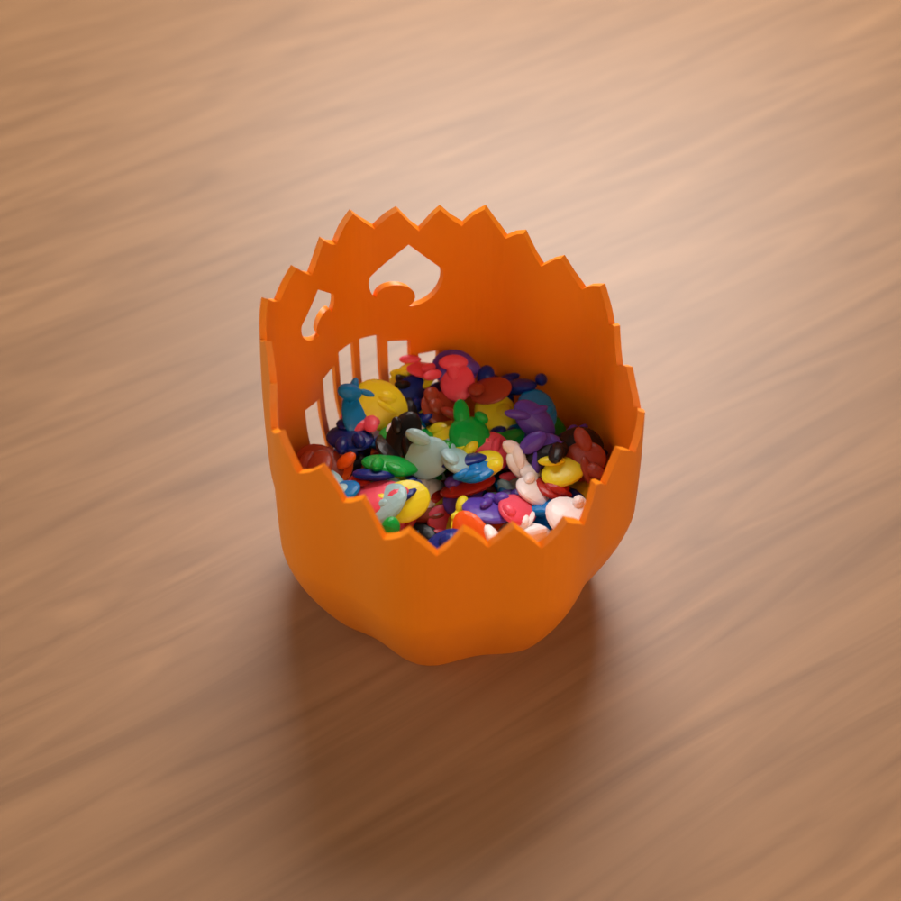
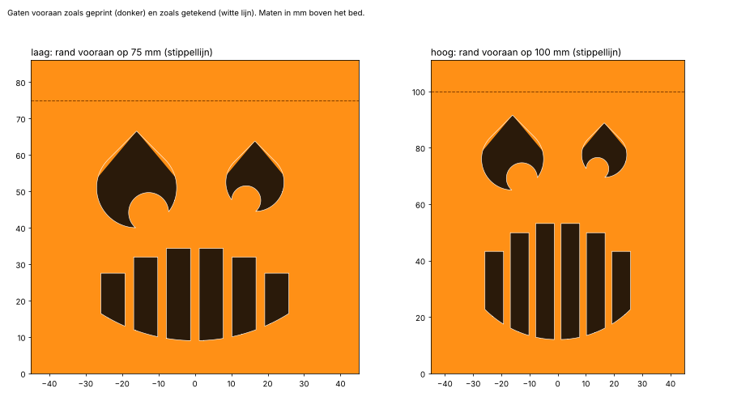

# H-03 Poepmonster (v0.1)

*English: [README.en.md](README.en.md)*

Een pompoenmonster dat de **poep van je A1 opeet**: de klodders filament die de printer bij elke kleurwissel
uitspuugt. Zet hem waar de poep uit de printer valt. Hij vangt ze op met zijn tanden, en door de hechtingen in
zijn buik zie je hoeveel regenboog hij al binnen heeft.


> **Status:** CAD, STL's, het Bambu Studio-project en de controle zijn klaar. Er is **nog niets echt
> geprint**, en hij heeft nog niet naast een echte A1 gestaan. De beelden zijn renders met nagemaakte poep.
>
> Het 3MF-project is gecontroleerd tegen de regels van het Bambu-formaat (`gereedschap/bambu/valideer.py` in
> de root van de repo). Het is hier niet in Bambu Studio zelf geopend: dat programma draait niet in deze
> omgeving.

| | |
|---|---|
| Varianten | **laag**: rand achteraan 40 mm (punten 48), vooraan 75 mm · **hoog**: achteraan 65 mm (punten 73), vooraan 100 mm · of een **eigen hoogte** |
| Maat | Ø 116 mm, 83 of 108 mm hoog. Past op de A1 mini |
| Inhoud | ~300 cm³ (laag) of ~530 cm³ (hoog), tot de achterrand |
| Filament | ongeveer 48 g (laag) of 68 g (hoog), geschat. Eén kleur, geen AMS nodig |
| Nodig | niets: één stuk, geen support, schroeven of lijm |

## Hoe het werkt

- Een bak met ribben, zoals een pompoen, met een wand van 2 mm.
- Bovenaan is hij **schuin afgesneden**: laag achteraan, hoog vooraan.
  - Zet de lage kant naar de printer. Daar valt de poep binnen.
  - Wat te ver vliegt, botst tegen de hoge voorkant en valt er toch in.
- Rondom staan **24 tanden** van 8 mm.
- Vooraan twee **ogen**, een grote en een kleine. Onderin elk oog staat een pupil die scheel naar de neus kijkt.
  Die rust op de rand van het oog, dus ook die print zonder support.
- De **buik** is een spleet die is dichtgenaaid met verticale **hechtingen**.
  - De spleetjes ertussen zijn 6,6 mm breed: smaller dan een poepklodder, dus die blijft binnen.
  - De hechtingen dragen ook het platte plafond van elk spleetje: een korte brug.



## Neerzetten

1. Kijk na een print met een paar kleurwissels **waar de poep op tafel ligt**: daar moet de mond komen.
2. Meet hoe hoog de opening ligt waar de poep uit de printer komt.
   - De **punten van de tanden achteraan** moeten minstens 1 cm lager zijn: 48 mm bij *laag*, 73 mm bij *hoog*.
   - Past geen van beide, maak dan een eigen hoogte (hieronder).
3. Zet het monster met zijn **rug naar de printer**, zijn gezicht naar jou.
4. Vol? Optillen en leeggieten.

## Printen

Open `print/poepmonster.3mf` in Bambu Studio. Er is één plaat per variant:

| Plaat | Variant | Kleur in het project | Filament (geschat) |
|---|---|---|---|
| 1 | laag | Pumpkin Orange 10301 | ~48 g |
| 2 | hoog | Pumpkin Orange 10301 | ~68 g |

- **Instellingen**: *0.20mm Standard @BBL A1* op de *Textured PEI Plate*, 0,4 mm nozzle. **Geen support.** Het
  project zet 3 wanden en gyroid-infill.
- Hij **staat rechtop**, met de bodem op het bed.
- **Kleur**: elke kleur kan. Oranje is een pompoen, paars of groen is een monster.

| Bestand | Maat (mm) |
|---|---|
| `print/poepmonster_laag.stl` | 116 × 116 × 83 |
| `print/poepmonster_hoog.stl` | 116 × 116 × 108 |

## Eigen hoogte

```
cd cad
python bouw.py eigen 50            # rand achteraan 50 mm (tanddalen), vooraan 35 mm hoger
python bouw.py eigen 50 90         # achteraan 50, vooraan 90
```

- Geef de hoogte van de **tanddalen**; de punten komen er 8 mm bovenop.
- Achteraan minstens 25 mm. De voorkant moet hoog genoeg zijn voor de ogen en de buik; anders zegt het script
  dat.
- De STL komt in `print/poepmonster_eigen_<achter>.stl`. Het script zegt ook hoeveel erin past.

## Controle

Zie [controle/RAPPORT.md](controle/RAPPORT.md). Kort:

- **Gezicht**: het zelfdragend maken haalt ongeveer 31 mm² van de getekende gaten af (de spitse bovenkant van
  de ogen). De spleetjes in de buik zijn 6,6 mm breed, de hechtingen 2,4 mm.
- **Printbaarheid**: één stuk en waterdicht, ook als STL. Er is geen overhang steiler dan 48° en geen detail
  smaller dan de nozzle.



## Mappen

```
print/        poepmonster.3mf (2 platen) en een STL per variant
cad/          de bron: params.py (varianten en maten), gezicht.py (ogen en buik), monster.py (de bak met de
              tanden), bouw.py, controle.py, render.py
controle/     RAPPORT.md, controle.json, gezicht.png
renders/      Blender-renders: voor.png, boven.png, varianten.png
onderdelen.json   volume, maat, randhoogtes en inhoud per STL
```

```
cd cad
python bouw.py            # print/
python controle.py        # controle/
python render.py alle     # renders/ (vereist de pip-module bpy)
```

## MakerWorld

- **Eigen ontwerp**: het monster is een eigen tekening.
- Het sterkste beeld is een **timelapse**: het monster naast de printer, en bij elke kleurwissel vliegt er een
  klodder in zijn mond. Film dat met de echte print; MakerWorld laat geen AI-beelden toe als modelfoto.
