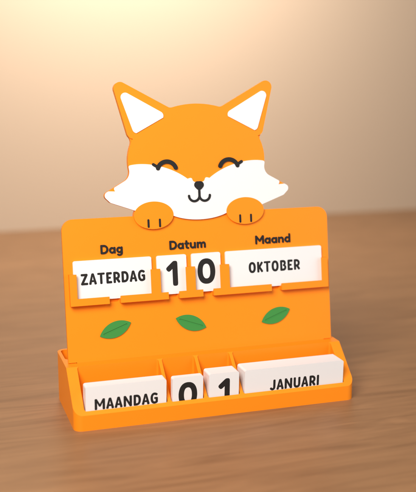
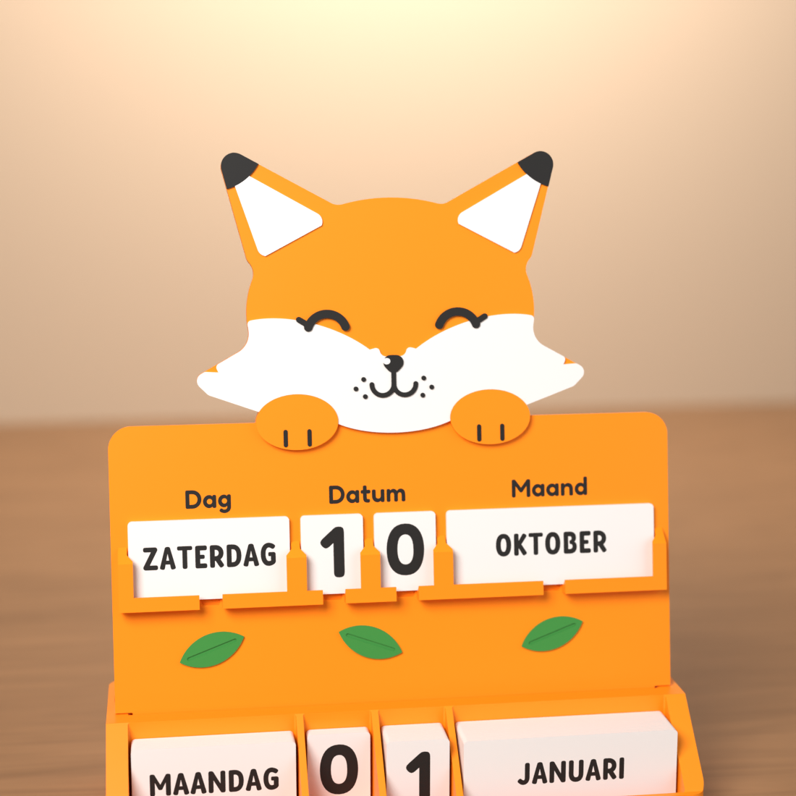
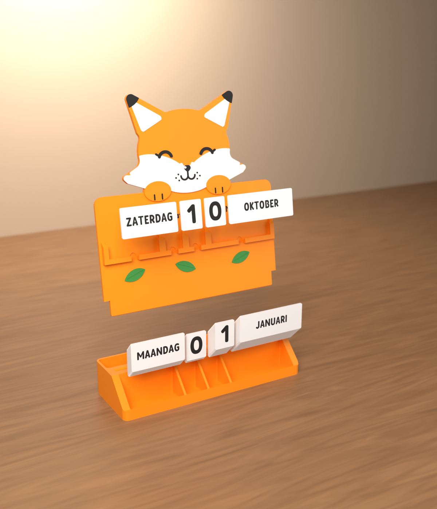
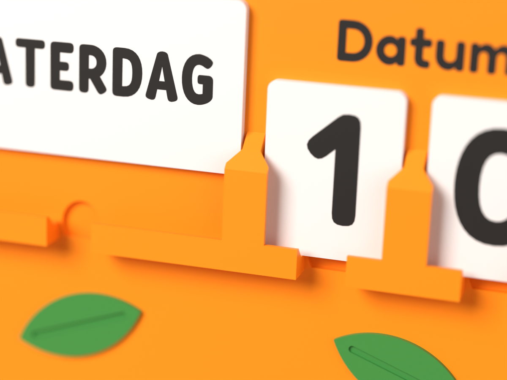
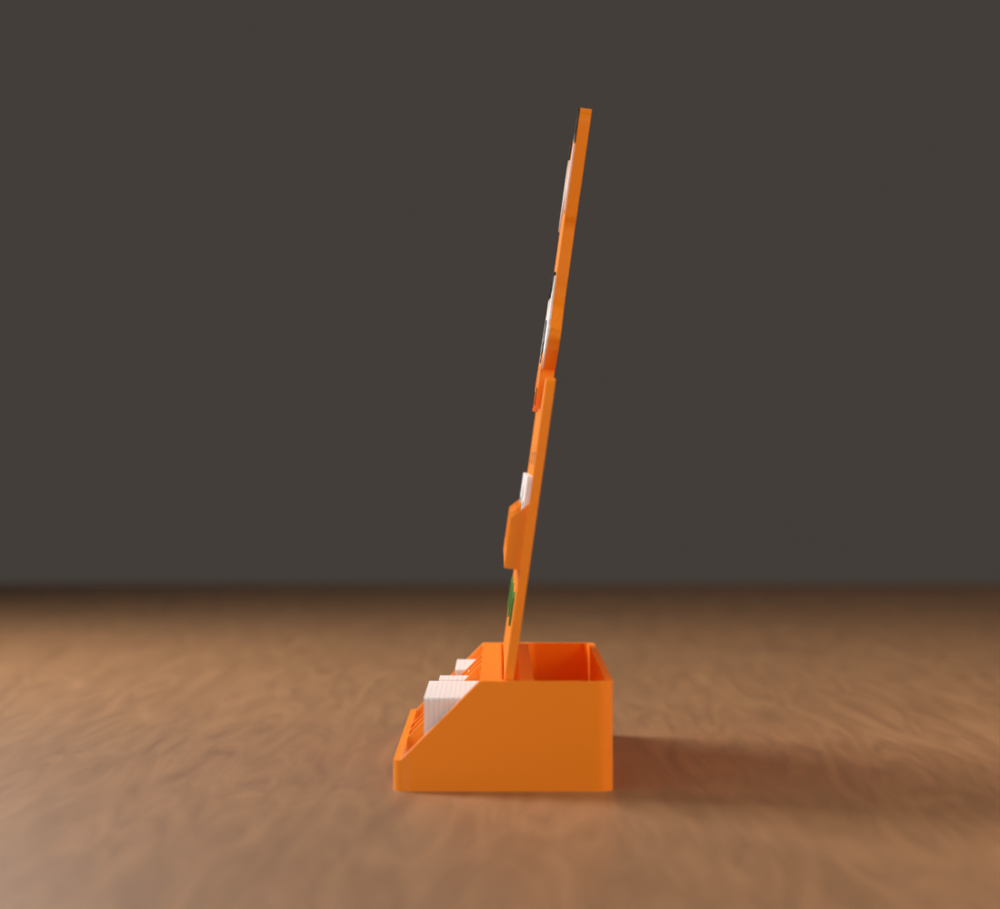
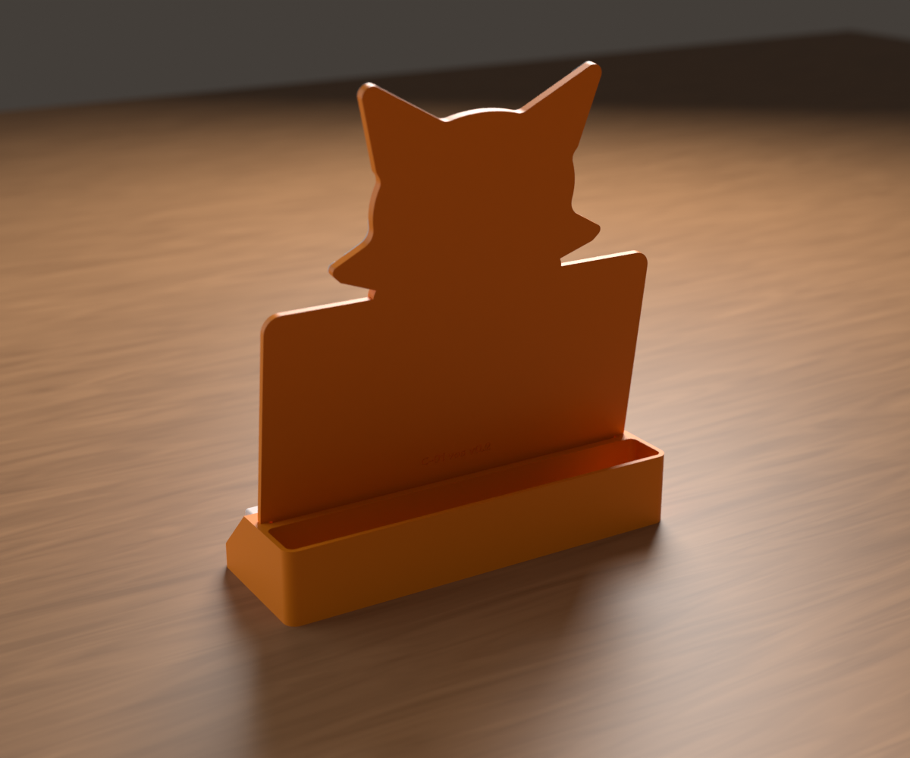
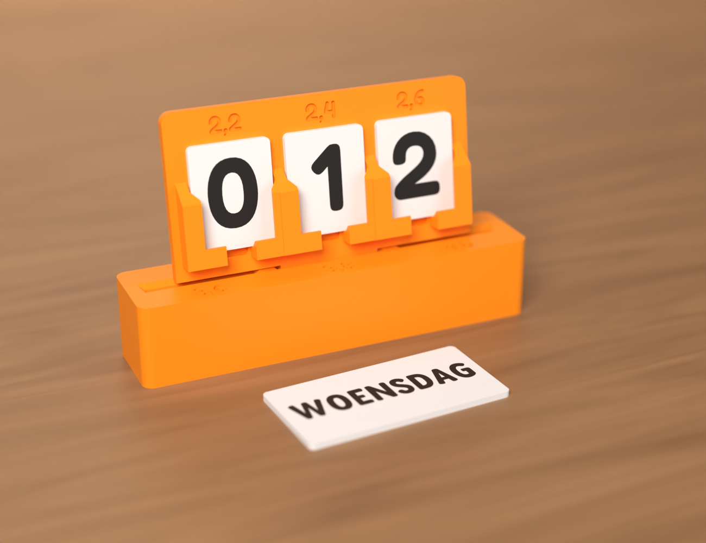
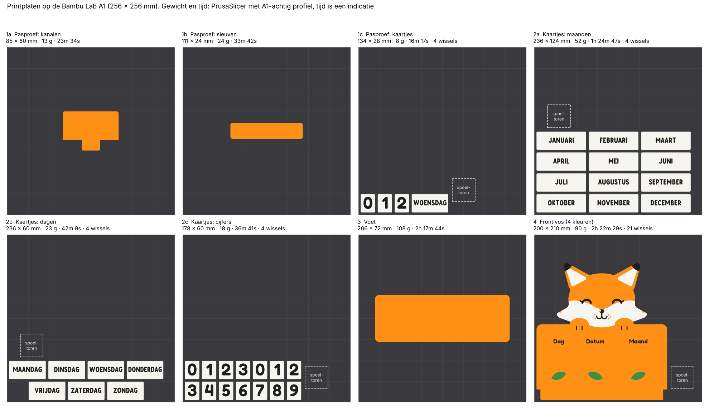
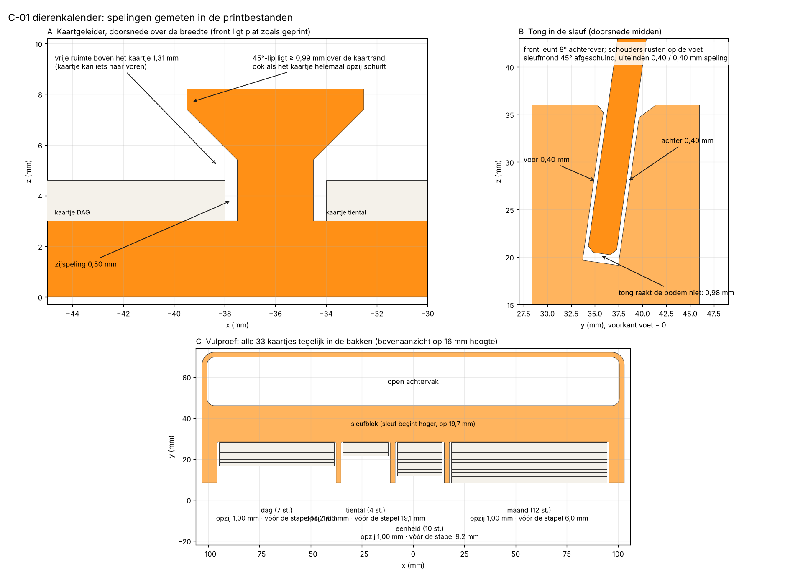

# C-01 Eeuwigdurende dierenkalender: vos (v0.2)

Functioneel prototype volgens het tabblad **Dierenkalender** van de MakerWorld-productielijst.
Printer: Bambu Lab A1 met AMS Lite, maximaal vier kleuren per plaat.



Vier posities: **DAG | tiental | eenheid | MAAND**, en daaronder vier opbergbakken.
De zes andere dieren (koe, uil, draak, eenhoorn, leeuw, hert) gebruiken straks dezelfde
voet, dezelfde kaartgeleiders en dezelfde kaartjes. Alleen het dierenfront verandert.

> **Status:** CAD, STL, montage- en printcontrole klaar, **nog niet echt geprint**. Druk eerst de
> pasproef af (stap 1) voordat je de hele set print.

## Foto's

| | |
|---|---|
|  |  |
| Vossenfront: oorpuntjes, glimlichtje op de neus, snorharenstipjes | Explosietekening: front, kaartjes, voet |
|  |  |
| Geleiders: 45°-afloop bovenaan, opening met nagelkuiltje in de draagrand (dagkaartje 12 mm omhoog) | Zijkant: front leunt 8° achterover |
|  |  |
| Achterkant: vlak, met open achtervak en verzonken versielabel | Pasproef: kanaalstrook in het sleuvenblok |

Alle renders komen uit Blender (Cycles) op de echte printbestanden, met de Bambu-kleuren. Het zijn
geen foto's van een print.

## Printvolgorde

| Stap | Map | Onderdeel | Kleuren | Maat (mm) | Filament | Tijd* |
|---|---|---|---|---|---|---|
| 1 | `stl/1-pasproef` | `proef_kanalen`: drie cijferkanalen 2,2 / 2,4 / 2,6 mm met tong | Oranje | 85 × 60 × 8 | 13 g | 24 min |
| 1 | `stl/1-pasproef` | `proef_sleuven`: drie sleuven 3,6 / 3,8 / 4,0 mm onder 8° | Oranje | 111 × 24 × 23 | 24 g | 34 min |
| 1 | `stl/1-pasproef` | `proef_kaartjes`: 0, 1, 2 en WOENSDAG | Wit + zwart | 134 × 28 × 1,6 | 8 g | 16 min |
| 2 | `stl/4-kaartjes` | `kaartjes_maanden` (12) | Wit + zwart | 236 × 124 | 52 g | 1 u 25 |
| 2 | `stl/4-kaartjes` | `kaartjes_dagen` (7) | Wit + zwart | 236 × 60 | 23 g | 42 min |
| 2 | `stl/4-kaartjes` | `kaartjes_cijfers` (4 + 10) | Wit + zwart | 178 × 60 | 18 g | 37 min |
| 3 | `stl/3-voet` | `voet`: vier bakken, schuine sleuf, open achtervak | Oranje | 206 × 72 × 36 | 108 g | 2 u 18 |
| 4 | `stl/2-vos` | `front_vos`: bord, vos, geleiders, labels, blaadjes | Oranje, wit, zwart, groen | 200 × 210 × 8 | 91 g | 2 u 22 |

\* Gewicht en tijd komen uit PrusaSlicer met een profiel dat de A1 benadert (0,2 mm laag, 2 wanden, 15 % grid,
A1-snelheden); Bambu Studio draait hier niet. Het gewicht is betrouwbaar; de tijd en de spoelhoeveelheid in Bambu
Studio wijken af. Pasproef samen ongeveer 45 g, de hele set ongeveer 290 g.



Kleuren: Pumpkin Orange 10301, Ivory White 11100, Charcoal 11101 en Mistletoe Green 10502.
Elk bestand eindigt op `__oranje`, `__wit`, `__zwart` of `__groen`.

### Meerkleurig laden in Bambu Studio

1. Sleep **alle** STL-bestanden van één onderdeel tegelijk in Bambu Studio (bijvoorbeeld de vier `front_vos__*.stl`).
2. Kies **Ja** bij *"Load these files as a single object with multiple parts?"*. De delen staan al op de juiste plek.
3. Wijs per deel het filament toe in de objectenlijst (oranje, wit, zwart, groen).
4. Leg het front en de kaartjes **plat**, met de achterkant op de plaat. De kleuren zitten alleen in de bovenste
   millimeters (front: 12 lagen met een kleurwissel, kaartjes: 2 lagen).
5. Startinstellingen: 0,2 mm laag, 0,4 mm nozzle, Textured PEI Plate, 15 % infill, **geen support**. Bij een drempel
   van 30° vond de slicer nergens iets om te ondersteunen; controleer de 45°-lippen toch even in de laagvoorvertoning.

## Montage- en printcontrole

`cad/controle.py` controleert de echte geometrie en schrijft [`controle/RAPPORT.md`](controle/RAPPORT.md).
Samenvatting van v0.2:

- **Botsingen:** 69 combinaties in gemonteerde stand, ook met alle 33 kaartjes tegelijk in de bakken: geen overlap.
- **Kaartje in kanaal:** 0,5 mm zijspeling, 1,3 mm vrije ruimte naar voren en de lip ligt minstens 1,0 mm over de
  kaartrand, ook als het kaartje helemaal opzij schuift.
- **Tong in sleuf:** 0,4 mm voor en achter, 0,4 mm aan de uiteinden en 1,0 mm onder de tong. De schouders van het bord
  rusten op de voet.
- **Bakken:** 1,0 mm opzij; vóór de volle stapel blijft 6 tot 19 mm over.
- **Uitnemen:** elk kaartje schuift vrij omhoog tot boven de geleiders en blijft daarbij 3,7 mm of meer onder de pootjes.
- **Printbaarheid:**
  - alles past op de A1;
  - geen overhang steiler dan 45°;
  - geen details smaller dan de nozzle;
  - support is niet nodig.
- **Stabiliteit:** zwaartepunt op 37 mm in een voet van 72 mm diep. Hij kantelt pas bij ongeveer 36° scheefstand.



## Pasproef: wat je test

Steek de kanaalstrook met zijn tong in elke sleuf van het sleuvenblok en schuif de cijferkaartjes in elk kanaal.

- [ ] **Kanaal** (2,2 / 2,4 / 2,6): het kaartje glijdt er makkelijk in en uit, maar valt er niet uit als je de strook voorover kantelt.
- [ ] **Uitnemen**: het kaartje steekt 9 mm boven de geleiders uit, zodat je het aan de zijkanten kunt vastpakken. In de opening
      in de draagrand (met nagelkuiltje) kun je het van onderen omhoog duwen.
- [ ] **Sleuf** (3,6 / 3,8 / 4,0): de tong zakt erin zonder te klemmen en de strook staat niet te wiebelen.
- [ ] **Kanteling**: de strook leunt ongeveer 8° achterover en blijft staan als je een kaartje wisselt.
- [ ] **Lippen**: de 45°-lippen zijn netjes geprint en niet doorgezakt.
- [ ] **Kaartjes**: WOENSDAG en de cijfers zijn goed leesbaar en de letters zijn heel.

Pas daarna de winnende maten aan in `cad/params.py` (`CHANNEL`, `SLOT_W`) en genereer opnieuw.

## Opnieuw genereren

```bash
cd cad
pip install -r requirements.txt
python kalender.py          # alle STL's (pasproef + set), ongeveer 5 seconden
python slice.py             # gewicht/tijd/support via PrusaSlicer (optioneel; vereist prusa-slicer)
python controle.py          # montage- en printcontrole -> controle/RAPPORT.md, renders/doorsneden.png, printplaten.png
python render.py --alle     # alle Blender-renders (of één: geheel, vos, explosie, zijkant, achterkant, detail, proef)
```

- `cad/params.py`: alle maten, met de startwaarden uit de productielijst
- `cad/kalender.py`: geleiders, front, voet, kaartjes, pasproef, montage en export
- `cad/fox.py`: de eigen getekende vossenkop (eenvoudige vormen, geen overgenomen geometrie)
- `cad/controle.py`, `cad/slice.py`: controles en slicer
- `cad/render.py`: Blender/Cycles-render, werkt zonder scherm

## Wijzigingen in v0.2

| Onderwerp | v0.1 | v0.2 | Waarom |
|---|---|---|---|
| Kanaaldiepte | 2,2 mm (proef 2,0/2,2/2,4) | **2,4 mm** (proef 2,2/2,4/2,6) | De eerste laag van een 45°-overhang zakt vaak 0,1-0,2 mm door |
| Zijspeling kaartje | 0,4 mm | **0,5 mm** per kant | Meer marge voor olifantenvoet en breedtetolerantie |
| Sleuflengte | 188,8 mm | **189,6 mm** (0,8 per kant) | Idem, vooral bij de eerste lagen van de tong |
| Tong | recht | **R2-onderhoeken, 0,6 mm 45°-afschuining** | Zoekt zelf zijn weg de sleuf in |
| Sleufmond | recht | **0,8 mm 45°-trechter** | Makkelijker inzetten |
| Boveneind geleiders | recht | **45°-afloop** tot de plaat | Kaartje glijdt er vanzelf in; geen losse puntjes |
| Labels Dag/Datum/Maand | 0,6 mm opliggend | **0,4 mm verzonken** | Een kaartje schuift er vlak overheen |
| Vensters | onderrand op 40 mm | **36 mm** | Op 40 mm liepen het tiental- en maandkaartje bij het uitschuiven tegen de pootjes (0 mm, gevonden door de controle); nu 3,7 mm of meer vrij |
| Bakken | binnenhoeken R1,5, voorwand liep scherp uit | **R0,8, vlakke voorwand** | Kaartjes kunnen helemaal naar achteren; geen messcherpe rand (gevonden door de controle) |
| Vos | basis | **zwarte oorpuntjes, glimlichtje op de neus, snorharenstipjes** | Meer karakter, nog steeds vier kleuren |
| Achterkant | leeg | **verzonken label "C-01 vos v0.2"** | Proefprints uit elkaar houden |

## Ontwerpkeuzes

| Onderwerp | Keuze | Reden |
|---|---|---|
| Kaarttekst | 0,4 mm Charcoal **verzonken** in de bovenkant, kaartje overal 1,6 mm | Vlak kaartje schuift beter onder de lippen en stapelt recht; losse letters kunnen niet afbreken |
| Lettertype | Fredoka SemiBold (cijfers, labels) en Fredoka SemiBold smal (dagen, maanden), 8 mm hoog | DONDERDAG past daarmee in 56 mm; alleen dat woord is nog ~5 % extra versmald |
| Zijlippen | Lip van 2 mm met een onderkant onder 45° | Printbaar zonder support terwijl het front plat ligt |
| Kaartje uitnemen | Geleiders 19 mm hoog, kaartje steekt 9 mm boven uit; opening van 8 mm in de draagrand | Vastpakken aan de zijkanten of van onderen omhoog duwen |
| Sleufdiepte | 16,5 mm | De tong raakt de bodem niet; de schouders van het bord rusten op de voet |
| Onderhoeken bord | Recht (bovenhoeken R8) | Vlakke schouders naast de tong |
| Voorkant bakken | 10 mm hoog, zijwanden lopen schuin op naar 36 mm | Tekst van het voorste kaartje blijft zichtbaar, vingers kunnen erbij |
| Buitenwanden voet | 7,4 mm | Vier bakken van 58/24/24/78 mm passen precies in 206 mm, met ruimte voor de R6-hoeken |
| Achtervak | Open vak achter de sleuf | Minder filament dan een massieve voet; extra opbergruimte |

## Licentie lettertype

Fredoka valt onder de SIL Open Font License (`fonts/OFL.txt`). De smalle variant is een statische instantie
(wdth 75, wght 600) van de variabele Fredoka uit Google Fonts.
